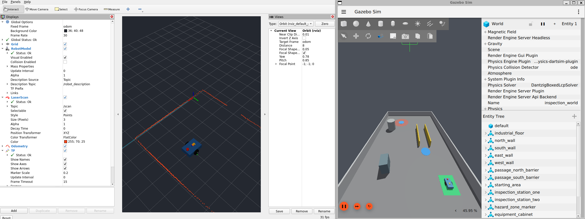
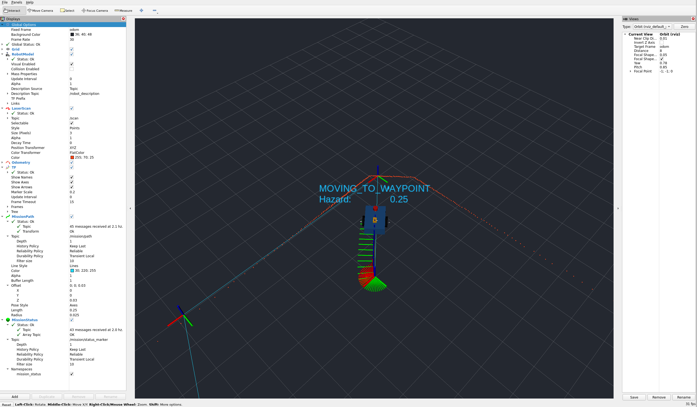

# ROS 2 and Gazebo: Guided Self-Study

An introductory learning record using a simulated inspection rover.

## My role

I used Codex as an AI tutor to explore ROS 2 and Gazebo. I followed guided
instructions, ran provided code for a simulated differential-drive rover, and
worked to understand how robot models, sensor data, odometry, and control
commands interact. My mechanical-engineering background motivated me to learn
more about sensing and feedback control.

The code, lesson materials, and technical explanations were generated with AI
assistance. This repository records guided self-study; it does not represent
software that I independently designed or wrote. Running an example and
studying its behavior is different from being able to develop that system
independently. The lesson exercises are learning prompts, not a list of
accomplishments I claim to have completed.

## What I studied

| Topic | Focus of the guided lessons |
|---|---|
| ROS 2 communication | Packages, nodes, topics, services, and launch files |
| Robot description | Xacro/URDF, links, joints, and coordinate frames |
| Simulation | Gazebo, simulated sensor data, and ROS-Gazebo bridges |
| Feedback | How odometry and waypoint error relate to velocity commands |
| Mission behavior | State transitions and responses to simulated hazards |
| Checking behavior | RViz displays, logs, and the supplied test examples |

I am developing familiarity with these topics. The feature list describes the
provided example, rather than independent proficiency in every listed topic.
The [learning review](docs/learning_review.md) contains questions for further study.

## The example system

The rover follows three predefined waypoints in a simplified industrial world.
An educational proportional controller uses odometry feedback to calculate
motion commands. A mathematical hazard signal triggers a stop and return to a
previously specified waypoint. ROS services start, reset, or abort the mission;
RViz displays state information, and a logger records selected values.

Five packages separate robot description, simulation, interfaces, control,
and launch configuration. See the [architecture](docs/architecture.md).

### Simulation views



*Stored capture showing the rover model, laser visualization, and simplified world.*



*Stored RViz capture showing the predefined route and current mission/hazard status.*

## Recorded checks and their limits

The repository retains sanitized summaries and captures dated 2026-08-08:

- separate package runs reporting 10 simulation tests and 18 control tests;
- mission-state and CSV excerpts for inspection, completion, and hazard response;
- invalid/stale-data stopping examples, topic information, and a TF frame graph;
- build and headless-launch summaries.

These are historical learning records, not newly executed tests of this
revision. Many text files are curated summaries rather than full raw terminal
logs. The exact Git revision used for the original runs was not recorded, so
the files do not establish that the current source is identical to that tested
snapshot. The [evidence index](docs/evidence/README.md) identifies the records;
the [validation plan](docs/validation_plan.md) preserves reported results.
No replacement runtime results or retroactive commit hashes have been invented.

## Scope

- Educational simulation only; no physical robot or field deployment.
- Fixed route and proportional waypoint control; no SLAM, Nav2, or motion planning.
- Lidar is displayed, but the controller does not use it for obstacle avoidance.
- The hazard signal is a mathematical field, not a chemical sensor model.
- No learned policy or machine-learning algorithm is implemented.
- Retreat follows a predefined point; it does not establish a safe path.
- Runtime stopping checks do not establish hardware safety or certification.

## Running the supplied example

The recorded environment used Ubuntu 22.04 under WSL2, ROS 2 Humble, Python
3.10, and Gazebo Harmonic. This example uses the explicit Humble/Harmonic
bridge package; consult the [installation and technical reference](docs/technical_reference.md#software-prerequisites)
before building. Use a Linux workspace path without spaces.

From the workspace root in a configured Ubuntu terminal:

```bash
source /opt/ros/humble/setup.bash
rosdep install --from-paths src --ignore-src --rosdistro humble -r -y
colcon build --symlink-install --packages-up-to hazard_inspection_bringup
source install/setup.bash
ros2 launch hazard_inspection_bringup inspection_demo.launch.py
```

In a second sourced terminal:

```bash
ros2 service call /mission/start std_srvs/srv/Trigger "{}"
```

Run the supplied unit tests in the configured workspace:

```bash
colcon test --packages-select hazard_inspection_sim hazard_inspection_control
colcon test-result --verbose
```

## Reading guide

- [Start with the introductory lesson](docs/module_01_beginner_start_here.md)
- [Technical reference: installation, operation, interfaces, troubleshooting](docs/technical_reference.md)
- [System architecture](docs/architecture.md)
- [Recorded evidence](docs/evidence/README.md)
- [Learning record and provenance](docs/course_completion_status.md)
- [Review questions](docs/learning_review.md)
- [Publication and privacy checklist](docs/publication_checklist.md)

The six modules progress from communication and robot modeling to simulation,
hazard monitoring, mission behavior, and testing. Instructions addressed to
"the student" are retained as course material rather than personal reflections.

## License

[MIT License](LICENSE). AI assistance and the scope of my participation are
described above.
