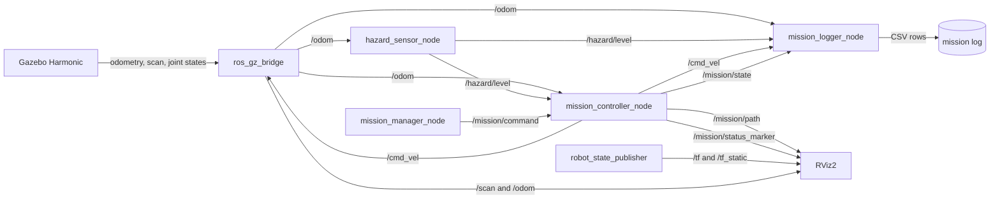
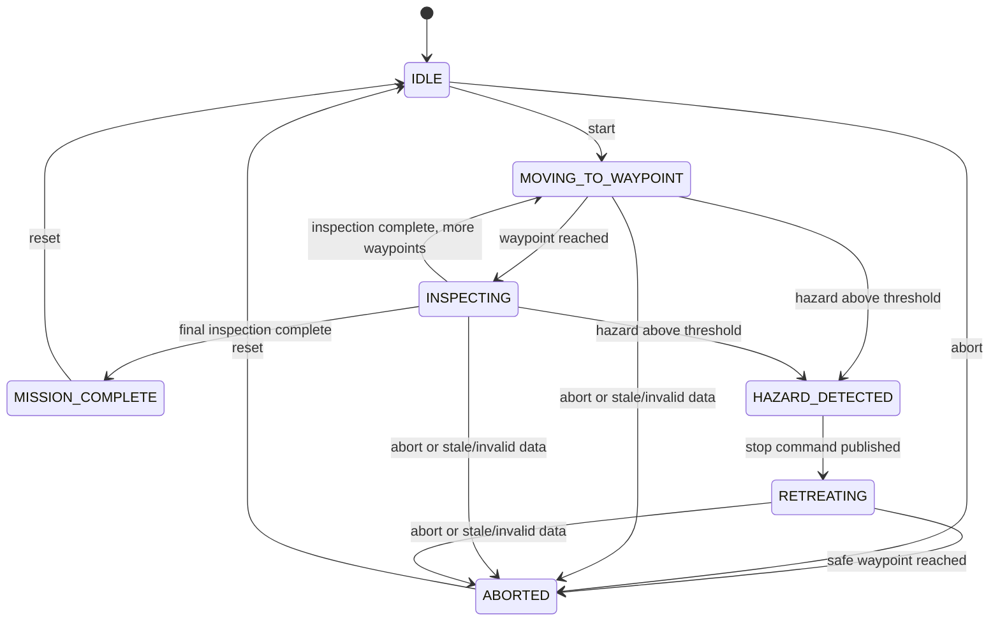
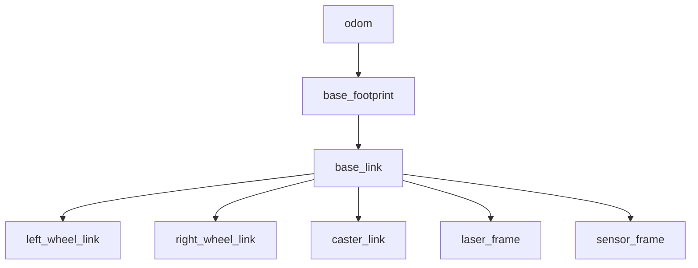
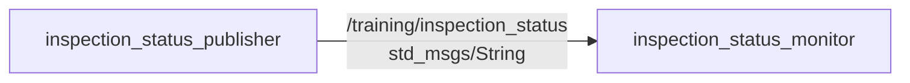
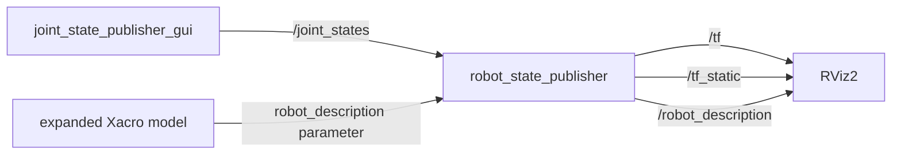
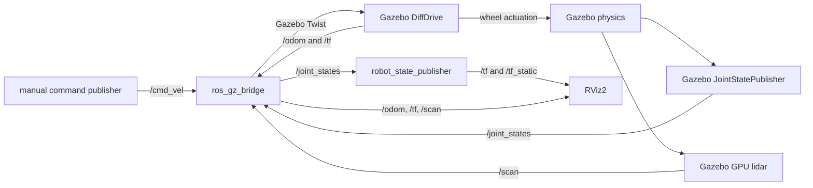
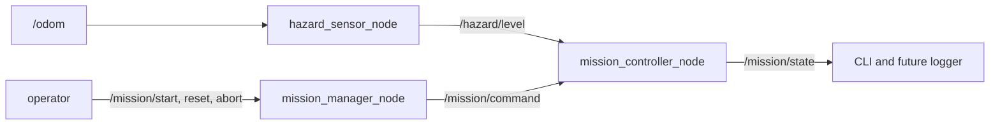
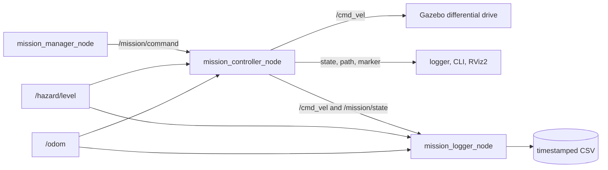
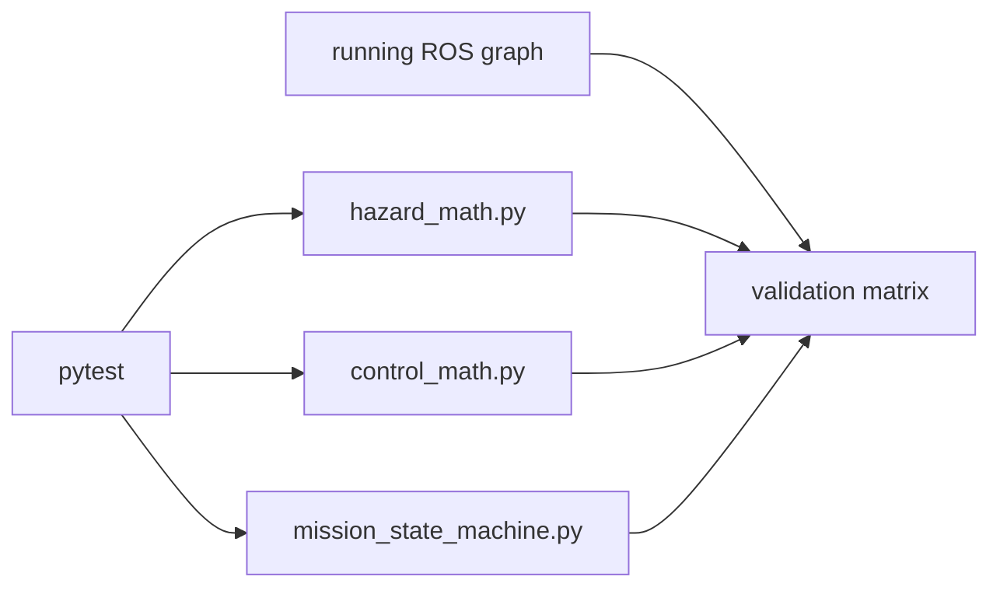

# System architecture

This document defines the completed architecture for
`hazard_inspection_rover`. After Module 6, the workspace contains the
introductory communication nodes, robot description, Gazebo Harmonic world,
differential-drive actuation, odometry, joint states, lidar, bridges, TF,
RViz2 views, mathematical hazard sensor, mission services, typed mission
state, proportional waypoint control, retreat actuation, planned path, status,
CSV logging, focused unit tests, validation plan, and portfolio documents.
Historical reported results are retained in the validation matrix; their original tested Git revision was not recorded.

## Design choices

The project uses small ROS packages rather than one large package. Robot assets,
simulation assets, interfaces, behavior, and launch configuration change for
different reasons, so separating them keeps their dependencies visible. The
tradeoff is a little more packaging work, which is useful practice for a ROS 2
portfolio.

The mission behavior uses a deterministic finite-state machine and a simple
proportional 2D waypoint controller. It is suitable for teaching integration
and fault handling, not for navigating an unknown or unstructured environment.

## Final repository tree

```text
hazard_inspection_ws/
├── .gitignore
├── LICENSE
├── README.md
├── docs/
│   ├── architecture.md
│   ├── course_completion_status.md
│   ├── course_outline.tex
│   ├── module_01_beginner_start_here.md
│   ├── module_01_file_and_code_guide.md
│   ├── module_01_ros2_fundamentals.md
│   ├── module_02_beginner_start_here.md
│   ├── module_02_file_and_code_guide.md
│   ├── module_02_robot_model.md
│   ├── module_03_beginner_start_here.md
│   ├── module_03_file_and_code_guide.md
│   ├── module_03_gazebo_simulation.md
│   ├── module_04_beginner_start_here.md
│   ├── module_04_file_and_code_guide.md
│   ├── module_04_hazard_monitoring.md
│   ├── module_05_beginner_start_here.md
│   ├── module_05_file_and_code_guide.md
│   ├── module_05_mission_integration.md
│   ├── module_06_beginner_start_here.md
│   ├── module_06_file_and_code_guide.md
│   ├── module_06_testing_and_portfolio.md
│   ├── demo_storyboard.md
│   ├── evidence/
│   │   └── README.md
│   ├── publication_checklist.md
│   ├── learning_review.md
│   └── validation_plan.md
└── src/
    ├── hazard_inspection_description/
    │   ├── CMakeLists.txt
    │   ├── package.xml
    │   ├── launch/
    │   │   └── display.launch.py
    │   ├── rviz/
    │   │   └── inspection.rviz
    │   └── urdf/
    │       ├── hazard_rover.gazebo.xacro
    │       └── hazard_rover.urdf.xacro
    ├── hazard_inspection_sim/
    │   ├── package.xml
    │   ├── resource/
    │   │   └── hazard_inspection_sim
    │   ├── setup.cfg
    │   ├── setup.py
    │   ├── hazard_inspection_sim/
    │   │   ├── __init__.py
    │   │   ├── hazard_math.py
    │   │   └── hazard_sensor_node.py
    │   ├── launch/
    │   │   └── simulation.launch.py
    │   ├── config/
    │   │   ├── bridge.yaml
    │   │   └── hazard_sensor.yaml
    │   ├── rviz/
    │   │   └── simulation.rviz
    │   ├── test/
    │   │   └── test_hazard_math.py
    │   └── worlds/
    │       └── inspection_world.sdf
    ├── hazard_inspection_control/
    │   ├── package.xml
    │   ├── resource/
    │   │   └── hazard_inspection_control
    │   ├── setup.cfg
    │   ├── setup.py
    │   ├── config/
    │   │   ├── module_01.yaml
    │   │   └── module_04.yaml
    │   ├── launch/
    │   │   ├── module_01_communication.launch.py
    │   │   └── module_04_hazard_monitoring.launch.py
    │   ├── hazard_inspection_control/
    │   │   ├── __init__.py
    │   │   ├── control_math.py
    │   │   ├── inspection_status_monitor.py
    │   │   ├── inspection_status_publisher.py
    │   │   ├── mission_state_machine.py
    │   │   ├── mission_controller_node.py
    │   │   ├── mission_logger_node.py
    │   │   └── mission_manager_node.py
    │   └── test/
    │       ├── test_control_math.py
    │       └── test_state_machine.py
    ├── hazard_inspection_interfaces/
    │   ├── CMakeLists.txt
    │   ├── package.xml
    │   └── msg/
    │       └── MissionState.msg
    └── hazard_inspection_bringup/
        ├── package.xml
        ├── resource/
        │   └── hazard_inspection_bringup
        ├── setup.cfg
        ├── setup.py
        ├── hazard_inspection_bringup/
        │   └── __init__.py
        ├── config/
        │   └── inspection_params.yaml
        └── launch/
            └── inspection_demo.launch.py
```

Module 6 files are source-controlled lessons, tests, and evidence templates.
The student fills validation results only after running the commands.

## Target runtime graph



## Target finite-state machine



`HAZARD_DETECTED` is intentionally visible as a state even though it is brief:
the controller publishes a zero velocity command before selecting the retreat
target. Missing, stale, NaN, or otherwise invalid safety-critical input leads to
a stopped `ABORTED` state.

## Target TF frame tree



- `odom`: locally continuous world reference from simulated wheel odometry.
- `base_footprint`: planar projection used for ground-relative motion.
- `base_link`: rover body reference and parent of physical components.
- wheel and caster frames: component poses relative to the body.
- `laser_frame`: lidar measurement origin.
- `sensor_frame`: conceptual environmental sensor origin.

## Target external contracts

| Kind | Name | Type | Main producer/server | Consumers/clients |
|---|---|---|---|---|
| Topic | `/cmd_vel` | `geometry_msgs/msg/Twist` | mission controller | Gazebo diff-drive bridge, logger |
| Topic | `/odom` | `nav_msgs/msg/Odometry` | Gazebo bridge | controller, hazard sensor, logger, RViz2 |
| Topic | `/scan` | `sensor_msgs/msg/LaserScan` | Gazebo bridge | RViz2 |
| Topic | `/joint_states` | `sensor_msgs/msg/JointState` | Gazebo bridge | robot state publisher |
| Topic | `/hazard/level` | `std_msgs/msg/Float64` | hazard sensor | controller, logger |
| Topic | `/mission/command` | `std_msgs/msg/String` | mission manager | controller |
| Topic | `/mission/state` | custom `MissionState` | controller | logger, CLI |
| Topic | `/mission/path` | `nav_msgs/msg/Path` | controller | RViz2 |
| Topic | `/mission/status_marker` | `visualization_msgs/msg/Marker` | controller | RViz2 |
| Service | `/mission/start` | `std_srvs/srv/Trigger` | mission manager | operator |
| Service | `/mission/reset` | `std_srvs/srv/Trigger` | mission manager | operator |
| Service | `/mission/abort` | `std_srvs/srv/Trigger` | mission manager | operator |

The foundational bridge configuration lives with the simulator because it
translates simulator-owned interfaces. The bringup package includes the tested
simulator launch and supplies integrated mission parameters rather than
duplicating the bridge table. The contract is checked statically in Module 6
and then verified by the student with the validation plan.

## Module 1 runtime graph



The training topic is deliberately isolated under `/training`. It will not be
mistaken for the final strongly typed `/mission/state` interface.

## Module 2 runtime graph



The Module 2 frame tree was rooted at `base_footprint`. `base_link`, caster,
and sensor transforms were fixed; wheel transforms depended on published joint
angles. That checkpoint had no `odom` frame because world-relative simulated
motion begins in Module 3.

## Module 3 runtime graph



Module 3 uses manual velocity publication only to validate the interface.
Gazebo owns simulated physical state; the bridge translates selected topics;
robot state publisher combines wheel states with the model; RViz2 visualizes
the resulting ROS data. No waypoint or hazard behavior exists at this
checkpoint.

## Module 4 runtime graph



The runtime exercises currently reach `IDLE`, `MOVING_TO_WAYPOINT`,
`HAZARD_DETECTED`, and `ABORTED`. The pure state-machine class also defines
inspection, retreat, and completion transitions, but Module 5 must connect them
to waypoint arrival, inspection timing, zero-velocity publication, and retreat
motion. Module 4's controller therefore makes decisions without claiming that
the rover is already navigating.

## Module 5 runtime graph



Module 5 follows a fixed route containing two inspection points and one transit
point. The default hazard interrupts the approach to station 2. The controller
publishes zero, exposes `HAZARD_DETECTED`, retreats to the last safe transit
point, and ends in `ABORTED`. Setting a higher threshold provides a separate
`MISSION_COMPLETE` validation. The controller does not consume lidar for
obstacle avoidance and does not claim general navigation capability.

## Module 6 test structure



Pure unit tests check deterministic calculation and transition responsibilities.
The student-run validation matrix checks middleware, simulation, visualization,
services, logging, timing, and the complete mission sequence.

## Final static consistency review

This review checks authored names and references. Runtime results remain for
the student because the course explicitly requires the student to run them.

| Item | Consistent authored contract |
|---|---|
| Package names | The five manifest, CMake/setup, launch, and documentation names agree. |
| Executables | `hazard_sensor_node`, `mission_controller_node`, `mission_manager_node`, and `mission_logger_node` match Python entry points and bringup actions. |
| Topics | `/cmd_vel`, `/odom`, `/scan`, `/joint_states`, `/hazard/level`, `/mission/command`, `/mission/state`, `/mission/path`, and `/mission/status_marker` agree across producers and consumers. |
| Services | `/mission/start`, `/mission/reset`, and `/mission/abort` all use `std_srvs/srv/Trigger`. |
| Frames | Xacro/Gazebo/RViz documentation agrees on `odom`, `base_footprint`, `base_link`, wheel, caster, `laser_frame`, and `sensor_frame`. |
| Launch paths | Main bringup includes installed `simulation.launch.py`; parameter, world, Xacro, bridge, and RViz assets are installed by their owning packages. |
| Parameters | Integrated YAML keys match controller/logger declarations; hazard YAML keys match hazard-node declarations. |
| Dependencies | Manifests declare runtime message, launch, ros_gz, Xacro, RViz, interface, and pytest dependencies used by their packages. |
| Commands | Build, launch, service, parameter, TF, logging, and test commands use the final package/executable names. |

The next step is not another feature module. It is the student's runtime
execution of `docs/validation_plan.md` and collection of actual evidence.
