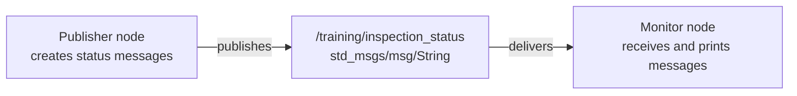
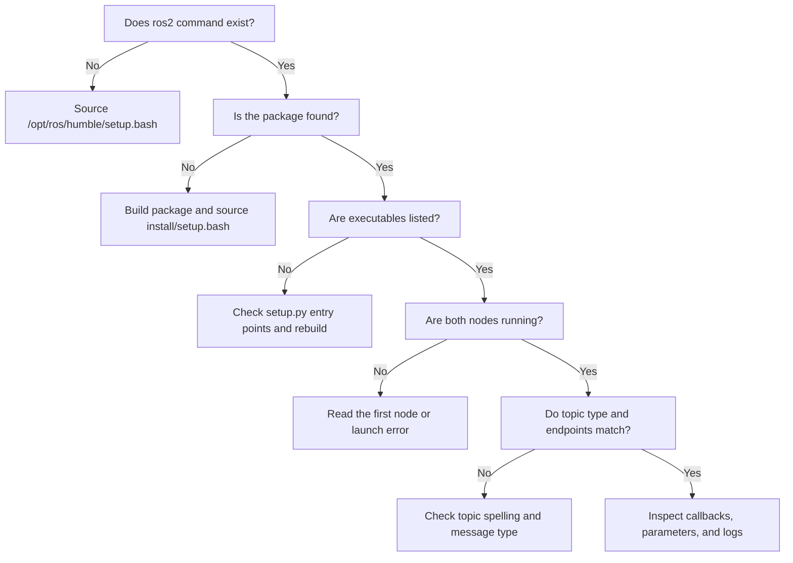

# Module 1 beginner guide — start here

Read this guide **before** the detailed Module 1 lesson or file-by-file code
reference.

If the code initially looks unfamiliar, that is normal. Module 1 introduces
Python classes, callbacks, ROS 2 communication, package installation, terminal
environments, and launch files at the same time. Your first goal is not to
understand or memorize every line. Your first goal is to follow one message from
the program that creates it to the program that receives it.

## 1. The one lesson to remember

> A ROS 2 system is made of independent programs called **nodes**. Nodes
> exchange typed messages through named communication channels called
> **topics**.

Module 1 contains two nodes:



The publisher does not directly call or import the monitor. ROS 2 connects the
two nodes because they agree on:

- the topic name: `/training/inspection_status`;
- the message type: `std_msgs/msg/String`;
- compatible communication settings.

If you understand this, you understand the central purpose of Module 1.

## 2. Why this small example exists

Later, the rover will use the same communication pattern:

```text
Gazebo             → /odom          → mission controller
Gazebo             → /scan          → RViz2
hazard sensor      → /hazard/level  → controller and logger
mission controller → /cmd_vel       → Gazebo rover
mission controller → /mission/state → logger and display
```

Module 1 temporarily removes the robot, simulator, geometry, sensor mathematics,
and controller. This leaves only the communication mechanism. When a later node
does not receive odometry or hazard data, you will already know how to inspect
the ROS graph instead of guessing whether the controller is wrong.

## 3. Mechanical-engineering analogy

Think of the system as an instrument chain:

| ROS 2 concept | Engineering analogy |
|---|---|
| Publisher node | Sensor or signal source |
| Topic | Named signal connection or data bus |
| Message type | Interface specification or signal format |
| Subscriber node | Display, recorder, or controller input |
| Parameter | Adjustable test or operating setting |
| ROS CLI inspection | Oscilloscope, data-acquisition display, or continuity check |

A powered sensor does not prove that the display receives its signal. Similarly,
two running ROS nodes do not prove that they are connected. Topic names, message
types, and endpoint inspection provide that evidence.

## 4. Vocabulary for this module

Learn these terms first. Do not add more terminology until these are comfortable.

### Node

A running ROS 2 software component. Module 1 has a publisher node and a monitor
node.

### Topic

A named channel used for continuous or repeated message communication. The
Module 1 topic is `/training/inspection_status`.

### Publisher

An endpoint that sends messages to a topic.

### Subscriber

An endpoint that requests messages from a topic. When a message arrives, ROS 2
runs the subscriber's callback.

### Message type

The agreed structure of the transmitted data. Both Module 1 nodes use
`std_msgs/msg/String`, which contains one field named `data`.

### Callback

A function saved for ROS 2 to call later when an event occurs. Timer expiration
and message arrival are two events used in Module 1.

### Parameter

A named configuration value belonging to a node. The publisher has a station
name and a publication period.

### Build and source

Building installs the package into the workspace's `install/` directory.
Sourcing updates the current terminal so ROS 2 can find that installed package.

## 5. The complete behavior in plain language

The publisher performs this loop:

```text
Start ROS 2
Create the publisher node
Read and validate configuration
Create a publisher for the training topic
Create a one-second timer

Whenever the timer expires:
    increase the sequence number
    create a String message
    put station and sequence information in the message
    publish it

Wait until the operator presses Ctrl+C
Clean up and shut down
```

The monitor behaves like this:

```text
Start ROS 2
Create the monitor node
Subscribe to the same training topic and String type

Whenever a message arrives:
    increase the received-message count
    print the count and message contents

Wait until the operator presses Ctrl+C
Clean up and shut down
```

## 6. What to read first

Do not begin with `setup.py` or `package.xml`. Read the code in this order.

### Step 1: publisher callback

Find `_publish_status()` in `inspection_status_publisher.py`:

```python
def _publish_status(self) -> None:
    self._sequence += 1

    message = String()
    message.data = (
        f'READY | station={self._station_name} '
        f'| sequence={self._sequence}'
    )
    self._publisher.publish(message)
```

Beginner interpretation:

```text
Increase message number
Create a String message
Fill in the message
Publish it
```

### Step 2: monitor callback

Find `_status_callback()` in `inspection_status_monitor.py`:

```python
def _status_callback(self, message: String) -> None:
    self._received_count += 1
    self.get_logger().info(
        f'Received #{self._received_count}: "{message.data}"'
    )
```

Beginner interpretation:

```text
A message arrived
Increase my received-message count
Print the message
```

### Step 3: publisher creation

```python
self._publisher = self.create_publisher(
    String,
    STATUS_TOPIC,
    PUBLISHER_QUEUE_DEPTH,
)
```

Beginner interpretation:

```text
Create a publisher that sends String messages
on /training/inspection_status.
```

The queue depth is an important communication setting, but it is not the first
concept to master. For now, understand that `10` allows a small history queue if
processing temporarily falls behind. It does not mean ten messages per second.

### Step 4: timer creation

```python
self._timer = self.create_timer(
    publish_period_s,
    self._publish_status,
)
```

Beginner interpretation:

```text
Ask ROS 2 to call _publish_status every publish_period_s seconds.
```

`self._publish_status` has no parentheses because the function is being saved
for ROS 2 to call later. Writing `self._publish_status()` would call it
immediately instead.

### Step 5: subscription creation

```python
self._subscription = self.create_subscription(
    String,
    STATUS_TOPIC,
    self._status_callback,
    SUBSCRIPTION_QUEUE_DEPTH,
)
```

Beginner interpretation:

```text
When a String message arrives on the training topic,
ask ROS 2 to call _status_callback.
```

### Step 6: main function

Reduce `main()` to three ideas:

```python
rclpy.init(args=args)
node = InspectionStatusPublisher()
rclpy.spin(node)
```

Beginner interpretation:

```text
Turn on ROS support
Create the node
Keep it alive and process callbacks
```

The remaining `try`, `finally`, `destroy_node()`, and `shutdown()` statements
make `Ctrl+C` cleanup safer. Understand their purpose now; study their exact
Python structure later.

## 7. What you may postpone

You do not need to memorize these files during your first pass:

| File | Sufficient understanding for now |
|---|---|
| `package.xml` | Lists package identity, build type, and ROS dependencies |
| `setup.py` | Installs Python code/data and creates executable names |
| `setup.cfg` | Places executables where ROS 2 expects them |
| Resource marker | Registers the package in the ROS package index |
| `__init__.py` | Makes the inner directory an importable Python package |
| Launch file | Starts both nodes |
| YAML file | Stores settings outside the algorithm |

Return to the detailed file guide after you have observed messages moving
between the nodes. The packaging code is easier to understand after you have a
concrete reason for installing and discovering an executable.

## 8. Predict before running

Write down your answers:

1. If the publication period is `1.0` second, approximately how many messages
   should be published in ten seconds?
2. If the monitor is not running, can the publisher still publish and log its
   own messages?
3. If the monitor starts after publisher sequence 5, must its first receipt
   number also be 6?
4. If only the monitor's topic is changed to `/wrong_topic`, will either process
   necessarily crash?
5. If the period changes from `1.0` to `2.0` seconds, will messages become more
   frequent or less frequent?

Prediction is important because it turns terminal output into a test instead of
an unexplained observation.

## 9. First guided session

Allow 60--90 minutes. Stop if concentration drops; the goal is understanding,
not speed.

### Part A — build and launch

In Ubuntu WSL:

```bash
cd ~/ros2_projects/hazard_inspection_ws
source /opt/ros/humble/setup.bash
rosdep install --from-paths src --ignore-src -r -y
colcon build --symlink-install \
  --packages-select hazard_inspection_control
source install/setup.bash
ros2 launch hazard_inspection_control \
  module_01_communication.launch.py
```

Do not interpret every log line. First look for repeating publisher output and
matching monitor receipts.

Expected message content:

```text
READY | station=training_station | sequence=1
```

### Part B — observe the communication contract

Open another Ubuntu WSL terminal:

```bash
cd ~/ros2_projects/hazard_inspection_ws
source /opt/ros/humble/setup.bash
source install/setup.bash

ros2 node list
ros2 topic list -t
ros2 topic info /training/inspection_status --verbose
ros2 topic echo /training/inspection_status --once
```

Ask what each command proves:

| Command | Evidence obtained |
|---|---|
| `ros2 node list` | Both node names are discoverable |
| `ros2 topic list -t` | The topic exists and has a message type |
| `ros2 topic info ... --verbose` | Publisher and subscriber endpoints match |
| `ros2 topic echo ... --once` | A real message can be observed independently |

### Part C — connect behavior to code

After observing one message:

1. Find where the message object is created.
2. Find where its `data` field is filled.
3. Find where it is published.
4. Find the monitor callback that receives it.
5. Find where the monitor reads `message.data`.

Do not read unrelated lines until you can trace those five steps.

### Part D — make one controlled change

Change this in `config/module_01.yaml`:

```yaml
publish_period_s: 1.0
```

to:

```yaml
publish_period_s: 2.0
```

Prediction:

```text
period = 2 seconds
frequency = 1 / period = 0.5 Hz
```

Restart the launch and measure:

```bash
ros2 topic hz /training/inspection_status
```

Stop the measurement with `Ctrl+C` after several samples. Small timing
variation is normal.

### Part E — explain the result

Complete this sentence in your own words:

> The YAML value changed ________. The launch file passed it to ________. That
> node used it to configure ________, which caused messages to ________.

A good answer mentions the publisher, timer period, and reduced frequency.

## 10. Common points of confusion

### “Why are there so many files for two small programs?”

ROS 2 separates source code, dependency declarations, installation rules,
configuration, and launch behavior. This feels heavy for two nodes but becomes
valuable when the project has simulation, robot descriptions, interfaces,
controllers, tests, and multiple launch configurations.

### “Why not run the `.py` file directly?”

Running through `ros2 run` checks that the package was correctly installed and
discovered. That is the same mechanism later launch files will use.

### “Why do I need to source every terminal?”

Environment changes apply only to the current terminal process and processes
started from it. A new terminal does not automatically know about the local
workspace unless its setup file is sourced.

### “Why does the callback run even though I never call it?”

You give the callback function to ROS 2 when creating the timer or subscription.
`rclpy.spin()` lets the executor wait for events and call the appropriate
function later.

### “Why are the publisher sequence and monitor count different?”

The publisher counts everything it sends. The monitor counts only messages it
receives after it is connected. They are independent pieces of state in
different processes.

### “Do I need to understand every Python type hint?”

Not yet. Type hints document intended data types and help tools detect mistakes.
Focus first on values, callbacks, and communication flow.

## 11. Stop conditions and troubleshooting method

If something fails, do not replace the whole project. Identify the layer.



Always save the exact error. An error message is measurement evidence, not a
personal failure.

## 12. Minimum completion standard

You are ready for Module 2 when you can explain these statements in your own
words:

1. The publisher and monitor are separate nodes.
2. They communicate through `/training/inspection_status`.
3. Both endpoints use `std_msgs/msg/String`.
4. A timer determines when the publisher callback runs.
5. A message arrival determines when the monitor callback runs.
6. `rclpy.spin()` keeps the node processing events.
7. YAML changes configuration without changing the main algorithm.
8. The launch file starts both nodes.
9. Building installs the package; sourcing lets the terminal discover it.
10. ROS CLI commands provide evidence about the running graph.

You do **not** need to:

- write `setup.py` from memory;
- memorize every XML tag;
- understand the middleware implementation;
- memorize every ROS CLI command;
- reproduce the node code without reference.

## 13. Questions to answer before continuing

1. What is the message path from timer event to monitor log?
2. Which three properties must agree for these endpoints to communicate?
3. What evidence distinguishes “both nodes are running” from “both nodes are
   connected”?
4. Why is a two-second period equivalent to approximately 0.5 Hz?
5. Which part of the code is called because time passed, and which part is
   called because a message arrived?
6. What would you inspect first if the publisher logs messages but the monitor
   receives nothing?

## 14. Recommended reading order after this guide

Use the Module 1 documents in this order:

1. **This beginner guide:** build the mental model and complete one short
   observation/modification session.
2. [`module_01_ros2_fundamentals.md`](module_01_ros2_fundamentals.md): follow the
   complete guided lesson and collect required evidence.
3. [`module_01_file_and_code_guide.md`](module_01_file_and_code_guide.md): look up
   unfamiliar packaging statements and study code blocks in more depth.
4. [`architecture.md`](architecture.md): connect this small communication
   pattern to the finished rover system.

The detailed file guide is a reference, not a prerequisite that must be read
linearly.

## 15. Pattern for future beginner guides

When each future module is created, it should receive a matching beginner guide
with the same structure:

1. one central lesson;
2. a small system diagram;
3. an engineering analogy;
4. essential vocabulary;
5. behavior in plain language;
6. the smallest code/configuration blocks to read first;
7. topics that may be postponed;
8. prediction questions;
9. a 60--90 minute first session;
10. common confusion and a diagnostic path;
11. a minimum completion standard.

This keeps the course layered: a beginner-friendly entry point, a full guided
lesson, and a detailed technical reference for each module.
