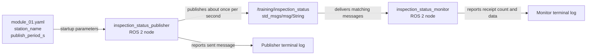
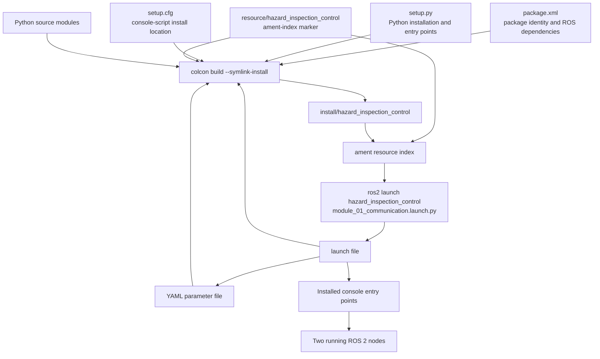

# Module 1 file structure and code guide

This companion guide explains how every Module 1 package file contributes to
the running ROS 2 system. It should be read after the main lesson in
[`module_01_ros2_fundamentals.md`](module_01_ros2_fundamentals.md).

If you have not yet formed a basic mental model of nodes, topics, publishers,
subscribers, and callbacks, read
[`module_01_beginner_start_here.md`](module_01_beginner_start_here.md) first.

The most important distinction is this:

> Files do not directly communicate with one another at runtime. The files are
> used to install, configure, and start ROS 2 nodes. The running publisher and
> monitor nodes communicate through a named, typed ROS 2 topic.

## 1. Module structure

```text
hazard_inspection_ws/
├── .gitignore
├── LICENSE
├── README.md
├── docs/
│   ├── architecture.md
│   ├── course_outline.tex
│   ├── module_01_file_and_code_guide.md   ← this guide
│   └── module_01_ros2_fundamentals.md
└── src/
    └── hazard_inspection_control/
        ├── package.xml
        ├── setup.py
        ├── setup.cfg
        ├── resource/
        │   └── hazard_inspection_control
        ├── config/
        │   └── module_01.yaml
        ├── launch/
        │   └── module_01_communication.launch.py
        └── hazard_inspection_control/
            ├── __init__.py
            ├── inspection_status_publisher.py
            └── inspection_status_monitor.py
```

There are three different levels in this tree:

1. **Workspace level:** `hazard_inspection_ws` is built by `colcon`.
2. **ROS package level:** `src/hazard_inspection_control` contains package
   metadata, installation rules, configuration, launch files, and Python code.
3. **Python import-package level:** the inner
   `hazard_inspection_control/hazard_inspection_control` directory contains the
   importable Python modules.

The repeated name is normal:

```text
src/
└── hazard_inspection_control/          ROS package directory
    └── hazard_inspection_control/      Python import package
```

The outer directory is found by `colcon` through `package.xml`. The inner
directory is found by Python through `__init__.py` and `setup.py`.

## 2. Runtime communication chart

When the Module 1 launch file is running, the actual communication is:



The message payload looks like:

```text
READY | station=training_station | sequence=1
```

The publisher does not call the monitor's Python function. It publishes a
`std_msgs/msg/String` message to `/training/inspection_status`. ROS 2 discovery
finds subscribers that use the same topic and compatible message type.

## 3. Build, discovery, and launch chart

The full path from source files to running nodes is:



This explains why building and sourcing matter:

- `colcon build` creates the package's installed representation.
- `source install/setup.bash` adds that installed representation to the current
  terminal environment.
- `ros2 run` and `ros2 launch` search the installed package, not merely any
  similarly named directory in `src/`.

## 4. File-purpose summary

| File | Main purpose | Used by |
|---|---|---|
| `package.xml` | Declares the ROS package, version, license, dependencies, and build type | `colcon`, `ament`, `rosdep`, ROS package tools |
| `setup.py` | Defines how Python code and package data are installed; registers executables | Python packaging and `colcon` |
| `setup.cfg` | Places console scripts where ROS 2 expects package executables | `setuptools`, `ros2 run`, `ros2 launch` |
| `resource/hazard_inspection_control` | Registers the package name in the ament resource index | ROS 2 package discovery |
| `__init__.py` | Marks the inner directory as a Python package | Python import system and `find_packages()` |
| `module_01.yaml` | Stores publisher parameters separately from source code | Launch file and publisher node |
| `module_01_communication.launch.py` | Starts both nodes and supplies the parameter file | `ros2 launch` |
| `inspection_status_publisher.py` | Creates and publishes status messages periodically | Publisher executable |
| `inspection_status_monitor.py` | Receives, counts, and logs status messages | Monitor executable |
| `.gitignore` | Prevents generated build, cache, and runtime files from being committed | Git |
| `LICENSE` | States the legal reuse terms | Repository users |
| Module documentation | Teaches, records scope, and supplies verification commands | Student and reviewers |

## 5. Detailed explanation of `package.xml`

The manifest begins with:

```xml
<?xml version="1.0"?>
<?xml-model href="http://download.ros.org/schema/package_format3.xsd"
  schematypens="http://www.w3.org/2001/XMLSchema"?>
<package format="3">
```

- `<?xml version="1.0"?>` identifies the file as XML.
- `<?xml-model ...?>` points XML-aware editors to the ROS package schema. This
  helps an editor detect invalid tags or structure.
- `<package format="3">` begins a ROS package manifest using package format 3,
  the normal format for modern ROS 2 packages.

### Package identity

```xml
<name>hazard_inspection_control</name>
<version>0.1.0</version>
<description>Control and introductory communication nodes ...</description>
<maintainer email="maintainer@users.noreply.github.com">Hazard Inspection Rover Maintainer</maintainer>
<license>MIT</license>
```

- `<name>` is the ROS package name used in commands such as
  `ros2 run hazard_inspection_control ...`.
- `<version>` is the package release version. It is not the ROS distribution
  version. `0.1.0` indicates an early project version.
- `<description>` tells users and package tools what the package contains.
- `<maintainer>` identifies the public project-maintenance contact. This
  repository uses a project-level no-reply identity to avoid personal data.
- `<license>` declares the source-code license. It agrees with the root
  `LICENSE` file.

The `name`, `version`, description, maintainer information, and license should
remain consistent with `setup.py`.

### Runtime dependencies

```xml
<exec_depend>ament_index_python</exec_depend>
<exec_depend>launch</exec_depend>
<exec_depend>launch_ros</exec_depend>
<exec_depend>rclpy</exec_depend>
<exec_depend>std_msgs</exec_depend>
```

`exec_depend` means the dependency is needed when installed code runs:

- `ament_index_python` provides `get_package_share_directory()`, used by the
  launch file to find installed configuration data.
- `launch` provides `LaunchDescription` and the general ROS-independent launch
  framework.
- `launch_ros` provides ROS-specific launch actions, including `Node`.
- `rclpy` is the Python client library used to create ROS 2 nodes, publishers,
  subscribers, timers, parameters, executors, and log messages.
- `std_msgs` supplies the `String` message type used by both nodes.

These declarations allow `rosdep` and repository reviewers to determine the ROS
dependencies without reading every import statement.

### Build-type export

```xml
<export>
  <build_type>ament_python</build_type>
</export>
</package>
```

- `<export>` contains information consumed by build tools.
- `<build_type>ament_python</build_type>` tells `colcon` that this is a Python
  package installed through the ament Python workflow rather than a CMake
  package.
- `</package>` closes the manifest.

## 6. Detailed explanation of `setup.py`

`setup.py` is the installation recipe for the Python package. It is not a ROS
node and does not run during the inspection mission.

### Module documentation and imports

```python
"""Python packaging configuration for hazard_inspection_control."""

from glob import glob
import os

from setuptools import find_packages, setup
```

- The first string is the module docstring. It states the file's purpose.
- `glob` finds files that match patterns such as `config/*.yaml`.
- `os` provides portable path construction through `os.path.join()`.
- `find_packages` searches for Python package directories containing
  `__init__.py`.
- `setup` receives all installation metadata and rules.

### Single source for the package name

```python
PACKAGE_NAME = 'hazard_inspection_control'
```

The name is stored once and reused. This reduces accidental spelling
differences inside `setup.py`. It must still agree with `package.xml`, the
resource marker, and the outer and inner directory names.

### Basic setup metadata

```python
setup(
    name=PACKAGE_NAME,
    version='0.1.0',
    packages=find_packages(exclude=['test']),
```

- `setup(...)` begins the complete package installation definition.
- `name=PACKAGE_NAME` gives the installed Python distribution the project name.
- `version='0.1.0'` is Python packaging metadata and should match
  `package.xml`.
- `find_packages(exclude=['test'])` finds the inner
  `hazard_inspection_control` Python package. Test directories are deliberately
  excluded from the installed runtime package.

If `__init__.py` were missing, this package-discovery step might not find the
inner source directory in this packaging configuration.

### Installing package data

```python
data_files=[
    (
        'share/ament_index/resource_index/packages',
        ['resource/' + PACKAGE_NAME],
    ),
    ('share/' + PACKAGE_NAME, ['package.xml']),
```

`data_files` installs non-Python files. Each tuple has the form:

```text
(installation destination, list of source files)
```

The first tuple installs the empty resource marker into the ament resource
index. The marker's filename is the package name, allowing ROS tools to find a
package named `hazard_inspection_control`.

The second tuple installs `package.xml` into the package's share directory. The
installed layout is conceptually:

```text
install/hazard_inspection_control/share/hazard_inspection_control/package.xml
```

The next entries install configuration and launch files:

```python
    (
        os.path.join('share', PACKAGE_NAME, 'config'),
        glob('config/*.yaml'),
    ),
    (
        os.path.join('share', PACKAGE_NAME, 'launch'),
        glob('launch/*.launch.py'),
    ),
],
```

- `os.path.join('share', PACKAGE_NAME, 'config')` constructs the installed
  configuration directory without manually inserting path separators.
- `glob('config/*.yaml')` includes all YAML files directly inside `config/` at
  build time.
- The launch entry does the same for files ending in `.launch.py`.

This is why adding a launch or configuration file with the correct suffix makes
it eligible for installation. A rebuild is still required for packaging tools
to process a newly added file.

### Python installation dependency

```python
install_requires=['setuptools'],
```

This line answers the example in the question directly:

- `install_requires` is a Python packaging field.
- `['setuptools']` states that the installed Python distribution requires the
  `setuptools` package.
- `setuptools` supplies the package installation and console-entry-point
  mechanisms used here.
- This list is **not** the place for ROS package dependencies such as `rclpy` or
  `std_msgs`. Those belong in `package.xml`, where `rosdep` and ROS tooling can
  understand them.
- It also does not install Ubuntu or Gazebo dependencies. System and ROS
  dependencies remain the responsibility of `apt` and `rosdep`.

### Archive safety

```python
zip_safe=True,
```

This is standard Python distribution metadata. It states that the importable
Python code is safe to load from a zipped Python package. In this project, ROS 2
normally installs the package into directories, and non-Python resources are
installed separately through `data_files`. The value does not create a ZIP file
for the student and does not control CSV compression.

### Human-readable metadata

```python
maintainer='Hazard Inspection Rover Maintainer',
maintainer_email='maintainer@users.noreply.github.com',
description=(
    'Control and introductory communication nodes for the hazard '
    'inspection rover.'
),
license='MIT',
```

- Maintainer fields identify the public project-maintenance contact. Keep the
  project-level no-reply identity unless you intentionally choose a public
  GitHub identity.
- Parentheses allow the long description to be split across physical lines.
  Adjacent Python string literals are combined into one string.
- `license='MIT'` agrees with the manifest and root license file.

### Console entry points

```python
entry_points={
    'console_scripts': [
        'inspection_status_monitor = '
        'hazard_inspection_control.inspection_status_monitor:main',
        'inspection_status_publisher = '
        'hazard_inspection_control.inspection_status_publisher:main',
    ],
},
```

This section makes `ros2 run` possible. Each entry follows:

```text
installed_executable = python.module.path:function_name
```

For example:

```text
inspection_status_publisher
    = hazard_inspection_control.inspection_status_publisher:main
```

means:

1. install a console executable named `inspection_status_publisher`;
2. import the Python module
   `hazard_inspection_control.inspection_status_publisher`;
3. call its `main()` function when the executable starts.

The two adjacent quoted strings in each entry are automatically joined by
Python. They are split only to keep lines readable.

Changing the executable name or module path requires rebuilding and sourcing
the workspace again. If the right side is misspelled, the executable can be
installed but will fail when it tries to import the missing module or function.

## 7. Detailed explanation of `setup.cfg`

```ini
[develop]
script_dir=$base/lib/hazard_inspection_control
[install]
install_scripts=$base/lib/hazard_inspection_control
```

This file controls where `setuptools` places console scripts:

- `[develop]` applies to development-style installation, including the workflow
  used by `--symlink-install`.
- `script_dir=...` selects the development script directory.
- `[install]` applies to a normal installation.
- `install_scripts=...` selects the normal installed script directory.
- `$base` is replaced by the package's installation prefix.
- `lib/hazard_inspection_control` is the conventional directory in which ROS 2
  expects this package's executables.

Without this configuration, Python might install the scripts somewhere that
`ros2 run hazard_inspection_control ...` does not search as expected.

## 8. The resource marker

The file is:

```text
resource/hazard_inspection_control
```

It is intentionally empty. Its **filename** carries the information.

During installation, `setup.py` copies it into:

```text
share/ament_index/resource_index/packages/hazard_inspection_control
```

The ament index can then answer the question, “Is there an installed package
named `hazard_inspection_control`, and under which prefix?” This is different
from Python import discovery: the resource marker identifies the ROS package;
`__init__.py` helps identify the Python package.

## 9. Detailed explanation of `__init__.py`

```python
"""ROS 2 control nodes for the hazard inspection rover course project."""
```

Although it contains only a docstring, the file has a structural purpose:

- it marks the inner directory as an importable Python package in the packaging
  style used by this project;
- it allows module paths such as
  `hazard_inspection_control.inspection_status_publisher`;
- it allows `find_packages()` in `setup.py` to locate the package;
- it provides a place for package-level documentation or carefully selected
  exports later.

It does not start a ROS node. Importing the package should not unexpectedly
launch processes or create publishers.

## 10. Detailed explanation of `module_01.yaml`

```yaml
inspection_status_publisher:
  ros__parameters:
    station_name: training_station
    publish_period_s: 1.0
```

### Node-name scope

```yaml
inspection_status_publisher:
```

The top-level key is the runtime node name. Parameters below it apply only to a
node with that exact name. If the launch file renames the node, this key must be
updated or replaced with a suitable wildcard structure.

### ROS parameter namespace

```yaml
ros__parameters:
```

The double underscore is required ROS 2 parameter-file syntax. It separates ROS
parameters from other possible node configuration content.

### Parameter values

```yaml
station_name: training_station
publish_period_s: 1.0
```

- `station_name` becomes a string.
- `publish_period_s` becomes a floating-point value measured in seconds.
- `1.0` seconds corresponds to a nominal frequency of
  \(f = 1/T = 1/1.0 = 1\) Hz.

The publisher declares matching parameter names and validates the received
types and values. The monitor has no Module 1 parameters, so it has no section
in this file.

## 11. Detailed explanation of the launch file

The file is `launch/module_01_communication.launch.py`.

### Imports

```python
from pathlib import Path

from ament_index_python.packages import get_package_share_directory
from launch import LaunchDescription
from launch_ros.actions import Node
```

- `Path` creates readable, platform-aware filesystem paths.
- `get_package_share_directory` asks the ament index for the installed package's
  share directory.
- `LaunchDescription` is the container returned to the ROS 2 launch system.
- `Node` describes one ROS 2 node process that the launch service should start.

### Package constant

```python
PACKAGE_NAME = 'hazard_inspection_control'
```

The package name is reused when locating shared files and defining nodes. It
must match the installed package.

### Required launch function

```python
def generate_launch_description() -> LaunchDescription:
    """Create the Module 1 publisher-and-monitor launch description."""
```

ROS 2 launch imports the file and calls a function with the conventional name
`generate_launch_description`. The return type hint documents that the function
returns a `LaunchDescription`.

### Locate the installed YAML file

```python
package_share = Path(get_package_share_directory(PACKAGE_NAME))
parameter_file = package_share / 'config' / 'module_01.yaml'
```

- The first line finds the installed share directory instead of assuming the
  current working directory or hard-coding a source path.
- Wrapping it in `Path` allows `/` to join path components.
- The second line constructs the installed YAML path.

This design allows the launch command to work from any current directory after
the overlay has been sourced.

### Publisher action

```python
status_publisher = Node(
    package=PACKAGE_NAME,
    executable='inspection_status_publisher',
    name='inspection_status_publisher',
    output='screen',
    parameters=[str(parameter_file)],
)
```

- `package` identifies which installed ROS package owns the executable.
- `executable` must match the left side of the console entry in `setup.py`.
- `name` sets the runtime ROS node name. It matches the YAML top-level key.
- `output='screen'` displays the node's log output in the launch terminal.
- `parameters=[...]` passes one or more parameter sources. Here it passes the
  installed YAML file.
- `str(parameter_file)` converts the `Path` object to the string form expected
  by the launch parameter interface.

### Monitor action

```python
status_monitor = Node(
    package=PACKAGE_NAME,
    executable='inspection_status_monitor',
    name='inspection_status_monitor',
    output='screen',
)
```

The monitor is defined similarly, but it receives no parameter file because its
topic and queue depth are constants in Module 1.

### Return both actions

```python
return LaunchDescription([
    status_publisher,
    status_monitor,
])
```

This returns the two actions to the launch service. The launch system starts and
supervises both processes. The order in this list is not a guarantee that one
node will be completely initialized before the other. ROS 2 discovery handles
either startup order.

## 12. Detailed explanation of the publisher

The file is
`hazard_inspection_control/inspection_status_publisher.py`.

### Module docstring and type imports

```python
"""Publish a simple inspection status for the Module 1 ROS 2 lesson."""

from typing import List, Optional
```

- The docstring explains the module's responsibility.
- `List[str]` documents that optional command-line arguments are a list of
  strings.
- `Optional[...]` documents values that may be `None`.

Python 3.10 also supports newer annotation spellings, but these forms are clear
and compatible with the selected environment.

### ROS imports

```python
import rclpy
from rclpy.node import Node
from std_msgs.msg import String
```

- `rclpy` provides initialization, executor spinning, state checks, and
  shutdown.
- `Node` is the base class for Python ROS 2 nodes.
- `String` is the generated Python class for `std_msgs/msg/String`.

Both publisher and subscriber must use a compatible message type.

### Constants

```python
STATUS_TOPIC = '/training/inspection_status'
DEFAULT_STATION_NAME = 'training_station'
DEFAULT_PUBLISH_PERIOD_S = 1.0
PUBLISHER_QUEUE_DEPTH = 10
```

Named constants avoid unexplained values inside the class:

- `STATUS_TOPIC` is an absolute topic name because it begins with `/`.
- The two defaults are used when no command-line, launch, or YAML override is
  supplied.
- Queue depth `10` asks the QoS history to keep up to ten recent messages if the
  receiving side temporarily falls behind. It does not mean ten messages are
  published at once, and it does not set the publication frequency.

### Class declaration

```python
class InspectionStatusPublisher(Node):
    """Publish a numbered training status message at a validated interval."""
```

Inheritance from `Node` gives the class ROS capabilities such as publishers,
timers, parameters, clocks, and loggers. Keeping node state inside a class makes
ownership and later extension clearer than using unrelated global variables.

### Constructor and ROS node name

```python
def __init__(self) -> None:
    """Initialize parameters, publisher, and periodic timer."""
    super().__init__('inspection_status_publisher')
```

- `__init__` runs when the node object is constructed.
- `-> None` is a return type hint; constructors initialize objects and do not
  return another value.
- `super().__init__(...)` initializes the base ROS `Node` and supplies its
  default runtime name.
- The launch file explicitly uses the same name. If launch supplies another
  name, the launch remapping takes precedence at runtime.

### Declare parameters

```python
self.declare_parameter('station_name', DEFAULT_STATION_NAME)
self.declare_parameter(
    'publish_period_s',
    DEFAULT_PUBLISH_PERIOD_S,
)
```

ROS 2 parameters should be declared before use:

- declaration makes the parameter visible through ROS parameter tools;
- the default establishes the expected type and fallback value;
- YAML or command-line values can override these defaults during startup.

### Read configuration and initialize state

```python
self._station_name, publish_period_s = (
    self._read_and_validate_parameters()
)
self._sequence = 0
```

- `_read_and_validate_parameters()` returns two validated values.
- `_station_name` is stored because every timer callback needs it.
- `publish_period_s` is a local variable needed only while creating the timer
  and writing the startup log.
- `_sequence` is persistent node state initialized to zero.
- A leading underscore is a Python convention meaning “internal implementation
  detail”; it is not strict access control.

### Create the publisher

```python
self._publisher = self.create_publisher(
    String,
    STATUS_TOPIC,
    PUBLISHER_QUEUE_DEPTH,
)
```

The arguments specify:

1. message type: `String`;
2. topic: `/training/inspection_status`;
3. QoS depth: `10` using the integer-depth convenience form.

The returned publisher object is retained in `self._publisher` and later used
to send each message.

### Create the timer

```python
self._timer = self.create_timer(
    publish_period_s,
    self._publish_status,
)
```

- The first argument is the timer period in seconds, not frequency in hertz.
- The second argument is a callback function object. It is written without
  parentheses because it should be called later by the ROS executor.
- Retaining the timer in `self._timer` makes its lifetime explicit.

`rclpy.spin(node)` later allows the executor to call `_publish_status` whenever
the timer becomes ready.

### Startup log

```python
self.get_logger().info(
    f'Publishing {STATUS_TOPIC} every {publish_period_s:.2f} s '
    f'for station "{self._station_name}"'
)
```

- `get_logger().info()` creates a ROS-formatted informational log.
- The `f` prefix permits variables inside braces.
- `:.2f` displays the period with two decimal places.
- Adjacent f-strings are joined, allowing readable source lines.

### Read and validate parameters

```python
def _read_and_validate_parameters(self) -> tuple[str, float]:
```

The return annotation says this method returns a two-item tuple containing a
string and a floating-point number.

```python
station_name_value = self.get_parameter('station_name').value
publish_period_value = self.get_parameter('publish_period_s').value
```

`get_parameter()` returns a ROS parameter object. `.value` extracts the Python
value used by the node.

```python
if not isinstance(station_name_value, str):
    raise TypeError('station_name must be a string')

station_name = station_name_value.strip()
if not station_name:
    raise ValueError('station_name must not be empty')
```

- The first test verifies the data type.
- `.strip()` removes leading and trailing whitespace.
- An empty result is rejected because a blank station identifier would produce
  ambiguous logs.
- `TypeError` describes a wrong type; `ValueError` describes an unacceptable
  value of an otherwise appropriate type.

```python
if isinstance(publish_period_value, bool) or not isinstance(
    publish_period_value,
    (int, float),
):
    raise TypeError('publish_period_s must be a number')
```

This logic deserves attention: in Python, `bool` is a subclass of `int`.
Without the explicit Boolean check, `True` could be accepted as `1`. The code
then accepts normal integer or floating-point numeric values.

```python
publish_period_s = float(publish_period_value)
if publish_period_s <= 0.0:
    raise ValueError('publish_period_s must be greater than zero')

return station_name, publish_period_s
```

- Converting to `float` gives the timer one consistent numeric representation.
- Zero or negative periods are rejected before timer creation.
- The final line returns the cleaned station name and validated period.

### Timer callback

```python
def _publish_status(self) -> None:
    """Create and publish the next status message."""
    self._sequence += 1
```

Every timer event increments the persistent message sequence.

```python
message = String()
message.data = (
    f'READY | station={self._station_name} '
    f'| sequence={self._sequence}'
)
```

- `String()` constructs a new ROS message object.
- A `std_msgs/msg/String` message has one field named `data`.
- The formatted payload contains a status word, station, and sequence number.
- This plain-text format is educational. The final mission state will use a
  structured interface rather than asking nodes to parse this training string.

```python
self._publisher.publish(message)
self.get_logger().info(f'Published: "{message.data}"')
```

The first line hands the message to the ROS middleware. The second creates
observable evidence in the terminal. A publish call succeeding does not prove
that a subscriber received the message; topic inspection and the monitor supply
that evidence.

### Main function and shutdown

```python
def main(args: Optional[List[str]] = None) -> None:
    rclpy.init(args=args)
    node: Optional[InspectionStatusPublisher] = None
```

- `main()` is the function named by the console entry point in `setup.py`.
- `args=None` allows normal command-line arguments to pass through, while tests
  or other callers could provide an explicit list.
- `rclpy.init()` initializes ROS communications for the process.
- Initializing `node` to `None` allows the cleanup block to check whether node
  construction completed.

```python
try:
    node = InspectionStatusPublisher()
    rclpy.spin(node)
except KeyboardInterrupt:
    pass
```

- The node object is created inside `try`.
- `rclpy.spin(node)` keeps the process alive and lets the executor dispatch
  callbacks such as the timer callback.
- `KeyboardInterrupt` normally comes from `Ctrl+C` and is treated as an expected
  operator shutdown rather than an application error.

```python
finally:
    if node is not None:
        node.destroy_node()
    if rclpy.ok():
        rclpy.shutdown()
```

- `finally` runs during normal interruption and most error exits.
- `destroy_node()` releases resources owned by the node.
- `rclpy.ok()` avoids requesting shutdown again if ROS has already shut down.
- `rclpy.shutdown()` closes the ROS client-library context.

```python
if __name__ == '__main__':
    main()
```

This allows direct Python execution during development, although the intended
ROS workflow is the installed `ros2 run` entry point. When the module is
imported, the condition is false, so importing it does not automatically start
the node.

## 13. Detailed explanation of the monitor

The file is `hazard_inspection_control/inspection_status_monitor.py`. Its
imports, main function, initialization, spinning, and shutdown follow the same
patterns as the publisher, so this section focuses on the subscriber-specific
parts.

### Shared topic and subscriber queue

```python
STATUS_TOPIC = '/training/inspection_status'
SUBSCRIPTION_QUEUE_DEPTH = 10
```

The topic string and message type must be compatible with the publisher. The
subscription queue depth controls how many recent incoming samples can wait for
callback processing under the selected QoS history behavior.

Because the same topic name is currently repeated in two source files, changing
only one copy intentionally breaks communication. Later designs could place
shared interface constants in a dedicated module, but keeping them visible in
Module 1 makes the topic contract easy to study.

### Subscriber node and state

```python
class InspectionStatusMonitor(Node):
    """Count and log each training inspection status message received."""

def __init__(self) -> None:
    super().__init__('inspection_status_monitor')
    self._received_count = 0
```

The class inherits from `Node`, uses a distinct runtime name, and initializes a
persistent counter for messages observed by this monitor process.

### Create the subscription

```python
self._subscription = self.create_subscription(
    String,
    STATUS_TOPIC,
    self._status_callback,
    SUBSCRIPTION_QUEUE_DEPTH,
)
```

The arguments specify:

1. expected message type: `String`;
2. subscribed topic name;
3. callback to invoke for each delivered message;
4. queue depth.

As with the timer callback, `self._status_callback` has no parentheses because
the executor must call it later. The returned subscription is stored on the
object. If it were kept only in an unused local variable and released, the
subscription might not remain active for the node's lifetime.

### Waiting log

```python
self.get_logger().info(
    f'Waiting for messages on {STATUS_TOPIC}'
)
```

This log confirms that node initialization completed. It does not prove that a
publisher exists. `ros2 topic info ... --verbose` provides endpoint evidence.

### Subscription callback

```python
def _status_callback(self, message: String) -> None:
    """Log one received status message and its receipt number."""
    self._received_count += 1
    self.get_logger().info(
        f'Received #{self._received_count}: "{message.data}"'
    )
```

- The executor supplies one deserialized `String` message as the callback
  argument.
- The type hint documents the expected message class.
- The local receipt counter increments independently of the publisher's
  sequence number.
- `message.data` reads the single field of the String message.

The two numbers can differ. For example, if the publisher sends sequences 1--5
before the monitor starts, the first received message might be publisher
sequence 6 but monitor receipt number 1. With default volatile communication,
the new monitor normally does not receive earlier messages that were sent
before it connected.

The monitor's `main()` has the same lifecycle purpose as the publisher's:
initialize ROS, construct the node, spin to dispatch callbacks, accept
`Ctrl+C`, destroy the node, and shut down the ROS context.

## 14. Supporting repository files

### `.gitignore`

This file excludes:

- `build/`, `install/`, and `log/` generated by `colcon`;
- Python bytecode, caches, coverage output, and package metadata;
- editor-specific settings and temporary files;
- runtime mission CSV files.

Generated files can be recreated and often contain machine-specific paths, so
they should not be treated as authored source code.

### `LICENSE`

The MIT License tells other people what they may do with the repository and
disclaims warranty. The license identifier in `package.xml` and `setup.py`
should match this file.

### `README.md`

The root README is the repository entry point for students, professors,
reviewers, and future maintainers. At the current checkpoint it describes the
architecture, course plan, installation, and Module 1 run path. It will grow as
later modules are implemented and verified.

### Module documentation

- `module_01_ros2_fundamentals.md` is the hands-on guided lesson.
- This file explains structure and code in greater depth.
- `architecture.md` describes the planned complete system.
- `course_outline.tex` explains the six-module pedagogical sequence in a
  printable LaTeX format.

Documentation is part of the engineering deliverable because it defines
expected behavior, limitations, procedures, and evidence.

## 15. What happens when the launch command is entered

Given:

```bash
ros2 launch hazard_inspection_control module_01_communication.launch.py
```

the conceptual sequence is:

1. The terminal has already sourced `/opt/ros/humble/setup.bash` and the local
   `install/setup.bash` overlay.
2. `ros2 launch` queries the ament index for
   `hazard_inspection_control`.
3. The resource marker helps locate the package installation prefix.
4. ROS 2 finds the installed launch file under the package share directory.
5. The launch system calls `generate_launch_description()`.
6. The launch file locates the installed `module_01.yaml`.
7. The launch service resolves both executable names registered by `setup.py`.
8. The publisher process initializes with YAML parameter overrides.
9. The monitor process initializes its subscription.
10. ROS 2 discovery matches the String publisher and subscriber on the same
    topic.
11. The publisher's executor dispatches its timer callback periodically.
12. The monitor's executor dispatches its subscription callback when messages
    arrive.
13. `Ctrl+C` asks the launch system and nodes to shut down.

## 16. Which changes require rebuilding?

With `colcon build --symlink-install`, the practical rules are:

| Change | Rebuild? | Restart nodes? | Reason |
|---|---:|---:|---|
| Edit publisher or monitor Python logic | Usually not for an existing symlinked install | Yes | A running process has already imported the old code |
| Add a new Python module | Recommended | Yes | Packaging/discovery may need updating |
| Change a console entry in `setup.py` | Yes | Yes | Installed executable metadata changed |
| Change `package.xml` dependencies | Yes, after resolving dependencies | Yes | Package metadata changed |
| Add a new launch or YAML file | Yes | Yes | New data file must be installed |
| Edit an already installed symlinked launch/YAML file | Often not | Yes | Launch must reread it; behavior can vary with installation method |
| Change `setup.cfg` | Yes | Yes | Script installation location changed |
| Change only Markdown documentation | No | No | ROS runtime is unaffected |

When uncertain, rebuild the selected package and source the overlay again. This
is slower than relying on a symlink, but it removes ambiguity while learning.

## 17. Independent inspection commands

After you build and source the workspace yourself, use:

```bash
ros2 pkg prefix hazard_inspection_control
ros2 pkg xml hazard_inspection_control
ros2 pkg executables hazard_inspection_control
```

These inspect package discovery and installed executables.

With both nodes running:

```bash
ros2 node list
ros2 node info /inspection_status_publisher
ros2 node info /inspection_status_monitor
ros2 topic info /training/inspection_status --verbose
ros2 topic echo /training/inspection_status --once
ros2 topic hz /training/inspection_status
ros2 param list /inspection_status_publisher
```

These inspect runtime communication rather than only source files.

## 18. Questions for self-check

Answer these without looking back at the guide:

1. Why are there two directories named `hazard_inspection_control`?
2. Which file tells `colcon` that the package uses `ament_python`?
3. Which file maps `inspection_status_publisher` to a Python `main()` function?
4. Why is `setuptools` listed in `install_requires`, while `rclpy` is declared
   in `package.xml`?
5. Why is the resource marker empty but still necessary?
6. How does the launch file find `module_01.yaml` without a hard-coded path?
7. Why must the YAML node name agree with the launched node name?
8. What is the difference between timer period, message queue depth, and
   publication frequency?
9. Why does the monitor save the subscription in `self._subscription`?
10. Why might publisher sequence 6 be monitor receipt number 1?
11. Which code prevents Boolean `True` from being accepted as a one-second
    timer period?
12. What does `rclpy.spin(node)` do that constructing the node alone does not?

## 19. Intentional modification exercises

### Exercise A: trace one parameter

Change `station_name` in `module_01.yaml`. Before running, trace it through:

```text
YAML key
  → launch parameters list
  → declared publisher parameter
  → get_parameter().value
  → validated _station_name
  → String message.data
  → monitor callback log
```

Predict every observable change and identify which files should remain
unchanged.

### Exercise B: add a structured field to the training string

Add a positive integer `inspection_id` parameter. Update:

1. the YAML file;
2. publisher parameter declaration;
3. validation logic;
4. message construction;
5. startup log or documentation as appropriate.

Do not modify the monitor. Predict why it can still receive and print the
message even though it does not understand the new field semantically.

### Exercise C: break and diagnose discovery

Temporarily misspell the executable in the launch file, then restore it. Decide
which layer failed:

- package discovery;
- executable discovery;
- Python import;
- ROS topic matching;
- callback logic.

Use the exact error and `ros2 pkg executables hazard_inspection_control` as
evidence rather than guessing.

## 20. Module 1 mental model

You should leave Module 1 with this compact model:

```text
package.xml        says what the ROS package is and depends on
setup.py           says what Python code/data to install and exposes executables
setup.cfg          puts those executables where ROS 2 expects them
resource marker    registers the package in the ament index
__init__.py        makes the inner directory an importable Python package
YAML               provides editable runtime configuration
launch file        locates installed resources and starts both processes
publisher node     periodically creates and publishes typed messages
topic              is the named, typed communication channel
monitor node       receives messages through a callback and reports evidence
```

If you can explain that chain, inspect each link with ROS tools, and diagnose
which layer failed when an error is introduced, you have achieved the central
learning objective of Module 1.
