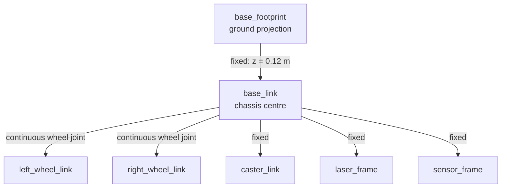
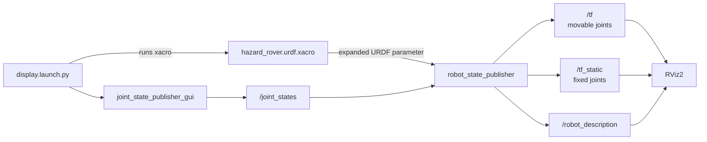
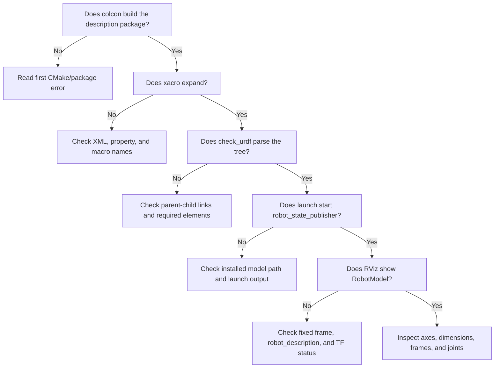

# Module 2 beginner guide — start here

Read this before the complete Module 2 lesson or detailed Xacro reference.

Module 1 taught that independent nodes communicate through named, typed
interfaces. Module 2 adds a different kind of interface: the robot's mechanical
structure and coordinate frames. The rover will appear in RViz2, but it will not
yet move through a simulated world. Gazebo, physics, lidar measurements,
odometry, and velocity control belong to Module 3.

If URDF, Xacro, joints, inertia matrices, and TF initially seem like unrelated
topics, do not attempt to memorize their syntax. Begin with the frame tree and
ask one question: **where is each component relative to its parent?**

## 1. The one lesson to remember

> A robot description is a coordinate-system and physical-structure contract.
> Links describe rigid bodies or frames; joints describe how one link is placed
> and allowed to move relative to another.

The Module 2 frame tree is:



`base_link` does not contain the other links in Python. The URDF/Xacro model
defines parent-child relationships, and `robot_state_publisher` converts those
relationships into TF transforms that other ROS 2 components can use.

## 2. Why Module 2 comes before Gazebo

RViz2 visualizes robot data but does not calculate contact forces, friction,
gravity, or wheel motion. That makes it a simpler place to answer:

- Is the chassis the expected size?
- Are left and right actually on the correct sides?
- Do wheel axes point in the correct direction?
- Are the sensor frames attached to the intended locations?
- Does the frame tree have one connected root?
- Are dimensions and masses plausible?

If Gazebo were added now, a wheel in the wrong location might look like a
friction problem, controller problem, plugin problem, or collision problem.
Verifying the static model first reduces the number of possible causes.

## 3. Mechanical-engineering analogy

| ROS description concept | Mechanical-engineering analogy |
|---|---|
| Link | Rigid component or coordinate frame attached to a component |
| Joint | Assembly constraint and relative coordinate definition |
| Joint origin | Component placement in an assembly |
| Joint axis | Hinge, shaft, or rotation axis |
| Visual geometry | Appearance used by an observer |
| Collision geometry | Simplified contact envelope |
| Inertial properties | Mass, centre of mass, and inertia tensor |
| TF tree | Continuously available assembly-coordinate transformation chain |
| Xacro property | Named design parameter in a parametric CAD model |
| Xacro macro | Reusable parametric component definition |

The strongest connection to mechanical design is parametric consistency. The
rover dimensions are declared once, and inertia macros calculate the matching
idealized inertia tensor. This is preferable to changing visual dimensions while
forgetting to update dynamics data.

## 4. Essential vocabulary

### URDF

Unified Robot Description Format. It is an XML format describing a tree of
links and joints together with geometry and physical properties.

### Xacro

An XML macro language that generates URDF. It adds properties, calculations,
macros, and reusable structure. The authored file ends in `.urdf.xacro`; ROS
tools receive the expanded URDF text.

### Link

A named rigid body or coordinate frame. A link may contain visual, collision,
and inertial elements. `base_footprint` is intentionally a frame-only link with
no mass or geometry.

### Joint

A parent-child connection between two links. A joint defines the child's pose
relative to the parent and may permit motion.

### Fixed joint

A joint with no relative motion. The caster and sensor housings are fixed in
Module 2.

### Continuous joint

A rotational joint without an angular position limit. The two wheel joints are
continuous.

### Origin

A translation (`xyz`) and orientation (`rpy`) that place an element or child
frame relative to a parent frame.

### Axis

The direction about which a rotating joint moves. The wheel joint axis is the
positive y-axis because each axle runs left-to-right across the rover.

### TF

The ROS 2 transform system. TF lets software ask for the pose of one coordinate
frame relative to another at a particular time.

### RViz2 fixed frame

The reference frame against which RViz2 draws everything. Module 2 uses
`base_footprint`, so the stationary rover is shown relative to its ground
projection.

## 5. Coordinate convention

The rover uses the common ROS mobile-robot convention:

```text
       +z
        ↑
        │
        └────→ +x  forward
       /
     +y  left
```

When looking down from above:

```text
                 +x forward
                     ↑
        +y left  ←  rover  →  right is -y
                     ↓
                    rear
```

This convention explains the wheel placement:

- left wheel y-coordinate: positive;
- right wheel y-coordinate: negative;
- both wheel axles: along the y-axis;
- chassis and sensor height: positive z;
- rear caster x-coordinate: negative.

## 6. What the running system does



In plain language:

1. The launch file finds the installed Xacro model.
2. The `xacro` command expands properties and macros into ordinary URDF XML.
3. The expanded model is passed to `robot_state_publisher` as the
   `robot_description` parameter.
4. `joint_state_publisher_gui` publishes wheel joint angles.
5. `robot_state_publisher` combines the model and joint angles to publish TF.
6. RViz2 reads the robot description and transforms, then draws the rover.

RViz2 is not publishing wheel commands and is not simulating motion. Moving a
GUI wheel slider changes the wheel's displayed joint angle only.

## 7. Read the model in this order

Do not begin with the inertia macros.

### Step 1: properties

Find:

```xml
<xacro:property name="base_length" value="0.50"/>
<xacro:property name="base_width" value="0.34"/>
<xacro:property name="base_height" value="0.14"/>
<xacro:property name="base_mass" value="9.00"/>
```

Interpretation:

```text
The chassis is a 0.50 m × 0.34 m × 0.14 m box with a mass of 9 kg.
```

Properties are similar to named dimensions in a parametric model.

### Step 2: one link

Find `base_link`:

```xml
<link name="base_link">
  <visual>...</visual>
  <collision>...</collision>
  <xacro:box_inertial .../>
</link>
```

Interpretation:

```text
base_link is a rigid chassis body with:
- visible shape;
- collision envelope;
- mass and rotational inertia.
```

### Step 3: one fixed joint

```xml
<joint name="laser_joint" type="fixed">
  <parent link="base_link"/>
  <child link="laser_frame"/>
  <origin xyz="..." rpy="0 0 0"/>
</joint>
```

Interpretation:

```text
Attach laser_frame rigidly to base_link at the stated position.
```

### Step 4: one movable joint

```xml
<joint name="${side}_wheel_joint" type="continuous">
  <parent link="base_link"/>
  <child link="${side}_wheel_link"/>
  <origin xyz="0 ${y_offset} ${wheel_z_offset}" rpy="0 0 0"/>
  <axis xyz="0 1 0"/>
</joint>
```

Interpretation:

```text
Attach a wheel to the chassis at its axle centre.
Allow unlimited rotation around the local y-axis.
```

`${side}` and `${y_offset}` are substituted when the wheel macro creates the
left and right instances.

### Step 5: the frame tree

Read only parent and child tags. Sketch the tree on paper. If a link appears
twice as a child, or never connects to the root, the URDF tree is invalid.

### Step 6: inertial formulas

After geometry and joints are understandable, inspect the macros. For an
idealized rectangular box:

\[
I_{xx}=\frac{m}{12}(y^2+z^2),\quad
I_{yy}=\frac{m}{12}(x^2+z^2),\quad
I_{zz}=\frac{m}{12}(x^2+y^2).
\]

The Xacro macro evaluates these expressions from the same dimensions used by
the geometry.

## 8. What you may postpone

For the first session, you may postpone:

- exact RViz configuration fields;
- how CMake installs directories;
- every inertia-tensor derivation;
- QoS details of `/robot_description`;
- Gazebo collision and friction behavior;
- differential-drive plugin configuration;
- why simulation may use additional tags later.

For now, know that:

```text
CMakeLists.txt  installs model, launch, and RViz files
package.xml     declares dependencies
Xacro           defines the robot
launch file     expands Xacro and starts visualization nodes
RViz config     selects displays, fixed frame, and camera view
```

## 9. Predict before running

Write down your answers:

1. Which direction is the robot's front?
2. Should the left wheel have a positive or negative y-coordinate?
3. Why is the wheel cylinder rotated by 90 degrees in its visual geometry?
4. What should happen if the wheel joint axis were changed from `0 1 0` to
   `0 0 1`?
5. Should moving a wheel slider make the entire rover translate across RViz2?
6. Which frames should remain fixed relative to `base_link`?
7. Why is `base_footprint` located on the ground rather than at the chassis
   centre?

## 10. First guided session

Allow 60--90 minutes.

### Part A — install Module 2 tools

Inside Ubuntu 22.04 WSL:

```bash
sudo apt update
sudo apt install -y \
  ros-humble-xacro \
  ros-humble-joint-state-publisher \
  ros-humble-joint-state-publisher-gui \
  ros-humble-robot-state-publisher \
  ros-humble-rviz2 \
  ros-humble-tf2-tools \
  liburdfdom-tools
```

### Part B — build both completed packages

```bash
cd ~/ros2_projects/hazard_inspection_ws
source /opt/ros/humble/setup.bash
rosdep install --from-paths src --ignore-src -r -y
colcon build --symlink-install
source install/setup.bash
```

Expected summary: two packages finish successfully.

### Part C — validate Xacro before launching a GUI

```bash
xacro src/hazard_inspection_description/urdf/hazard_rover.urdf.xacro \
  > /tmp/hazard_rover.urdf

check_urdf /tmp/hazard_rover.urdf
```

Expected: the parser reports the root link and successfully parses the link
tree. Warnings or errors should be investigated before opening RViz2.

### Part D — launch the visualization

```bash
ros2 launch hazard_inspection_description display.launch.py
```

Expected windows:

- RViz2 showing a blue rectangular rover body;
- two dark wheels;
- gray rear caster;
- red lidar housing;
- yellow environmental-sensor housing;
- joint-state publisher GUI with two wheel sliders.

Expected TF axes and labels appear because the TF display is enabled.

### Part E — orient yourself visually

In RViz2:

1. Find the red x-axis pointing forward.
2. Find the green y-axis pointing left.
3. Find the blue z-axis pointing upward.
4. Confirm the left wheel lies on positive y.
5. Confirm the rear caster lies on negative x.
6. Confirm both sensor housings sit above the chassis.

Do not judge only by colors. Use frame names and axes as evidence.

### Part F — move wheel joints

Move one wheel slider in `joint_state_publisher_gui`.

Expected:

- the wheel rotates about its axle;
- the chassis remains stationary;
- the other wheel does not have to move;
- the rover does not translate, because RViz2 has no physics.

### Part G — inspect TF independently

Open a second sourced terminal:

```bash
ros2 node list
ros2 topic list -t
ros2 run tf2_ros tf2_echo base_footprint laser_frame
```

Expected translation is approximately:

```text
x = 0.17 m
y = 0.00 m
z = 0.215 m
```

The z-value contains the chassis-centre height plus the lidar's offset above
`base_link`.

Stop `tf2_echo` with `Ctrl+C`.

## 11. One controlled modification

Change only:

```xml
<xacro:property name="base_length" value="0.50"/>
```

to:

```xml
<xacro:property name="base_length" value="0.60"/>
```

Predict:

- chassis becomes 0.10 m longer;
- width and height remain unchanged;
- wheel positions remain at x = 0;
- caster and sensors keep their explicitly configured x positions;
- box inertia values depending on x change automatically.

Rebuild, source, and relaunch. Then restore `0.50` after the experiment.

This exercise shows both the advantage and limitation of parametric design:
inertial calculations update automatically, but explicitly chosen component
positions do not automatically redesign themselves.

## 12. Common points of confusion

### “Is RViz2 the simulator?”

No. RViz2 visualizes data. Gazebo simulates physics and sensors. Module 2 uses
RViz2 so model structure can be verified without physics.

### “Why do the wheels move but the rover stays still?”

Joint-state values describe wheel angles. No contact model converts those angles
into chassis motion in RViz2.

### “Why do we need both `base_footprint` and `base_link`?”

`base_footprint` provides a planar ground reference. `base_link` is the physical
body frame at the chassis centre. Separating them is useful because navigation
and visualization often need a ground-projected frame even though the body has
height.

### “Why does a cylinder need a 90-degree visual rotation?”

URDF cylinders are aligned with their local z-axis by default. A wheel axle runs
along y, so the cylinder geometry is rotated. The link and joint frames remain
defined separately from the geometry's visual rotation.

### “Why is a frame called `laser_frame` if no scan exists?”

The frame defines where a future measurement originates. Module 3 will attach a
Gazebo lidar sensor and publish scans with this frame identifier.

### “Why are collision and inertia included before Gazebo?”

They are part of a complete physical robot description and can be reviewed now.
Gazebo will use them later. Including them early prevents visual-only modeling
from being mistaken for simulation readiness.

## 13. Troubleshooting path



Use the first meaningful error. Later errors may be consequences.

## 14. Minimum completion standard

You are ready for Module 3 when you can explain:

1. A link represents a rigid body or named frame.
2. A joint places and constrains a child link relative to a parent.
3. Xacro generates URDF using properties, expressions, and macros.
4. `robot_state_publisher` combines the model with joint states to publish TF.
5. Fixed transforms and wheel transforms form one connected tree.
6. RViz2 visualizes the model but does not simulate physics.
7. `base_footprint` is the ground projection; `base_link` is the chassis frame.
8. Wheel axles lie along y while forward motion is along x.
9. Visual, collision, and inertial descriptions have different purposes.
10. Frame and joint correctness must be checked before Gazebo is introduced.

You do not need to memorize:

- the complete Xacro syntax;
- every RViz configuration field;
- all inertia formulas without reference;
- the launch API;
- every TF command.

## 15. Evidence to save

Save:

1. successful two-package build summary;
2. successful `check_urdf` output;
3. RViz2 screenshot with RobotModel and TF enabled;
4. screenshot showing the joint-state GUI;
5. `tf2_echo base_footprint laser_frame` output;
6. generated `frames.pdf` from the full lesson;
7. before/after screenshot of the controlled chassis-length exercise;
8. written answers to the prediction questions.

## 16. Reading order

1. **This guide:** form the mental model and complete the first visualization.
2. [`module_02_robot_model.md`](module_02_robot_model.md): complete every
   verification, exercise, and checkpoint.
3. [`module_02_file_and_code_guide.md`](module_02_file_and_code_guide.md): study
   package, Xacro, launch, and RViz details as needed.
4. [`architecture.md`](architecture.md): connect the frame tree to the future
   Gazebo and control architecture.

The detailed reference is not intended to be read linearly before the rover is
visible.
