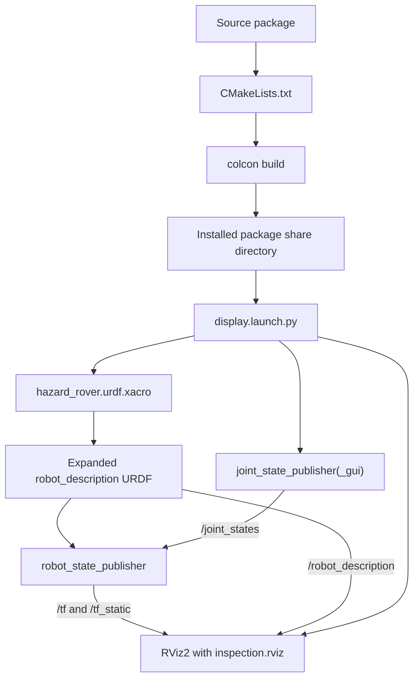

# Module 2 file structure and code guide

This is the detailed technical reference for the Module 2 robot-description
package. Read the beginner guide and observe the rover in RViz2 before trying to
study this entire document.

Recommended order:

1. [`module_02_beginner_start_here.md`](module_02_beginner_start_here.md)
2. [`module_02_robot_model.md`](module_02_robot_model.md)
3. This file as a reference

## 1. Package structure

```text
src/hazard_inspection_description/
├── CMakeLists.txt
├── package.xml
├── launch/
│   └── display.launch.py
├── rviz/
│   └── inspection.rviz
└── urdf/
    └── hazard_rover.urdf.xacro
```

This is an `ament_cmake` package even though its launch file is Python. The
package contains data resources rather than an authored Python module. CMake is
used to install those resource directories into a standard ROS package share
location.

## 2. Source-to-visualization flow



At runtime, CMake is no longer calculating transforms. Its job was to install
the authored files. The Xacro command generates URDF, ROS nodes publish state,
and RViz2 displays received data.

## 3. `CMakeLists.txt` line by line

```cmake
cmake_minimum_required(VERSION 3.8)
```

This declares the oldest CMake version expected by the package. It lets CMake
select compatible policy behavior and fail clearly on an older unsupported
version.

```cmake
project(hazard_inspection_description)
```

This establishes the CMake project name and the `${PROJECT_NAME}` variable. It
must agree with the ROS package name in `package.xml`.

```cmake
find_package(ament_cmake REQUIRED)
```

This finds the ROS 2 CMake build system. `REQUIRED` means configuration should
stop if `ament_cmake` is unavailable rather than producing an incomplete
package.

```cmake
install(
  DIRECTORY launch rviz urdf
  DESTINATION share/${PROJECT_NAME}
)
```

This is the package's primary build rule:

- `install(...)` specifies files copied or linked into the install space;
- `DIRECTORY launch rviz urdf` selects all three authored resource directories;
- directory names are preserved below the destination;
- `DESTINATION share/${PROJECT_NAME}` creates the standard package share
  location.

The resulting conceptual layout is:

```text
install/hazard_inspection_description/
└── share/hazard_inspection_description/
    ├── launch/display.launch.py
    ├── rviz/inspection.rviz
    └── urdf/hazard_rover.urdf.xacro
```

ROS tools find that share directory through the ament index. Hard-coding a path
inside `src/` would make the package dependent on one repository location.

```cmake
ament_package()
```

This finalizes the ament package, installs package metadata, and creates the
resource-index information required for discovery. It normally appears after
the package's install rules.

## 4. `package.xml` in detail

### XML and package format

```xml
<?xml version="1.0"?>
<?xml-model href="http://download.ros.org/schema/package_format3.xsd"
  schematypens="http://www.w3.org/2001/XMLSchema"?>
<package format="3">
```

- The first line identifies XML 1.0.
- The model declaration helps supporting editors validate ROS package tags.
- Package format 3 provides the manifest structure used by current ROS 2
  packages.

### Identity metadata

```xml
<name>hazard_inspection_description</name>
<version>0.1.0</version>
<description>Xacro robot model and RViz configuration ...</description>
<maintainer email="maintainer@users.noreply.github.com">Hazard Inspection Rover Maintainer</maintainer>
<license>MIT</license>
```

These fields identify the package for build tools and repository users. The
project-level no-reply maintainer avoids exposing a personal address. The
license should match the root MIT license.

### Build-tool dependency

```xml
<buildtool_depend>ament_cmake</buildtool_depend>
```

`ament_cmake` is required while configuring and installing the package. It is a
build-tool dependency rather than one of the visualization processes launched
at runtime.

### Runtime dependencies

```xml
<exec_depend>ament_index_python</exec_depend>
<exec_depend>joint_state_publisher</exec_depend>
<exec_depend>joint_state_publisher_gui</exec_depend>
<exec_depend>launch</exec_depend>
<exec_depend>launch_ros</exec_depend>
<exec_depend>robot_state_publisher</exec_depend>
<exec_depend>rviz2</exec_depend>
<exec_depend>urdf</exec_depend>
<exec_depend>xacro</exec_depend>
```

The responsibility of each dependency is:

| Dependency | Use in Module 2 |
|---|---|
| `ament_index_python` | Finds the installed package share directory in the launch file |
| `joint_state_publisher` | Publishes default wheel joint positions without a GUI |
| `joint_state_publisher_gui` | Provides wheel-angle sliders and publishes `/joint_states` |
| `launch` | Supplies launch descriptions, arguments, substitutions, and conditions |
| `launch_ros` | Supplies the ROS-specific `Node` launch action |
| `robot_state_publisher` | Converts description and joint states into TF transforms |
| `rviz2` | Visualizes RobotModel and TF |
| `urdf` | Supplies URDF-related runtime support and validation ecosystem |
| `xacro` | Expands properties, expressions, and macros into URDF |

`rosdep install --from-paths src --ignore-src` reads these names and resolves
the corresponding system packages.

### Build-type export

```xml
<export>
  <build_type>ament_cmake</build_type>
</export>
```

This tells `colcon` to configure the package using the `ament_cmake` workflow and
its `CMakeLists.txt`.

## 5. Xacro and URDF mental model

The authored Xacro file is XML plus macro-processing features. It passes through
two conceptual stages:

```text
Authored .urdf.xacro
    properties + expressions + macros
                 ↓ xacro
Expanded URDF XML
    explicit links + joints + numeric values
                 ↓ robot_state_publisher
TF transform publications
```

`check_urdf` validates the expanded second stage. When debugging a macro, inspect
both the source Xacro and `/tmp/hazard_rover.urdf`.

## 6. Xacro document declaration

```xml
<?xml version="1.0"?>
<robot xmlns:xacro="http://www.ros.org/wiki/xacro"
       name="hazard_inspection_rover">
```

- The XML declaration identifies the document type.
- `<robot>` is the URDF root element.
- `xmlns:xacro` defines the `xacro:` XML namespace so elements such as
  `<xacro:property>` and `<xacro:macro>` are recognized by the preprocessor.
- The robot name identifies the complete model, not a ROS node.

The comments immediately below state the module boundary and coordinate
convention. Comments do not change the generated model, but they prevent future
maintainers from mistaking absent Gazebo tags for an omission.

## 7. Parametric properties

### Chassis properties

```xml
<xacro:property name="base_length" value="0.50"/>
<xacro:property name="base_width" value="0.34"/>
<xacro:property name="base_height" value="0.14"/>
<xacro:property name="base_mass" value="9.00"/>
<xacro:property name="ground_clearance" value="0.05"/>
<xacro:property name="base_link_height"
                value="${ground_clearance + base_height / 2.0}"/>
```

The first five values are design inputs in SI units. The final property is a
derived value:

```text
base_link_height = chassis bottom clearance + half chassis height
                 = 0.05 + 0.14/2
                 = 0.12 m
```

`${...}` asks Xacro to evaluate an expression. A derived property reduces the
risk of changing chassis height without updating its centre position.

### Wheel properties

```xml
<xacro:property name="wheel_radius" value="0.09"/>
<xacro:property name="wheel_width" value="0.04"/>
<xacro:property name="wheel_mass" value="0.55"/>
<xacro:property name="wheel_y_offset"
                value="${base_width / 2.0 + wheel_width / 2.0}"/>
<xacro:property name="wheel_z_offset"
                value="${wheel_radius - base_link_height}"/>
```

The wheel centre is placed one chassis half-width plus one wheel half-width from
the centreline. Therefore the inner wheel face is flush with the side of the
chassis:

```text
y centre = 0.34/2 + 0.04/2 = 0.19 m
```

Its position relative to `base_link` is:

```text
z relative = wheel centre above ground - base_link above ground
           = 0.09 - 0.12
           = -0.03 m
```

### Caster properties

The caster centre is at x = -0.19 m, placing it toward the rear. Its relative z
offset makes the bottom of the sphere touch the ground:

```text
z relative = 0.035 - 0.12 = -0.085 m
```

It remains a fixed link because swivel and rolling behavior is unnecessary for
static structural visualization.

### Sensor properties

The laser and environmental sensor dimensions define simple housings. They also
provide geometry inputs to the inertia macros. They are not sensor range,
accuracy, update rate, or noise settings; those concepts are added with
simulation and hazard-sensor nodes later.

## 8. Inertia macros

### Why macros are used

Each inertial element needs a mass, centre-of-mass origin, and a symmetric 3×3
inertia tensor represented by six URDF attributes:

```text
ixx  ixy  ixz
ixy  iyy  iyz
ixz  iyz  izz
```

For centered, axis-aligned, uniform primitives, the products of inertia are
zero. Macros prevent formulas from being copied inconsistently across links.

### Box macro

```xml
<xacro:macro name="box_inertial" params="mass x y z">
```

This declares a reusable element named `box_inertial` with four required macro
arguments. It is invoked later as `<xacro:box_inertial .../>`.

```xml
<origin xyz="0 0 0" rpy="0 0 0"/>
<mass value="${mass}"/>
```

The centre of mass is assumed to coincide with the link origin and the inertia
principal axes align with the link axes.

```xml
ixx="${mass * (y * y + z * z) / 12.0}"
iyy="${mass * (x * x + z * z) / 12.0}"
izz="${mass * (x * x + y * y) / 12.0}"
```

These are the standard solid rectangular-prism formulas. Changing a passed
dimension changes the expanded numeric tensor.

### Cylinder-y macro

The wheel cylinder's symmetry axis is y:

```xml
iyy="${mass * radius * radius / 2.0}"
```

Therefore y receives the axial moment, while x and z receive the equal radial
moments. A common modeling error is to rotate only the wheel's visual geometry
while leaving an inertia tensor whose axial moment still lies on z.

### Cylinder-z macro

The upright lidar cylinder's symmetry axis is z, so `izz` is the axial moment
and x/y are radial moments.

### Sphere macro

A centered uniform sphere has equal principal moments, so all three diagonal
values use `2*m*r^2/5`.

### Modeling limitation

These formulas describe ideal uniform solids. Real wheels may have rims, tires,
hubs, motors, and nonuniform mass. The model is sufficiently honest for a light
educational simulation but should not be presented as experimentally identified
hardware dynamics.

## 9. Materials

```xml
<material name="industrial_blue">
  <color rgba="0.12 0.32 0.55 1.0"/>
</material>
```

Named global materials allow visual elements to reference a color by name.
RGBA contains red, green, blue, and alpha values from 0 to 1. Alpha `1.0` is
opaque. Materials affect visual appearance, not collision or inertia.

The colors serve identification:

- blue: main body;
- dark rubber: wheels;
- gray: caster;
- red: lidar;
- yellow: environmental sensor.

## 10. Root and chassis

### Frame-only root link

```xml
<link name="base_footprint"/>
```

This creates a named link with no visual, collision, or inertial element. It is
the tree root and represents the ground projection below the chassis centre.

A massless root also avoids placing the chassis inertia directly on the root,
which is inconvenient for some kinematic libraries.

### Ground-to-body joint

```xml
<joint name="base_footprint_joint" type="fixed">
  <parent link="base_footprint"/>
  <child link="base_link"/>
  <origin xyz="0 0 ${base_link_height}" rpy="0 0 0"/>
</joint>
```

The origin expresses the child `base_link` pose in the parent
`base_footprint` frame. There is no relative rotation and the chassis centre is
0.12 m upward.

### Chassis link

The `base_link` visual and collision use the same centered box dimensions. The
visual contains a material; the collision does not need a color. The
`box_inertial` invocation generates the inertial block from chassis properties.

Using the same geometry for visual and collision is transparent and simple. A
more detailed model might use a decorative visual mesh and a simpler collision
box, but external assets are deliberately avoided.

## 11. Drive-wheel macro

```xml
<xacro:macro name="drive_wheel" params="side y_offset">
```

One macro creates both a wheel link and its joint. `side` becomes `left` or
`right`; `y_offset` supplies the signed placement.

### Generated link names

```xml
<link name="${side}_wheel_link">
```

The two invocations expand into `left_wheel_link` and `right_wheel_link`.
Likewise, the joint name becomes `left_wheel_joint` or `right_wheel_joint`.

### Cylinder orientation

```xml
<origin xyz="0 0 0" rpy="${pi / 2.0} 0 0"/>
```

URDF cylinder geometry is aligned along local z by default. Rotating it by
90 degrees about x maps its cylinder axis to y. This `<origin>` belongs to the
geometry inside the link; it does not move the link frame or redefine the joint
axis.

Roll-pitch-yaw values are in radians. `pi/2` is 90 degrees.

### Continuous joint

```xml
<joint name="${side}_wheel_joint" type="continuous">
```

A continuous joint rotates without a position limit. This fits a drive wheel
that may turn through multiple revolutions.

```xml
<origin xyz="0 ${y_offset} ${wheel_z_offset}" rpy="0 0 0"/>
```

This places the child link frame at the wheel axle centre relative to
`base_link`.

```xml
<axis xyz="0 1 0"/>
```

The axle lies along y. Joint rotation follows the right-hand rule about the
positive axis.

```xml
<limit effort="5.0" velocity="20.0"/>
```

Continuous joints do not require position bounds, but effort and velocity
limits document finite actuator-related limits. These values are educational
placeholders and will be revisited if controller or hardware assumptions change.

### Macro instances

```xml
<xacro:drive_wheel side="left" y_offset="${wheel_y_offset}"/>
<xacro:drive_wheel side="right" y_offset="${-wheel_y_offset}"/>
```

The only difference is the side label and sign of y. This guarantees symmetric
geometry while preserving distinct link and joint names.

## 12. Caster and fixed sensor links

Each remaining physical component follows the same pattern:

```text
link:
    visual geometry
    collision geometry
    inertial properties

fixed joint:
    parent base_link
    child component frame
    component origin
```

### Caster

The sphere is centered at `(-0.19, 0, -0.085)` relative to `base_link`. With
`base_link` at z = 0.12 m, its absolute centre is z = 0.035 m and its bottom
touches the ground plane.

### Lidar

The laser joint places the housing at:

```text
x = +0.17 m, toward the front
z relative = base_height/2 + laser_height/2
           = 0.07 + 0.025
           = 0.095 m
```

Absolute z is 0.12 + 0.095 = 0.215 m. The bottom of the lidar housing is at the
chassis top, 0.19 m.

`laser_frame` will later become the frame identifier for scan measurements. The
current colored cylinder is only housing geometry.

### Environmental sensor

The sensor box is placed toward the rear at x = -0.08 m. Its bottom also meets
the chassis top. `sensor_frame` will represent the conceptual measurement
origin used by the simulated hazard system.

## 13. Visual, collision, and inertial elements

These elements answer different questions:

| Element | Question answered | Used now | Used by Gazebo later |
|---|---|---:|---:|
| `<visual>` | What should an observer see? | Yes, RViz2 | Yes |
| `<collision>` | What simplified volume can contact other objects? | Optional display | Yes |
| `<inertial>` | How does the body resist translation and rotation? | Review only | Yes |

They may share dimensions but remain separate because detailed visual meshes,
simplified collision shapes, and measured inertial properties often differ in
real projects.

## 14. Launch file imports

```python
from pathlib import Path
```

`Path` supports readable path joining.

```python
from ament_index_python.packages import get_package_share_directory
```

This function asks the ament index for an installed package share path. It
avoids source-tree assumptions.

```python
from launch import LaunchDescription
from launch.actions import DeclareLaunchArgument
from launch.conditions import IfCondition, UnlessCondition
from launch.substitutions import Command, LaunchConfiguration
from launch_ros.actions import Node
from launch_ros.parameter_descriptions import ParameterValue
```

- `LaunchDescription` contains actions.
- `DeclareLaunchArgument` exposes command-line configuration.
- `IfCondition` and `UnlessCondition` make actions mutually conditional.
- `LaunchConfiguration` represents a value resolved when the launch executes.
- `Command` runs a command and uses its standard output as a substitution.
- `Node` starts a ROS node process.
- `ParameterValue` explicitly preserves generated XML as a string parameter.

## 15. Locate installed resources

```python
package_share = Path(get_package_share_directory(PACKAGE_NAME))
default_model = package_share / 'urdf' / 'hazard_rover.urdf.xacro'
default_rviz_config = package_share / 'rviz' / 'inspection.rviz'
```

These paths refer to the installed package, not the source directory. The launch
file therefore works when called from any directory after sourcing the overlay.

## 16. Launch arguments

Each `DeclareLaunchArgument` provides:

- a public name used as `name:=value`;
- a default value;
- a human-readable description visible through launch introspection.

### `model`

Accepts an absolute path to another compatible Xacro file. The default is the
installed rover model.

### `use_gui`

Selects between graphical and non-graphical joint-state publishers. Exactly one
should run.

### `rviz`

Allows a headless or command-line-only launch for diagnostics.

### `use_sim_time`

Remains false in Module 2 because no simulator publishes `/clock`. Module 3 will
use simulation time consistently across relevant nodes.

## 17. Deferred launch substitutions

```python
model = LaunchConfiguration('model')
```

This is not the final path string when Python first constructs the launch
description. It is a substitution object resolved later using the launch
context and any command-line override.

The same applies to Boolean-looking strings such as `use_gui`. Launch conditions
interpret their resolved textual values.

## 18. Expand Xacro into `robot_description`

```python
robot_description_content = ParameterValue(
    Command(['xacro "', model, '"']),
    value_type=str,
)
robot_description = {
    'robot_description': robot_description_content,
    'use_sim_time': use_sim_time,
}
```

`Command` executes the equivalent of:

```bash
xacro /installed/path/hazard_rover.urdf.xacro
```

Xacro writes expanded URDF XML to standard output. `ParameterValue` forces that
content to remain a string when it becomes the `robot_description` parameter.

The double quotes assembled around `model` are defensive. They prevent command
parsing from treating a possible space as an argument separator. This protects
the Xacro command itself, but it does not make every Humble build tool safe for
spaces; from Module 4 onward, use `~/ros2_projects/hazard_inspection_ws`.

`use_sim_time` is included in the same parameter dictionary. It is a ROS node
parameter, not Xacro input.

## 19. `robot_state_publisher` launch action

```python
robot_state_publisher = Node(
    package='robot_state_publisher',
    executable='robot_state_publisher',
    name='robot_state_publisher',
    output='screen',
    parameters=[robot_description],
)
```

- `package` and `executable` identify installed software.
- `name` defines the runtime graph name.
- `output='screen'` exposes logs in the launch terminal.
- `parameters` provides expanded model text and time choice.

The node parses the model, immediately publishes fixed transforms, subscribes to
joint states, and publishes movable-link transforms when joint positions are
available.

## 20. Conditional joint-state publishers

The GUI action uses:

```python
condition=IfCondition(use_gui)
```

The non-GUI action uses:

```python
condition=UnlessCondition(use_gui)
```

They are logical opposites. Starting both would create two publishers for the
same joint data and could cause confusing or competing values.

The non-GUI version is useful for WSL display troubleshooting, automated checks,
or default zero joint positions.

## 21. RViz2 launch action

```python
arguments=['-d', str(default_rviz_config)]
```

`-d` tells RViz2 to load a saved display configuration. The path is fixed to the
package's installed default configuration in this module.

```python
condition=IfCondition(rviz)
```

This lets `rviz:=false` suppress the visualization process while leaving TF
publication testable.

The `use_sim_time` parameter is passed for future compatibility but remains
false here.

## 22. Return action ordering

```python
return LaunchDescription([
    model_argument,
    use_gui_argument,
    rviz_argument,
    use_sim_time_argument,
    robot_state_publisher,
    joint_state_publisher_gui,
    joint_state_publisher,
    rviz_node,
])
```

Arguments are declared before actions that use them. Process action ordering in
the list does not prove complete initialization ordering; ROS discovery and
transient-local model publication allow endpoints to connect as they start.

## 23. RViz configuration structure

The `.rviz` file is YAML-like serialized application state. It is normally
created or updated through the RViz GUI using **File → Save Config**, but keeping
it in version control makes the expected view reproducible.

### Panels

The Displays panel lets the student inspect status and display properties. The
Views panel exposes camera controls.

### Global options

```yaml
Global Options:
  Background Color: 36; 40; 48
  Fixed Frame: base_footprint
  Frame Rate: 30
```

- Background color affects only presentation.
- `base_footprint` is the coordinate reference for all drawn data.
- frame rate is the target visualization refresh, not TF or sensor frequency.

### Grid display

The XY grid at z = 0 represents the ground plane. A 0.5 m cell size provides
visual scale against the 0.5 m chassis.

### RobotModel display

```yaml
Description Source: Topic
Description Topic:
  Value: /robot_description
```

RViz2 receives the URDF description from the topic published by
`robot_state_publisher`. Transient-local durability allows a late-starting RViz
subscriber to obtain the retained description.

`Visual Enabled: true` selects visual geometry. `Collision Enabled: false`
avoids drawing overlapping collision geometry by default. Toggle it during an
exercise.

### TF display

The TF display draws axes, arrows, names, and the frame tree. Marker scale 0.20
keeps axes visible without overwhelming the small rover.

### Orbit view

The camera target is `base_footprint` with a focal point near the chassis. Yaw,
pitch, and distance establish a useful initial three-quarter view. These values
do not change robot frames.

### Window geometry

The serialized window size, panel state, and Qt main-window state are UI
preferences. They may adjust automatically across computers and screen sizes.

## 24. Runtime topic responsibilities

| Topic | Type | Producer | Consumer | Meaning |
|---|---|---|---|---|
| `/joint_states` | `sensor_msgs/msg/JointState` | selected joint-state publisher | robot state publisher | Wheel names, angles, velocities, efforts as available |
| `/robot_description` | `std_msgs/msg/String` | robot state publisher | RViz2 and tools | Expanded URDF model text |
| `/tf_static` | `tf2_msgs/msg/TFMessage` | robot state publisher | RViz2 and TF tools | Fixed-joint transforms |
| `/tf` | `tf2_msgs/msg/TFMessage` | robot state publisher | RViz2 and TF tools | Transforms affected by joint positions |

The launch configuration may also expose standard ROS parameter and logging
topics. Focus on these four model-related contracts.

## 25. Static versus dynamic transforms

Fixed joints never change relative pose and can be published with static
durability. In this model those include:

- `base_footprint` → `base_link`;
- `base_link` → `caster_link`;
- `base_link` → `laser_frame`;
- `base_link` → `sensor_frame`.

Wheel transforms include a constant translation plus a rotation determined by
the corresponding joint-state position. They are published as time-varying TF.

The rover still does not have `odom` → `base_footprint`. Module 3 will introduce
that world-relative motion transform through simulated odometry.

## 26. Why `base_footprint` and `base_link` are separate

`base_link` represents a physical body frame with height, mass, collision, and
inertia. `base_footprint` is a planar abstraction on the ground.

This separation supports future algorithms that care about 2D floor-plane pose
without pretending the chassis centre lies at ground level. For a flat world,
their x/y/yaw may correspond while z remains different.

## 27. What a syntactically valid model cannot prove

Successful Xacro expansion and `check_urdf` parsing prove structural syntax and
tree connectivity. They do not prove:

- dimensions are realistic;
- left/right signs are correct;
- axes follow the intended mechanism;
- collision envelopes are safe;
- inertia values match hardware;
- wheels contact a future floor correctly;
- the controller will command correct motion.

That is why Module 2 combines parser checks, numerical transform checks, visual
inspection, and prediction exercises.

## 28. Change-and-rebuild guide

| Change | Rebuild? | Relaunch? | Reason |
|---|---:|---:|---|
| Edit Xacro through symlink install | Recommended while learning | Yes | Xacro is expanded only at node startup |
| Add a new file under an already installed directory | Yes | Yes | Install step must register/copy/link it |
| Edit launch file | Recommended | Yes | Launch file is imported per launch |
| Edit RViz config | Recommended | Restart RViz | Config is read at RViz startup |
| Edit `CMakeLists.txt` | Yes | Yes | Installation rules changed |
| Edit `package.xml` | Yes after rosdep | Yes | Dependencies/metadata changed |
| Edit only Markdown | No | No | Runtime unaffected |

Use a rebuild after each exercise until the install-space concept is familiar.

## 29. Focused self-check questions

1. Why does this package use `ament_cmake` without authored C++ code?
2. What does `install(DIRECTORY ...)` make possible?
3. What is the difference between the robot name and a ROS node name?
4. What does `${...}` mean inside Xacro attributes?
5. Why is the wheel's cylinder geometry rotated while the joint origin is not?
6. Which moment of inertia is axial for a wheel?
7. Why are products of inertia zero in these idealized macros?
8. How does a `LaunchConfiguration` differ from an ordinary Python string?
9. Why use `Command(['xacro ', model])` rather than reading the source file as
   plain text?
10. Why are GUI and non-GUI joint-state publishers mutually conditional?
11. Which data must RViz2 receive to display both geometry and correct poses?
12. Why can `check_urdf` pass when a wheel is mechanically oriented incorrectly?

## 30. Modification exercises for deeper understanding

### A. Trace a geometric property

Trace `wheel_radius` through:

```text
Xacro property
  → wheel visual cylinder
  → wheel collision cylinder
  → wheel inertia macro
  → wheel centre height
  → wheel relative z offset
  → expanded URDF numeric values
  → RViz geometry and TF
```

List every expected change before editing.

### B. Add a mast frame without geometry

Add a frame-only `inspection_mast_frame` fixed above `base_link`. This practices
the distinction between a coordinate frame and a physical body. Decide whether
it truly needs visual, collision, mass, or only a link and fixed joint.

Do not retain it in the main design unless it has a documented future purpose.

### C. Compare visual and collision display

Enable collision geometry in RViz2. Because Module 2 uses matching primitives,
the shapes overlap. Explain why a future decorative mesh could differ from a
computationally simple collision approximation.

## 31. Compact Module 2 mental model

```text
package.xml
    declares description-package dependencies

CMakeLists.txt
    installs resource directories into the package share path

Xacro properties
    hold design dimensions and masses

Xacro macros
    generate repeated wheel structure and consistent inertia elements

links
    define bodies or frames

joints
    place and constrain child links relative to parents

joint_state_publisher(_gui)
    supplies wheel angles

robot_state_publisher
    combines URDF and joint angles into TF

RViz2
    visualizes robot_description and TF without simulating physics
```

If you can draw the frame tree, explain one fixed joint and one continuous
joint, predict a transform from dimensions, and identify whether a failure lies
in Xacro, URDF, TF, or RViz2, you have achieved Module 2's central objective.
