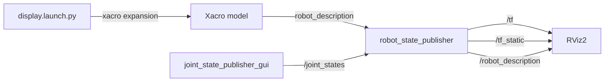
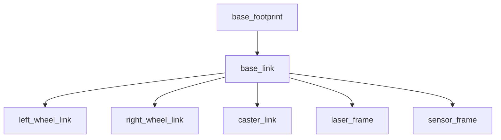

# Module 2 — robot model, TF frames, and RViz2

**Estimated time:** 3–5 hours  
**Checkpoint:** a validated Xacro rover appears in RViz2 with an inspectable TF
tree and manually adjustable wheel joints

If you are new to robot descriptions, begin with
[`module_02_beginner_start_here.md`](module_02_beginner_start_here.md). Use
[`module_02_file_and_code_guide.md`](module_02_file_and_code_guide.md) as the
detailed technical reference.

Do not continue to Module 3 until the model, frame tree, joint axes, and
dimensions have been checked independently of Gazebo.

## Learning objectives

By the end of Module 2, you should be able to:

1. Explain the roles of URDF, Xacro, links, joints, origins, and axes.
2. Apply the ROS coordinate convention: x forward, y left, z upward.
3. Distinguish visual, collision, and inertial model elements.
4. Use named Xacro properties and macros for parametric consistency.
5. Explain why `base_footprint` and `base_link` are separate frames.
6. Describe how joint states and a robot description become `/tf` and
   `/tf_static` transforms.
7. Use RViz2, `check_urdf`, `tf2_echo`, and `view_frames` as independent
   verification tools.
8. Diagnose a model problem at the XML/Xacro, URDF-tree, TF, or RViz layer.

## Concepts introduced

- URDF link-and-joint trees
- Xacro properties, arithmetic expressions, and macros
- SI units in robot descriptions
- Translation and roll-pitch-yaw orientation
- Fixed and continuous joints
- Visual, collision, and inertial properties
- Idealized box, cylinder, and sphere inertia tensors
- `robot_description`
- `joint_state_publisher` and `joint_state_publisher_gui`
- `robot_state_publisher`
- `/joint_states`, `/tf`, and `/tf_static`
- RViz2 fixed frames and displays
- Ament CMake resource installation

## Scope and limitations

Module 2 is a structural visualization, not a dynamics demonstration.

Implemented now:

- parametric primitive geometry;
- mass and idealized inertia properties;
- collision envelopes;
- complete connected frame tree;
- manually adjustable continuous wheel joints;
- TF and RViz2 visualization.

Not implemented until Module 3:

- Gazebo Harmonic;
- gravity, friction, contact, and dynamics;
- differential-drive actuation;
- odometry;
- laser scan measurements;
- simulated movement through a world.

The fixed spherical caster is an educational simplification. A more detailed
caster assembly could use swivel and rolling joints, but that complexity does
not improve the Module 2 learning objective.

## Files created in Module 2

```text
src/hazard_inspection_description/
├── CMakeLists.txt
├── package.xml
├── launch/
│   └── display.launch.py
├── rviz/
│   └── inspection.rviz
└── urdf/
    └── hazard_rover.urdf.xacro

docs/
├── module_02_beginner_start_here.md
├── module_02_file_and_code_guide.md
└── module_02_robot_model.md
```

All source files above are complete authored files; the lesson does not rely on
omitted code fragments. The detailed guide explains each important statement.

## System data flow



## Coordinate-frame design



| Frame | Parent | Joint type | Engineering meaning |
|---|---|---|---|
| `base_footprint` | none | root | Planar ground projection under chassis centre |
| `base_link` | `base_footprint` | fixed | Chassis geometric centre |
| `left_wheel_link` | `base_link` | continuous | Left drive-wheel axle centre |
| `right_wheel_link` | `base_link` | continuous | Right drive-wheel axle centre |
| `caster_link` | `base_link` | fixed | Rear passive support sphere centre |
| `laser_frame` | `base_link` | fixed | Future lidar origin and housing centre |
| `sensor_frame` | `base_link` | fixed | Future environmental-sensor origin |

### Absolute nominal positions in Module 2

These values are relative to `base_footprint` when both wheel angles are zero:

| Frame | x (m) | y (m) | z (m) |
|---|---:|---:|---:|
| `base_footprint` | 0.000 | 0.000 | 0.000 |
| `base_link` | 0.000 | 0.000 | 0.120 |
| `left_wheel_link` | 0.000 | +0.190 | 0.090 |
| `right_wheel_link` | 0.000 | -0.190 | 0.090 |
| `caster_link` | -0.190 | 0.000 | 0.035 |
| `laser_frame` | +0.170 | 0.000 | 0.215 |
| `sensor_frame` | -0.080 | 0.000 | 0.210 |

The chassis bottom is 0.05 m above the ground. Wheel and caster geometry touches
the z = 0 plane in the idealized model. Both sensor housings sit directly above
the chassis top at z = 0.19 m.

## Model dimensions and mass assumptions

| Component | Geometry | Dimensions | Mass |
|---|---|---|---:|
| Chassis | box | 0.50 × 0.34 × 0.14 m | 9.00 kg |
| Each drive wheel | cylinder | radius 0.09 m, width 0.04 m | 0.55 kg |
| Caster | sphere | radius 0.035 m | 0.10 kg |
| Lidar housing | cylinder | radius 0.04 m, height 0.05 m | 0.18 kg |
| Hazard-sensor housing | box | 0.08 × 0.06 × 0.04 m | 0.12 kg |

Total modeled mass is 10.50 kg. These values are plausible educational
approximations, not measurements from manufactured hardware.

## Inertia mathematics

The model assumes uniform-density primitive shapes with centres of mass at their
link origins.

For a box with side lengths x, y, z:

\[
I_{xx}=\frac{m}{12}(y^2+z^2),\quad
I_{yy}=\frac{m}{12}(x^2+z^2),\quad
I_{zz}=\frac{m}{12}(x^2+y^2).
\]

For a solid cylinder of radius r and length L along its symmetry axis:

\[
I_{axis}=\frac{1}{2}mr^2,\qquad
I_{radial}=\frac{m}{12}(3r^2+L^2).
\]

For a solid sphere:

\[
I_{xx}=I_{yy}=I_{zz}=\frac{2}{5}mr^2.
\]

Xacro macros calculate these values from the same properties used by geometry.
Off-diagonal terms are zero because each primitive is centered and aligned with
its link-frame principal axes.

## Understand each major file

### `CMakeLists.txt`

**Why it exists:** this is an `ament_cmake` data package. CMake installs the
launch, RViz, and URDF directories into the package share location.

**How ROS discovers it:** `colcon` finds `package.xml`, sees the
`ament_cmake` build type, processes `CMakeLists.txt`, and registers the installed
package in the ament index.

**Inputs:** authored directories under the package source.  
**Outputs:** installed resources under
`install/hazard_inspection_description/share/hazard_inspection_description/`.

**Independent test:**

```bash
ros2 pkg prefix hazard_inspection_description
```

**Two intentional modifications:**

1. Add a new installed `config` directory and update the `install(DIRECTORY ...)`
   list.
2. Temporarily omit `rviz` from installation, rebuild, observe the missing-file
   launch result, and restore it.

### `package.xml`

**Why it exists:** declares package identity, license, CMake build tool, and
runtime tools including Xacro, RViz2, robot-state publishers, and launch.

**How ROS discovers it:** `colcon`, `ament`, `rosdep`, and ROS package tools read
the manifest.

**Inputs/outputs:** metadata only; it does not publish a topic.

**Independent test:**

```bash
ros2 pkg xml hazard_inspection_description
```

**Two intentional modifications:**

1. Verify that the public maintainer identity matches the package manifest.
2. Identify which `<exec_depend>` corresponds to each import or launched node.

### `hazard_rover.urdf.xacro`

**Why it exists:** provides the authoritative parametric mechanical and frame
description.

**How ROS discovers it:** CMake installs it; the launch file finds the installed
package share directory and runs `xacro` on the model.

**Inputs:** declared properties and macro instance arguments.  
**Outputs:** expanded URDF text used as `robot_description`.

**Independent tests:**

```bash
xacro src/hazard_inspection_description/urdf/hazard_rover.urdf.xacro \
  > /tmp/hazard_rover.urdf
check_urdf /tmp/hazard_rover.urdf
```

**Two intentional modifications:**

1. Change chassis length from 0.50 m to 0.60 m and predict all affected values.
2. Move `sensor_frame` laterally by +0.05 m in y and verify the transform.

### `display.launch.py`

**Why it exists:** expands Xacro, supplies `robot_description`, selects GUI or
non-GUI joint-state publication, and optionally starts RViz2.

**How ROS discovers it:** CMake installs it in the package share `launch`
directory; `ros2 launch` searches that location.

**Inputs:** `model`, `use_gui`, `rviz`, and `use_sim_time` launch arguments.  
**Outputs:** running visualization nodes and ROS topics/transforms.

**Independent tests:**

```bash
ros2 launch hazard_inspection_description display.launch.py \
  rviz:=false use_gui:=false
```

**Two intentional modifications:**

1. Launch once with `rviz:=false` and inspect the graph without a GUI.
2. Change the default for `use_gui` and explain which joint-state publisher
   should run.

### `inspection.rviz`

**Why it exists:** saves a repeatable visualization configuration with Grid,
RobotModel, TF axes/names, `base_footprint` fixed frame, and an initial camera.

**How ROS discovers it:** CMake installs it; the launch file passes its installed
path to `rviz2 -d`.

**Inputs:** `/robot_description`, `/tf`, and `/tf_static`.  
**Output:** configured RViz2 displays.

**Independent test:**

```bash
rviz2 -d "$(ros2 pkg prefix hazard_inspection_description)/share/hazard_inspection_description/rviz/inspection.rviz"
```

The RobotModel needs the other nodes to show valid data.

**Two intentional modifications:**

1. Toggle collision geometry in the RobotModel display and compare it with the
   visual geometry.
2. Change TF marker scale and save a personal RViz view after understanding the
   original.

## Before running: predictions

Record answers before observing RViz2:

1. What color and primitive shape represents each component?
2. Which frame should be the tree root?
3. Which transforms should appear on `/tf_static`?
4. Which transforms depend on `/joint_states`?
5. If `base_link` is 0.12 m high and `laser_frame` is 0.095 m above it, what is
   the laser's height above `base_footprint`?
6. If the left wheel y-coordinate is positive, which side of the rover should it
   occupy when x points forward?
7. Should changing a wheel angle change `base_link` relative to
   `base_footprint` in RViz2?

## Step-by-step commands

Run all commands inside Ubuntu 22.04 WSL.

### 1. Confirm WSL GUI support

```bash
echo "$DISPLAY"
echo "$WAYLAND_DISPLAY"
```

At least the relevant WSLg display environment should be configured. If both
are empty, GUI programs may not open even when ROS is correct.

### 2. Install dependencies

```bash
sudo apt update
sudo apt install -y \
  ros-humble-xacro \
  ros-humble-joint-state-publisher \
  ros-humble-joint-state-publisher-gui \
  ros-humble-robot-state-publisher \
  ros-humble-rviz2 \
  ros-humble-tf2-tools \
  liburdfdom-tools
```

### 3. Enter, resolve, and build

```bash
cd ~/ros2_projects/hazard_inspection_ws
source /opt/ros/humble/setup.bash
rosdep install --from-paths src --ignore-src -r -y
colcon build --symlink-install
```

Expected pattern:

```text
Starting >>> hazard_inspection_control
Starting >>> hazard_inspection_description
Finished <<< hazard_inspection_description [...]
Finished <<< hazard_inspection_control [...]

Summary: 2 packages finished [...]
```

The order may differ because independent packages can build concurrently.

### 4. Source and inspect installation

```bash
source install/setup.bash
ros2 pkg prefix hazard_inspection_description
find "$(ros2 pkg prefix hazard_inspection_description)/share/hazard_inspection_description" \
  -maxdepth 2 -type f | sort
```

Expected installed resources include the Xacro, launch file, RViz config,
manifest, and CMake metadata.

### 5. Expand Xacro

```bash
xacro src/hazard_inspection_description/urdf/hazard_rover.urdf.xacro \
  > /tmp/hazard_rover.urdf
```

No terminal output normally indicates successful expansion. Confirm that output
was created:

```bash
wc -l /tmp/hazard_rover.urdf
grep -c '<link name=' /tmp/hazard_rover.urdf
grep -c '<joint name=' /tmp/hazard_rover.urdf
```

Expected counts:

```text
7 links
6 joints
```

The exact line count is not a requirement because Xacro formatting may vary.

### 6. Validate URDF tree

```bash
check_urdf /tmp/hazard_rover.urdf
```

Expected pattern:

```text
robot name is: hazard_inspection_rover
---------- Successfully Parsed XML ---------------
root Link: base_footprint has 1 child(ren)
```

The tool then prints descendants. Treat any parser error as a stop condition.

### 7. Launch without GUIs first

```bash
ros2 launch hazard_inspection_description display.launch.py \
  rviz:=false use_gui:=false
```

Expected processes:

- `robot_state_publisher`;
- non-GUI `joint_state_publisher`.

In another sourced terminal:

```bash
ros2 node list
ros2 topic list -t
```

Expected nodes:

```text
/joint_state_publisher
/robot_state_publisher
```

Expected topics include:

```text
/joint_states [sensor_msgs/msg/JointState]
/robot_description [std_msgs/msg/String]
/tf [tf2_msgs/msg/TFMessage]
/tf_static [tf2_msgs/msg/TFMessage]
```

Stop with `Ctrl+C`.

### 8. Launch RViz2 and the joint GUI

```bash
ros2 launch hazard_inspection_description display.launch.py
```

Expected nodes now include:

```text
/joint_state_publisher_gui
/robot_state_publisher
/rviz2
```

Inspect the RViz Displays panel:

- Global Status should be OK.
- Fixed Frame should be `base_footprint`.
- RobotModel should be enabled and OK.
- TF should be enabled with all expected frames.

### 9. Inspect exact transforms

From a second sourced terminal:

```bash
ros2 run tf2_ros tf2_echo base_footprint base_link
```

Expected translation is approximately `(0, 0, 0.12)` with zero rotation.

Then:

```bash
ros2 run tf2_ros tf2_echo base_footprint laser_frame
```

Expected translation is approximately `(0.17, 0, 0.215)`.

Then:

```bash
ros2 run tf2_ros tf2_echo base_link left_wheel_link
```

Expected translation is approximately `(0, 0.19, -0.03)`. Rotation changes if
the GUI slider is moved.

Stop each command with `Ctrl+C`.

### 10. Generate a frame-tree artifact

With the launch still running:

```bash
cd ~/ros2_projects/hazard_inspection_ws
ros2 run tf2_tools view_frames
```

Expected pattern:

```text
Listening to tf data during 5 seconds...
Generating graph in frames.pdf file...
```

Open `frames.pdf` yourself and confirm one root and seven frames. Do not commit
the generated artifact unless you intentionally place a selected copy in the
documentation.

### 11. Inspect joint-state behavior

```bash
ros2 topic echo /joint_states --once
```

Expected names include:

```text
left_wheel_joint
right_wheel_joint
```

Move one GUI slider and repeat the command. One position value should change.
The frame position remains at the axle centre, while its orientation rotates.

### 12. Inspect static and dynamic TF topics

```bash
ros2 topic info /tf --verbose
ros2 topic info /tf_static --verbose
```

Conceptually:

- fixed-joint transforms are published on `/tf_static`;
- wheel transforms are updated through `/tf` using joint-state positions.

## Expected behavior summary

| Item | Expected result |
|---|---|
| Root frame | `base_footprint` |
| Total links | 7 |
| Total joints | 6 |
| Movable joints | left and right continuous wheel joints |
| Fixed joints | base, caster, laser, and sensor joints |
| RViz fixed frame | `base_footprint` |
| Chassis color | industrial blue |
| Wheel color | dark rubber |
| Lidar color | red |
| Hazard sensor color | yellow |
| Default GUI | joint-state sliders and RViz2 enabled |
| Physical translation | none; this module has no simulator |

## Common errors and troubleshooting

### `Package 'hazard_inspection_description' not found`

Build the workspace and source the local overlay:

```bash
source /opt/ros/humble/setup.bash
source install/setup.bash
```

### `xacro: command not found`

Install `ros-humble-xacro` and source Humble.

### Xacro reports an unknown property or macro

Read the first Xacro error and its source line. Check spelling, `${...}` syntax,
macro declaration order, and provided parameters. One missing quote can create
many later XML errors.

### `check_urdf` reports a missing parent or child link

Every joint's `<parent link="...">` and `<child link="...">` must refer to an
existing expanded link name. Inspect `/tmp/hazard_rover.urdf`, not only the
macro source, because macro substitutions determine final names.

### RViz says `Fixed Frame [base_footprint] does not exist`

Check whether `robot_state_publisher` is running and whether the Xacro was
accepted. Then inspect:

```bash
ros2 topic echo /tf_static --once
```

Also stop old launches that might create confusing duplicate node names.

### RViz opens but RobotModel is empty

Inspect the RobotModel display status. Verify:

```bash
ros2 topic echo /robot_description --once
ros2 run tf2_ros tf2_echo base_footprint base_link
```

The description and transforms are both needed.

### Joint-state GUI does not open in WSL

Check WSLg environment variables and test that another GUI such as RViz2 can
open. You can continue temporarily with:

```bash
ros2 launch hazard_inspection_description display.launch.py use_gui:=false
```

### Wheel rotates around the wrong direction

Separate two concepts:

- geometry `<origin rpy="...">` rotates the cylinder shape;
- joint `<axis xyz="...">` defines allowed mechanical rotation.

For this rover, both must result in an axle aligned with y.

### Rover appears below or above the grid

Inspect the `base_footprint` to `base_link` transform, chassis half-height,
ground clearance, wheel radius, and wheel z-offset. Do not fix the appearance by
moving the RViz grid; fix an incorrect model relationship.

## Student exercises

### Exercise 1 — chassis-length parameter study

Change chassis length from 0.50 m to 0.60 m. Predict appearance, inertia changes,
and unchanged explicit component origins. Expand, validate, rebuild, and compare
RViz screenshots. Restore 0.50 m afterward.

### Exercise 2 — relocate the environmental sensor

Move `sensor_frame` to y = +0.07 m while keeping x and z unchanged.

Before running, predict:

- which side it moves toward;
- whether `laser_frame` changes;
- whether `base_link` inertia changes;
- expected `base_link` to `sensor_frame` translation.

Verify with:

```bash
ros2 run tf2_ros tf2_echo base_link sensor_frame
```

Restore the centered design unless you prefer and document the offset as an
intentional design decision.

### Exercise 3 — intentional joint-axis fault

Temporarily change the wheel joint axis to `0 0 1`. Predict and observe the GUI
rotation, then restore `0 1 0`. Explain why the model can remain syntactically
valid while being mechanically wrong.

## Evidence to report

1. Two-package build summary.
2. `check_urdf` root and successful parse.
3. RViz screenshot with RobotModel and TF names/axes.
4. Node list and topic list.
5. `tf2_echo` results for base, laser, and left wheel.
6. `frames.pdf` tree result.
7. Joint-state output before and after moving one slider.
8. Results of at least Exercises 1 and 2.
9. Answers to the prediction questions.

## Questions before Module 3

1. Why must a URDF form a tree rather than an arbitrary cyclic mechanism graph?
2. What is the difference between rotating wheel geometry and defining a wheel
   joint axis?
3. Why does `robot_state_publisher` need `/joint_states` for continuous joints?
4. Which transforms can be published once, and which change over time?
5. Why can a model look visually correct but still be physically invalid?
6. What changes automatically when a Xacro property changes, and what does not?
7. Why is validating in RViz2 before Gazebo an engineering risk-reduction step?
8. Which model assumptions would need reconsideration for physical hardware?

## Completion checklist

- [ ] I built both Module 1 and Module 2 packages successfully.
- [ ] I expanded Xacro and validated the resulting URDF.
- [ ] I can identify all seven frames and six joints.
- [ ] I verified x-forward, y-left, and z-up using RViz axes.
- [ ] I moved both wheel joints and observed rotation about y.
- [ ] I measured at least three transforms with `tf2_echo`.
- [ ] I generated and inspected the TF frame graph.
- [ ] I can distinguish visual, collision, and inertial elements.
- [ ] I completed and explained two controlled modifications.
- [ ] I restored or documented intentional final parameter choices.
- [ ] I saved the requested evidence.
- [ ] I can answer the eight questions above in my own words.

## Suggested Git commit

After verification and restoration of temporary faults:

```bash
git add README.md docs src/hazard_inspection_description
git commit -m "feat: add rover URDF and TF model"
```

Stop here and report the Module 2 evidence before Gazebo files are created.
