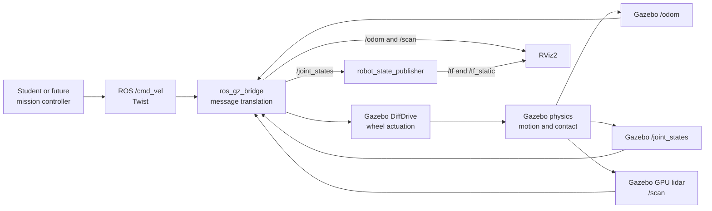
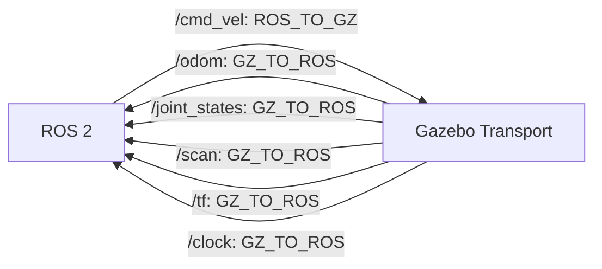

# Module 3 beginner guide — start here

Read this before the complete lesson or the detailed file reference.

Module 2 described what the rover **is**: links, joints, geometry, mass, and
coordinate frames. Module 3 describes what happens when that model enters a
simulated world: gravity acts, contacts occur, wheels are driven, lidar rays
intersect obstacles, and robot motion produces odometry.

Feeling confused here is normal. Module 3 joins three systems that have
different responsibilities:

1. ROS 2, where your future controller publishes commands and consumes data;
2. Gazebo Harmonic, where physics and sensor simulation occur;
3. `ros_gz_bridge`, which translates selected messages between them.

Do not try to memorize the XML, YAML, and launch syntax at once. First learn
which system owns each piece of information.

## 1. The one lesson to remember

> A simulator is another subsystem with its own communication network. A bridge
> deliberately connects only the ROS 2 topics required by the application.

The Module 3 data path is:



The bridge does not calculate physics. RViz2 does not drive the wheels. The
Xacro file does not publish velocity commands. Each part has one job.

## 2. Mechanical-engineering analogy

Think of Module 3 as a virtual test rig:

| Robotics software item | Test-engineering analogy |
|---|---|
| Xacro/URDF | Test article definition and mass-property sheet |
| SDF world | Test cell layout and fixtures |
| Gazebo physics | Simplified analytical test environment |
| DiffDrive system | Virtual motor/drive mechanism |
| GPU lidar | Virtual measurement instrument |
| `ros_gz_bridge` | Data-acquisition interface and signal conversion |
| `/cmd_vel` | Command input |
| `/odom`, `/scan` | Measured outputs |
| RViz2 | Engineering data display |
| Validation commands | Instrument and interface checkout |

As with a physical test, a plausible result does not prove that every model
assumption is correct. Simulation is useful because assumptions are explicit
and tests are repeatable, not because it perfectly represents reality.

## 3. What changed from Module 2

Module 2:

```text
joint_state_publisher_gui → wheel angle → robot_state_publisher → RViz2
```

Module 3:

```text
/cmd_vel → bridge → Gazebo DiffDrive → physics → wheel joint states
                                              → odometry
Gazebo lidar → bridge → /scan
joint states → robot_state_publisher → component TF
odometry TF → odom → base_footprint
```

The joint-state GUI is intentionally absent. Gazebo is now the authority for
wheel positions. Two programs should not compete to publish different versions
of the same physical state.

## 4. The five files to understand first

Read these in this order:

1. `config/bridge.yaml` — the signal wiring table;
2. `urdf/hazard_rover.gazebo.xacro` — simulated actuator and lidar;
3. `worlds/inspection_world.sdf` — floor, walls, route markers, and sensor
   support;
4. `launch/simulation.launch.py` — starts and connects everything;
5. `rviz/simulation.rviz` — chooses what engineering data to display.

Packaging files matter, but they can be read after the runtime flow makes
sense.

## 5. Essential vocabulary

### Gazebo Harmonic

The modern Gazebo release used by this course. Harmonic uses `gz sim` and
`ros_gz`; it is not Gazebo Classic.

### SDFormat or SDF

An XML format for complete simulation worlds and models. The world file
contains multiple static objects and simulation systems. URDF describes the
rover; SDF describes the test environment.

### Gazebo system plugin

A simulation component loaded by Gazebo. This module uses built-in systems for
physics, user commands, scene publication, rendering sensors, differential
drive, and joint-state publication.

### Bridge

A translator between a Gazebo Transport topic and a ROS 2 topic. A bridge entry
specifies two topic names, two message types, and a direction.

### `geometry_msgs/msg/Twist`

A body-velocity command. For this planar rover:

- `linear.x` requests forward/backward speed in m/s;
- `angular.z` requests yaw rate in rad/s;
- unused components remain zero.

It is not a wheel-speed message and it is not a target position.

### Odometry

An estimate of position, orientation, and velocity relative to `odom`. Here it
is simulated wheel-derived odometry from Gazebo's differential-drive system.
It is not GPS, ground truth, localization on a map, or SLAM.

### LaserScan

An ordered array of range measurements at known angles. A value represents the
distance from `laser_frame` to the first simulated surface hit by a ray.

### Simulation time

Gazebo publishes `/clock`. Nodes with `use_sim_time:=true` use this clock so
their timestamps remain synchronized with pausing and simulation speed.

## 6. Differential-drive idea

Let:

- \(v\) = requested forward velocity;
- \(\omega\) = requested yaw rate;
- \(L\) = distance between wheel centres;
- \(r\) = wheel radius.

The ideal left and right wheel linear velocities are:

\[
v_L = v - \frac{\omega L}{2},
\qquad
v_R = v + \frac{\omega L}{2}.
\]

Wheel angular velocities are:

\[
\dot{\phi}_L = \frac{v_L}{r},
\qquad
\dot{\phi}_R = \frac{v_R}{r}.
\]

For this rover, \(L=0.38\,\text{m}\) and \(r=0.09\,\text{m}\).

Before running, predict:

1. If \(v=0.20\) m/s and \(\omega=0\), do the wheels turn at equal or
   different speeds?
2. If \(v=0\) and \(\omega=0.60\) rad/s, which wheel moves backward?
3. If both command components are zero, what should happen to `/odom`?

Write the answers before testing.

## 7. Why the bridge directions matter



One-way connections make ownership explicit:

- command intent originates in ROS 2;
- simulated measurements and state originate in Gazebo.

A bidirectional bridge is unnecessary here and could make feedback loops or
competing publishers harder to diagnose.

## 8. Why the world is deliberately simple

The world uses primitive boxes and cylinders:

- a floor and four perimeter walls;
- two yellow barriers forming a 1.0 m-wide passage;
- a green starting area;
- two blue inspection markers;
- a red-orange visual hazard zone;
- one cabinet and one tank.

The hazard disk is only a marker. Module 4 will compute hazard level from the
robot's odometry using a mathematical function. This separation keeps physics
light and makes the hazard model independently testable.

## 9. What to observe, not merely whether it launches

During Module 3, look for causal evidence:

1. Publishing positive `linear.x` changes rover position in Gazebo.
2. `/odom` position changes consistently.
3. Orange wheel markers rotate, confirming changing joint angle.
4. `/joint_states` contains both wheel joint names.
5. `/scan` contains 360 ranges and obstacle distances change with pose.
6. RViz2 shows the rover moving relative to `odom`.
7. TF contains one connected chain from `odom` to sensor frames.
8. Stopping the command publisher stops continued command updates.

The goal is not merely a visually pleasing animation. The goal is to trace an
input through actuation, physics, measurement, translation, and visualization.

## 10. A first-pass reading strategy

### Read now

- the bridge directions;
- the names `/cmd_vel`, `/odom`, `/scan`, `/joint_states`, `/tf`, `/clock`;
- the DiffDrive wheel joint names, separation, and radius;
- the lidar update rate and range;
- the launch diagram;
- the difference between Gazebo and RViz2.

### Read after the first successful run

- every package dependency;
- `setup.py` installation paths;
- every world material color;
- launch substitution syntax;
- each RViz serialized property.

### Do not memorize

- complete SDF syntax;
- complete RViz configuration syntax;
- plugin filenames;
- every message field.

Instead, learn how to find, inspect, and verify them.

## 11. Signs that you understand Module 3

You are ready to continue when you can explain:

- why `/cmd_vel` travels ROS-to-Gazebo while `/scan` travels the other way;
- why `joint_state_publisher_gui` is removed from the simulation launch;
- how wheel radius and separation affect motion;
- why `odom` is not the same as a global map;
- why the lidar requires both a sensor tag on the robot and a Sensors system in
  the world;
- why every relevant ROS node uses simulation time;
- how to isolate whether a failure is in Gazebo, the bridge, TF, or RViz2.

You do not need to reproduce the files from memory. You should be able to read
them with a clear question in mind and predict the effect of a small change.

