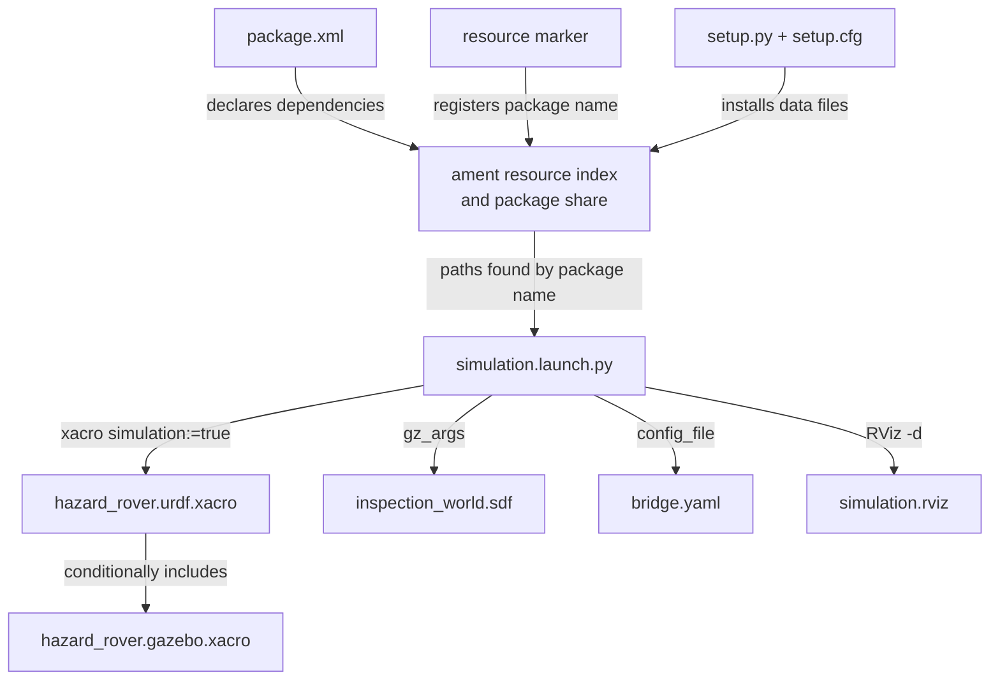
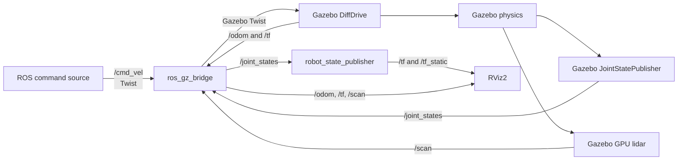
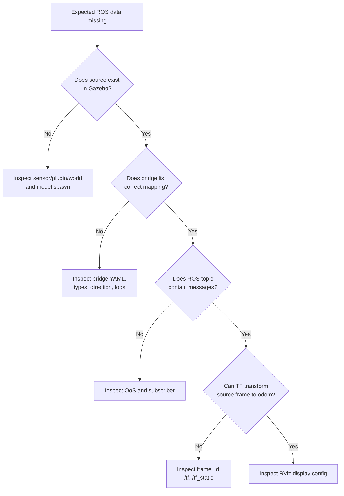

# Module 3 file-and-code guide

This reference explains why every Module 3 file exists, how it is discovered,
what its important code means, how it communicates, and how to test it
independently. Read the beginner guide and perform one successful launch before
trying to understand every detail here.

## 1. Module structure and communication chart

### Build-time and launch-time file flow



### Runtime data flow



### Who owns what?

| Information | Authoritative source | Why |
|---|---|---|
| Desired body velocity | ROS command publisher | application decides requested motion |
| Wheel response | Gazebo DiffDrive and physics | simulation applies actuation and contact |
| Wheel positions | Gazebo joint-state system | simulated mechanism owns physical state |
| Odometry | Gazebo DiffDrive | plugin integrates wheel motion |
| Lidar ranges | Gazebo sensor | rendering engine tests simulated rays |
| Fixed robot geometry | Xacro via robot state publisher | description defines link relationships |
| World geometry | SDF | simulation environment owns obstacles |
| Visualization | RViz2/Gazebo GUI | displays data but does not own physical state |

## 2. File purpose and discovery summary

| File | Why it exists | How it is discovered | Runtime inputs | Runtime outputs |
|---|---|---|---|---|
| `package.xml` | declares package metadata and dependencies | `colcon`, `rosdep`, ament | none | dependency/install contract |
| `setup.py` | installs Python package and non-code assets | `colcon` invokes setuptools | source files | package share and Python install |
| `setup.cfg` | selects ROS executable install directory | setuptools | setup context | script path policy |
| `resource/hazard_inspection_sim` | registers package in ament index | installed by `setup.py` | none | discoverable package name |
| `__init__.py` | marks Python import package | Python import system | none | package namespace |
| `bridge.yaml` | defines ROS↔Gazebo translations | launch passes absolute path | Gazebo/ROS messages | translated topics |
| `simulation.launch.py` | orchestrates Module 3 processes | `ros2 launch` searches package share | launch arguments | processes and parameters |
| `inspection_world.sdf` | defines the simulated test cell | launch passes path to `gz sim` | physics updates | contacts, scene, sensor support |
| `hazard_rover.gazebo.xacro` | adds actuation, sensing, friction | included by main Xacro | wheel dimensions | Gazebo tags in expanded URDF |
| `hazard_rover.urdf.xacro` modifications | selects display or simulation variant | Xacro command | `simulation` argument | expanded URDF |
| `simulation.rviz` | saves the expected engineering view | RViz2 receives `-d` path | TF, model, scan, odom | visualization window |

## 3. `package.xml`

### Why it exists

The manifest identifies the package to ROS tooling and declares runtime
dependencies. `rosdep` reads dependency keys from this file; `colcon` uses it
to determine package identity and build type.

### Header and identity

```xml
<package format="3">
  <name>hazard_inspection_sim</name>
  <version>0.1.0</version>
```

- `format="3"` selects package manifest schema version 3.
- `<name>` must match the package directory, `setup.py` name, resource marker,
  and launch command.
- `<version>` is project metadata, not the ROS distribution.

```xml
<maintainer email="maintainer@users.noreply.github.com">Hazard Inspection Rover Maintainer</maintainer>
<license>MIT</license>
```

The project-level no-reply maintainer avoids exposing a personal address. The
license must match the repository `LICENSE`.

### Build tool

```xml
<buildtool_depend>ament_python</buildtool_depend>
```

This tells `colcon` to build/install the package using ROS 2's Python packaging
workflow. It does not mean every current asset is Python code. The package is
prepared for the Module 4 hazard sensor node.

### Execution dependencies

```xml
<exec_depend>hazard_inspection_description</exec_depend>
<exec_depend>ros_gz_bridge</exec_depend>
<exec_depend>ros_gz_sim</exec_depend>
```

- the description package supplies the Xacro rover;
- `ros_gz_sim` starts Gazebo and provides the `create` executable;
- `ros_gz_bridge` translates topics.

Message dependencies such as `geometry_msgs`, `nav_msgs`, `sensor_msgs`,
`tf2_msgs`, and `rosgraph_msgs` document interface types used by the bridge.
Launch, RViz2, Xacro, and robot-state-publisher dependencies document processes
started by the launch file.

### Test dependencies

The `ament_*` linters and `pytest` support later package quality checks. Module
3 contains no authored algorithm requiring unit tests; integration behavior is
checked through the ROS CLI. Mathematical unit tests begin with Modules 4–6.

### Export

```xml
<export>
  <build_type>ament_python</build_type>
</export>
```

This confirms the build extension used by tooling.

### Independent tests

```bash
ros2 pkg xml hazard_inspection_sim
rosdep check --from-paths src/hazard_inspection_sim --ignore-src
```

### Predict before modifying

What error would you expect if `ros_gz_bridge` were removed from the manifest
on a computer where it was not already installed?

### Two intentional modifications

1. Verify the public maintainer identity with `ros2 pkg xml`.
2. Sort the execution dependencies alphabetically without changing their
   meaning; rebuild and confirm behavior is unchanged.

## 4. `setup.py`

### Why it exists

`setup.py` tells setuptools what Python package and data files to install.
ROS 2 runs launch files from the **install space**, not directly from `src`.

### Imports

```python
from glob import glob
from setuptools import find_packages, setup
```

- `glob('config/*.yaml')` obtains all matching authored files;
- `find_packages()` locates directories containing `__init__.py`;
- `setup()` describes installation metadata and files.

### Package name

```python
package_name = 'hazard_inspection_sim'
```

One variable reduces repeated spelling errors. It must match `package.xml`.

### Name, version, and Python packages

```python
name=package_name,
version='0.1.0',
packages=find_packages(exclude=['test']),
```

- `name` registers the distribution;
- `version` should match the manifest;
- `find_packages` installs `hazard_inspection_sim/__init__.py` and future
  modules, while excluding tests from runtime installation.

### `data_files`

```python
(
    'share/ament_index/resource_index/packages',
    [f'resource/{package_name}'],
),
```

This installs the marker into ament's package index. Without it,
`get_package_share_directory('hazard_inspection_sim')` cannot reliably find the
package.

```python
(f'share/{package_name}', ['package.xml']),
```

This installs the manifest in the package share directory.

```python
(f'share/{package_name}/config', glob('config/*.yaml')),
(f'share/{package_name}/launch', glob('launch/*.launch.py')),
(f'share/{package_name}/rviz', glob('rviz/*.rviz')),
(f'share/{package_name}/worlds', glob('worlds/*.sdf')),
```

Each source asset category is copied or symlinked into an equivalent installed
subdirectory. Adding a new resource directory requires adding an installation
rule.

### `install_requires`

```python
install_requires=['setuptools'],
```

This is a Python-package dependency list interpreted by setuptools. It is not
where ROS package dependencies belong; those remain in `package.xml`.
`setuptools` is required for installation machinery.

Do not put `rclpy`, `ros_gz_sim`, or Ubuntu apt package names here.

### `zip_safe`

```python
zip_safe=True,
```

This declares that the Python code itself can be imported from a zipped
distribution. ROS data files are separately installed into the share
directory, so the launch code accesses them as ordinary paths.

### Metadata

Maintainer, description, and license describe the Python distribution. Keep
them consistent with `package.xml`.

### `entry_points`

```python
entry_points={
    'console_scripts': [],
},
```

There is no authored Python executable in Module 3, so the list is empty.
Module 4 will add `hazard_sensor_node` here. Keeping the block makes that future
extension visible without inventing a placeholder executable.

### Independent test

After building:

```bash
ros2 pkg prefix --share hazard_inspection_sim
find "$(ros2 pkg prefix --share hazard_inspection_sim)" -maxdepth 2 -type f
```

Confirm config, launch, RViz, and world files are installed.

### Two intentional modifications

1. Add a temporary `worlds/README.md`; predict why the current `*.sdf` glob
   will not install it. Do not change the rule unless the file must be runtime
   data.
2. Temporarily remove the RViz `data_files` line, rebuild, and observe why the
   launch cannot find the installed config. Restore the line immediately.

## 5. `setup.cfg`

```ini
[develop]
script_dir=$base/lib/hazard_inspection_sim

[install]
install_scripts=$base/lib/hazard_inspection_sim
```

Python console scripts must be installed under `lib/<package>` so
`ros2 run <package> <executable>` can locate them. Module 3 has none, but Module
4 will. `[develop]` applies to development/symlink installation and `[install]`
to normal installation.

### Independent test

This file has no runtime process. Its behavior becomes observable once a
console script is added in Module 4.

### Two intentional modifications

1. Compare this file with Module 1's `setup.cfg`; explain why package names
   differ.
2. Do not change `$base`. Instead, locate the existing Module 1 executable
   under `install/hazard_inspection_control/lib/` to see the resulting layout.

## 6. Resource marker and `__init__.py`

### `resource/hazard_inspection_sim`

The zero-content file's **filename** is the data. Installed in the ament
resource index, it announces that a package named `hazard_inspection_sim`
exists.

Test:

```bash
python3 -c "from ament_index_python.packages import get_package_share_directory; print(get_package_share_directory('hazard_inspection_sim'))"
ros2 pkg prefix hazard_inspection_sim
```

Use the second command as the practical proof of discovery.

### `hazard_inspection_sim/__init__.py`

This marks the directory as an importable Python package and contains a package
docstring. Module 4 will place the hazard sensor module beside it.

Test:

```bash
python3 -c "import hazard_inspection_sim; print(hazard_inspection_sim.__doc__)"
```

Run after sourcing the workspace.

### Two intentional modifications for each

- Resource marker: compare its filename to the manifest; rename it on paper and
  predict package-discovery failure. Do not keep the rename.
- Resource marker: locate its installed copy after building.
- `__init__.py`: improve the docstring without adding side effects.
- `__init__.py`: explain why starting ROS nodes during package import would be
  a poor design.

## 7. `bridge.yaml`

### Why it exists

Gazebo Transport and ROS 2 are separate middleware systems with different
message definitions. This YAML file is an explicit translation table.

### Anatomy of one entry

```yaml
- ros_topic_name: /cmd_vel
  gz_topic_name: /cmd_vel
  ros_type_name: geometry_msgs/msg/Twist
  gz_type_name: gz.msgs.Twist
  direction: ROS_TO_GZ
```

- `ros_topic_name`: name visible through `ros2 topic`;
- `gz_topic_name`: name visible through `gz topic`;
- `ros_type_name`: ROS interface type;
- `gz_type_name`: Gazebo protobuf message type;
- `direction`: authority and flow.

The identical topic spelling does not mean it is one network. The bridge
connects two separate topics that happen to have the same name.

### Command bridge

`/cmd_vel` is `ROS_TO_GZ`: a student command or future mission controller
publishes a ROS `Twist`; DiffDrive subscribes to a Gazebo `Twist`.

### Odometry bridge

`/odom` maps:

```text
gz.msgs.Odometry → nav_msgs/msg/Odometry
```

It is one-way because Gazebo owns simulated wheel odometry.

### TF bridge

`/tf` maps:

```text
gz.msgs.Pose_V → tf2_msgs/msg/TFMessage
```

DiffDrive publishes `odom -> base_footprint`. Robot state publisher also writes
other transforms to the ROS `/tf` topic. Multiple publishers are valid when
they own different frame edges.

### Joint-state bridge

Gazebo's `gz.msgs.Model` includes joint states; the bridge converts it to
`sensor_msgs/msg/JointState`. Robot state publisher consumes the result.

### Scan bridge

`gz.msgs.LaserScan` becomes `sensor_msgs/msg/LaserScan`. Its frame is set to
`laser_frame` in the sensor definition.

### Clock bridge

`/clock` is one-way from simulation to ROS. Nodes using simulation time must
never publish another competing clock.

### Independent tests

Gazebo side:

```bash
gz topic -l
gz topic -i -t /scan
```

ROS side:

```bash
ros2 topic list -t
ros2 topic info /scan --verbose
```

### Predict before modifying

If `gz_topic_name` for scan became `/lidar` but the sensor still published
`/scan`, which network would still show data?

### Two intentional modifications

1. Rename only the ROS scan topic to `/training_scan`; verify Gazebo retains
   `/scan`, then restore it.
2. Set the scan bridge `lazy: true`, read the official meaning, and observe
   whether the Gazebo subscription is created only when an ROS subscriber such
   as RViz2 exists. Restore the simpler configuration unless documented.

## 8. `hazard_rover.gazebo.xacro`

### Why it exists

The base Xacro remains useful for non-simulation display. This separate file
contains only Gazebo-specific behavior: friction, lidar, drive actuation, and
joint-state publication.

### Macro boundary

```xml
<xacro:macro
  name="hazard_rover_gazebo"
  params="wheel_separation wheel_radius">
```

The main model passes physical dimensions into the macro. This avoids a second
independent wheel radius that could silently disagree with collision geometry.

### Friction

```xml
<gazebo reference="left_wheel_link">
  <mu1>1.0</mu1>
  <mu2>1.0</mu2>
</gazebo>
```

`reference` attaches Gazebo properties to an existing URDF link. The two wheel
friction coefficients support traction. They are simplified coefficients, not
measured tire data.

The caster uses `0.01` because it is a fixed sphere rather than a modeled swivel
caster. Low friction reduces artificial dragging. This is a declared
approximation.

### GPU lidar

```xml
<sensor name="inspection_lidar" type="gpu_lidar">
```

The modern Gazebo sensor type is `gpu_lidar`. It uses rendering to find
intersections.

```xml
<topic>/scan</topic>
<gz_frame_id>laser_frame</gz_frame_id>
<update_rate>10</update_rate>
```

- Gazebo output topic: `/scan`;
- measurement frame: `laser_frame`;
- nominal production rate: 10 Hz.

```xml
<samples>360</samples>
<min_angle>-${pi}</min_angle>
<max_angle>${pi}</max_angle>
```

This creates a full 360-degree planar scan with one-degree nominal spacing.

```xml
<min>0.12</min>
<max>8.0</max>
<resolution>0.01</resolution>
```

Measurements below 0.12 m or beyond 8 m lie outside configured range. Range
resolution is 1 cm in the idealized sensor.

```xml
<noise>
  <type>gaussian</type>
  <mean>0.0</mean>
  <stddev>0.005</stddev>
</noise>
```

This adds zero-mean Gaussian range noise with 5 mm standard deviation. It is a
simple generic model, not calibrated hardware noise.

### DiffDrive

```xml
<plugin
  filename="gz-sim-diff-drive-system"
  name="gz::sim::systems::DiffDrive">
```

`filename` identifies Gazebo's built-in shared-library plugin.
`name` identifies its registered system class.

```xml
<left_joint>left_wheel_joint</left_joint>
<right_joint>right_wheel_joint</right_joint>
```

Names must exactly match URDF joint names.

```xml
<wheel_separation>${wheel_separation}</wheel_separation>
<wheel_radius>${wheel_radius}</wheel_radius>
```

These values convert body velocity into joint velocity and integrate odometry.
A mismatch creates systematic motion error even if visualization looks correct.

```xml
<topic>/cmd_vel</topic>
<odom_topic>/odom</odom_topic>
<tf_topic>/tf</tf_topic>
<frame_id>odom</frame_id>
<child_frame_id>base_footprint</child_frame_id>
```

These tags align Gazebo's external interfaces with the bridge and TF contract.

Velocity and acceleration limits add a secondary simulation constraint:

```xml
<max_linear_velocity>0.50</max_linear_velocity>
<max_angular_velocity>1.50</max_angular_velocity>
```

The future mission controller will apply its own more conservative saturation.
Plugin limits do not replace application safety logic.

### JointStatePublisher

The plugin publishes the two named wheel joints on Gazebo topic
`/joint_states`. Fixed joints need no changing joint-state values.

### Independent tests

```bash
xacro src/hazard_inspection_description/urdf/hazard_rover.urdf.xacro \
  simulation:=true > /tmp/hazard_rover_sim.urdf
grep -E "DiffDrive|inspection_lidar|JointStatePublisher" \
  /tmp/hazard_rover_sim.urdf
```

Runtime:

```bash
gz topic -i -t /scan
gz topic -i -t /joint_states
```

### Predict before modifying

What happens to indicated travel if the plugin wheel radius is increased while
the physical wheel geometry is unchanged?

### Two intentional modifications

1. Change lidar samples from 360 to 180 and verify array length and display
   density; restore or document the decision.
2. Reduce `max_linear_velocity` to 0.10, command 0.30, measure approximate
   odometry response, then restore 0.50.

## 9. Changes to `hazard_rover.urdf.xacro`

### Simulation argument

```xml
<xacro:arg name="simulation" default="false"/>
<xacro:include filename="hazard_rover.gazebo.xacro"/>
```

The file containing the macro is always parsed, but the macro is called only
when `simulation` is true.

```xml
<xacro:if value="$(arg simulation)">
  <xacro:hazard_rover_gazebo
    wheel_separation="${2.0 * wheel_y_offset}"
    wheel_radius="${wheel_radius}"/>
</xacro:if>
```

The separation equals twice the positive centre offset:

```text
2 × (base_width/2 + wheel_width/2)
= base_width + wheel_width
= 0.34 + 0.04
= 0.38 m
```

### Visible wheel marker

The added orange box sits off the wheel axis. A black cylinder is symmetric
about its axle and therefore looks unchanged when rotated. The marker makes
rotation visually observable in Module 2 and Module 3 without changing
collision geometry or inertia.

This is a visualization aid, not a physical mass. It intentionally appears
only under `<visual>`.

### Independent tests

```bash
xacro src/hazard_inspection_description/urdf/hazard_rover.urdf.xacro \
  > /tmp/plain.urdf
xacro src/hazard_inspection_description/urdf/hazard_rover.urdf.xacro \
  simulation:=true > /tmp/sim.urdf
grep -c "gz-sim-diff-drive-system" /tmp/plain.urdf
grep -c "gz-sim-diff-drive-system" /tmp/sim.urdf
```

### Two intentional modifications

1. Change the orange marker color and verify only appearance changes.
2. Calculate wheel separation from the properties by hand, then find the
   expanded numeric value. Do not replace the expression with a magic number.

## 10. `inspection_world.sdf`

### Why it exists

URDF defines one robot. SDF defines a complete simulation world containing
systems, environment settings, static objects, and markers.

### Root and world name

```xml
<sdf version="1.10">
  <world name="inspection_world">
```

The world name is part of Gazebo service paths, including
`/world/inspection_world/create`. It must match `WORLD_NAME` in the launch file.

### Core systems

- `Physics`: advances dynamics and contacts;
- `UserCommands`: provides create/remove and other world services;
- `SceneBroadcaster`: sends scene state to the GUI;
- `Sensors`: updates rendering sensors using Ogre2.

Adding explicit systems prevents reliance on implicit defaults. The Sensors
system is necessary for the GPU lidar.

### Physics

```xml
<max_step_size>0.001</max_step_size>
<real_time_factor>1.0</real_time_factor>
<real_time_update_rate>1000</real_time_update_rate>
```

The target step is 1 ms and target real-time factor is 1. Laptop load may cause
actual real-time factor to fall below 1. These values are not evidence of
achieved performance until measured.

### Static objects

Each wall uses:

```xml
<model>
  <static>true</static>
  <link>
    <collision>...</collision>
    <visual>...</visual>
  </link>
</model>
```

`static=true` prevents dynamics integration. Collision affects robot and lidar;
visual affects rendering.

### Narrow passage

Barrier centrelines are y = -0.95 and -2.05 m. Each is 0.10 m thick:

```text
north inner face = -1.00 m
south inner face = -2.00 m
clear width = 1.00 m
```

The rover's approximate outside width is 0.42 m, leaving about 0.29 m nominal
clearance per side when centered.

### Route markers

Start, station, and hazard markers have visual geometry but no collision. They
communicate intent without becoming bumps or obstacles.

The hazard zone's comment states the critical architectural truth: Module 4
will compute hazard mathematically from odometry. Red color alone produces no
measurement.

### Independent tests

World only:

```bash
gz sim -v 3 \
  "$(ros2 pkg prefix --share hazard_inspection_sim)/worlds/inspection_world.sdf"
```

This does run Gazebo, so it is a student command. It loads the environment
without spawning the rover through the ROS launch.

Inspect service:

```bash
gz service -l | grep /world/inspection_world/create
```

### Predict before modifying

If a route marker receives a collision element 0.05 m tall, what physical
symptom might appear as the rover crosses it?

### Two intentional modifications

1. Move the cabinet by 0.5 m and predict the changed lidar pattern.
2. Change passage width by moving one barrier 0.10 m; calculate clearance
   before testing and preserve a feasible route.

## 11. `simulation.launch.py`

### Why it exists

One command should reliably start all Module 3 processes with consistent file
paths, model text, clock selection, and optional GUIs.

### Imports

`Path` joins installed paths. `get_package_share_directory` resolves packages
through ament. Launch actions declare arguments, include Gazebo's launch, delay
spawning, and start ROS nodes. `Command` runs Xacro at launch time.

### Constants

```python
DESCRIPTION_PACKAGE = 'hazard_inspection_description'
SIM_PACKAGE = 'hazard_inspection_sim'
WORLD_NAME = 'inspection_world'
ROBOT_NAME = 'hazard_inspection_rover'
```

These make cross-file naming contracts visible and reduce spelling mistakes.

### Installed resource lookup

```python
sim_share = Path(get_package_share_directory(SIM_PACKAGE))
default_world = sim_share / 'worlds' / 'inspection_world.sdf'
```

The launch file never assumes the current working directory. It uses installed
package paths, so it works from any terminal directory after sourcing.

### Launch arguments

- `gui`: controls Gazebo GUI;
- `rviz`: controls RViz2;
- `model`: allows a compatible Xacro override;
- `world`: allows another SDF world;
- `use_sim_time`: defaults true.

Values are `LaunchConfiguration` substitutions resolved when the launch runs,
not ordinary Python booleans at file-import time.

### Xacro command

```python
Command(['xacro "', model, '" simulation:=true'])
```

This expands the model with Gazebo additions. Quotes defensively protect a
model path containing spaces. `ParameterValue(..., value_type=str)` prevents
the generated XML from being interpreted as another parameter type. The main
workspace should nevertheless use a path without spaces because Humble custom
interface generation is less tolerant than this Xacro command.

### Robot state publisher

It receives:

- expanded `robot_description`;
- `use_sim_time`.

It consumes bridged `/joint_states` and publishes fixed/component TF. It does
not calculate `odom -> base_footprint`; DiffDrive owns that edge.

### Gazebo include

The launch includes `ros_gz_sim`'s `gz_sim.launch.py`.

- `-r` starts the simulation running;
- `-v 3` selects informational verbosity;
- `-s` in headless mode starts server only.

Two mutually exclusive include actions use `IfCondition(gui)` and
`UnlessCondition(gui)`.

### Bridge node

```python
arguments=[
    '--ros-args',
    '-p',
    f'config_file:={bridge_config}',
],
```

This passes the installed YAML path as a ROS parameter to
`parameter_bridge`. The launch does not duplicate topic mappings in Python.

### Spawn timer

```python
TimerAction(period=3.0, actions=[...])
```

Gazebo must create the world's entity-creation service before the `create`
executable calls it. The delay is pragmatic startup sequencing, not a guarantee
for every computer. A service/event-driven lifecycle would be more robust but
would add complexity beyond this course stage.

The `create` arguments specify:

- world `inspection_world`;
- entity name `hazard_inspection_rover`;
- model text source topic `robot_description`;
- initial pose `(-4.0, -2.5, 0.03, yaw 0)`.

The 0.03 m height lets physics settle the rover onto the floor without starting
with deeply interpenetrating collision geometry.

### RViz2

RViz2 loads the installed configuration and simulation time. `IfCondition`
allows it to be disabled without changing physics or communication.

### Independent tests

Inspect arguments:

```bash
ros2 launch hazard_inspection_sim simulation.launch.py --show-args
```

Headless integration:

```bash
ros2 launch hazard_inspection_sim simulation.launch.py \
  gui:=false rviz:=false
```

### Predict before modifying

If `use_sim_time` becomes false only for RViz2, what timestamp/TF symptom might
appear when Gazebo is paused or slower than wall time?

### Two intentional modifications

1. Launch with each of the four GUI combinations and identify which processes
   remain.
2. Change spawn yaw to approximately `1.5708` rad, predict the direction of a
   positive forward command, test, then restore zero for the planned route.

## 12. `simulation.rviz`

### Why it exists

RViz configuration is saved application state. Versioning it gives every run a
repeatable engineering view without manual display setup.

### Fixed frame

```yaml
Fixed Frame: odom
```

Module 2 used `base_footprint` because the rover had no world-relative pose.
Module 3 uses `odom`, so robot motion is visible relative to a stationary local
frame.

### RobotModel

The display reads `/robot_description` with transient-local durability. TF
determines each link pose.

### LaserScan

The display subscribes to `/scan` using best-effort reliability, a common
sensor-data policy. It draws points in orange-red. It needs a TF path from
`laser_frame` to `odom`.

### Odometry

The display retains pose axes, making direction and traveled pose visible. It
does not create odometry.

### TF

Axes, arrows, and names expose frame ownership and connectivity. Disable names
temporarily if the display is cluttered.

### Independent tests

Run RViz2 against an already-running headless simulation:

```bash
rviz2 -d \
  "$(ros2 pkg prefix --share hazard_inspection_sim)/rviz/simulation.rviz" \
  --ros-args -p use_sim_time:=true
```

### Predict before modifying

What happens to the rover display if Fixed Frame changes from `odom` to a
nonexistent `map`?

### Two intentional modifications

1. Change scan point size in the RViz GUI, save the config deliberately, and
   inspect the diff before committing.
2. Toggle collision geometry for the RobotModel and explain why it overlaps
   visual primitives for this simplified rover.

## 13. Message-level meaning

### `/cmd_vel`

Only these fields are used:

```yaml
linear:
  x: forward_speed_m_per_s
angular:
  z: yaw_rate_rad_per_s
```

This is a request, not proof of achieved motion. Compare it with odometry.

### `/odom`

Important fields:

```text
header.stamp                  simulation timestamp
header.frame_id               odom
child_frame_id                base_footprint
pose.pose.position            estimated x, y, z
pose.pose.orientation         quaternion
twist.twist.linear.x          estimated body forward velocity
twist.twist.angular.z         estimated yaw rate
```

### `/joint_states`

Arrays correspond by index:

```text
name[i]
position[i]
velocity[i]
effort[i]
```

Do not assume a fixed joint ordering without checking `name`.

### `/scan`

Important fields:

```text
header.frame_id     laser_frame
angle_min/max       scan limits
angle_increment     angular spacing
range_min/max       valid sensor bounds
ranges              ordered measurements
```

Index \(i\) corresponds approximately to:

\[
\theta_i = \text{angle\_min} + i\,\text{angle\_increment}.
\]

## 14. End-to-end debugging decision tree



This prevents replacing the entire project when one interface is misnamed.

## 15. What Module 3 proves—and does not prove

It proves, after the student records successful evidence:

- a ROS command can cross into Gazebo;
- built-in differential-drive actuation moves the simulated model;
- odometry, wheel states, and lidar can cross back into ROS;
- TF and RViz2 can present a connected moving robot;
- headless simulation can preserve interfaces.

It does not prove:

- accurate physical tire/contact behavior;
- calibrated inertial or sensor parameters;
- collision avoidance;
- waypoint following;
- hazard detection;
- global localization or SLAM;
- production or safety readiness.

That distinction is part of technically honest portfolio communication.

## 16. Compact Module 3 mental model

```text
package.xml
    declares required ROS packages

setup.py
    installs world, launch, bridge, and RViz resources

Xacro
    describes rover and conditionally adds Gazebo systems

SDF
    describes the industrial test world and sensor-support systems

bridge.yaml
    declares typed, directional transport translations

simulation.launch.py
    locates installed files and starts the integrated system

Gazebo
    computes simplified physics, wheel state, odometry, and lidar

robot_state_publisher
    converts model + joint state into component transforms

RViz2
    visualizes ROS model, TF, odometry, and scan
```

If you can trace a `Twist` command to wheel motion and trace a lidar ray back to
an RViz2 point—while naming the file and process at each boundary—you have
understood Module 3.
