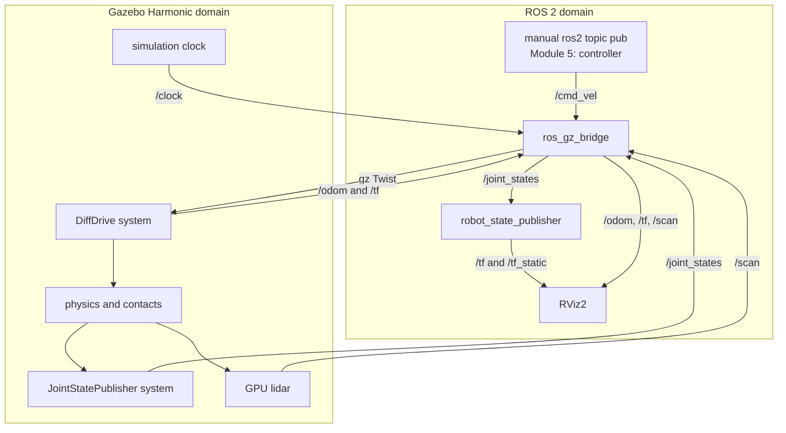

# Module 3 — Gazebo Harmonic simulation, drive control, odometry, and lidar

Estimated beginner time: **4–5 hours**

Complete this module only after the Module 2 Xacro model and TF tree work. This
lesson adds simulation and manual velocity testing. It does not yet add the
hazard function or mission controller.

## 1. Learning objectives

By the end of Module 3, you should be able to:

- distinguish Gazebo, ROS 2, `ros_gz_bridge`, and RViz2 responsibilities;
- explain why URDF/Xacro and SDF are both used;
- spawn the Xacro rover in a Gazebo Harmonic world;
- send a planar `Twist` velocity command;
- interpret simulated wheel joint states and odometry;
- inspect a simulated 2D lidar scan;
- explain the `odom -> base_footprint -> base_link` TF chain;
- use simulation time consistently;
- isolate failures by checking Gazebo topics before ROS topics;
- state the simplifying assumptions and limitations honestly.

## 2. Concepts introduced

- modern Gazebo Harmonic and SDFormat;
- simulation system plugins;
- differential-drive kinematics;
- Gazebo Transport versus ROS 2 topics;
- directional bridge configuration;
- simulated odometry and laser scan;
- simulation clock;
- launch-time model spawning;
- headless simulation;
- interface-level validation.

## 3. Files created or modified

```text
hazard_inspection_ws/
├── docs/
│   ├── module_03_beginner_start_here.md
│   ├── module_03_file_and_code_guide.md
│   └── module_03_gazebo_simulation.md
└── src/
    ├── hazard_inspection_description/
    │   └── urdf/
    │       ├── hazard_rover.gazebo.xacro          new
    │       └── hazard_rover.urdf.xacro            modified
    └── hazard_inspection_sim/
        ├── package.xml
        ├── setup.cfg
        ├── setup.py
        ├── resource/
        │   └── hazard_inspection_sim
        ├── hazard_inspection_sim/
        │   └── __init__.py
        ├── config/
        │   └── bridge.yaml
        ├── launch/
        │   └── simulation.launch.py
        ├── rviz/
        │   └── simulation.rviz
        └── worlds/
            └── inspection_world.sdf
```

No `hazard_sensor_node.py` is added yet. That node belongs to Module 4.

## 4. Runtime architecture



## 5. Before installation: verify the selected platform

Run these commands in the Ubuntu 22.04 WSL terminal, not PowerShell:

```bash
grep -E '^(PRETTY_NAME|VERSION_ID|UBUNTU_CODENAME)=' /etc/os-release
source /opt/ros/humble/setup.bash
printenv ROS_DISTRO
python3 --version
```

Expected:

```text
PRETTY_NAME="Ubuntu 22.04.5 LTS"
VERSION_ID="22.04"
UBUNTU_CODENAME=jammy
humble
Python 3.10.x
```

Stop if the active distribution is Ubuntu 24.04. Do not mix Jammy ROS Humble
packages with Noble.

## 6. Install Gazebo Harmonic and integration packages

ROS 2 Humble's default Gazebo pairing is Fortress. This project intentionally
uses Harmonic through the OSRF repository and the non-default package
`ros-humble-ros-gzharmonic`.

If you already installed these packages while following the root README, use
the verification commands and do not reinstall them.

```bash
sudo apt-get update
sudo apt-get install -y curl lsb-release gnupg
sudo curl https://packages.osrfoundation.org/gazebo.gpg \
  --output /usr/share/keyrings/pkgs-osrf-archive-keyring.gpg
echo "deb [arch=$(dpkg --print-architecture) signed-by=/usr/share/keyrings/pkgs-osrf-archive-keyring.gpg] https://packages.osrfoundation.org/gazebo/ubuntu-stable $(lsb_release -cs) main" \
  | sudo tee /etc/apt/sources.list.d/gazebo-stable.list > /dev/null
sudo apt-get update
sudo apt-get install -y gz-harmonic ros-humble-ros-gzharmonic
```

Do not additionally install `ros-humble-ros-gz`; that package selects Humble's
default Fortress integration and may conflict with the Harmonic packages.

Verify:

```bash
gz sim --versions
ros2 pkg prefix ros_gz_sim
ros2 pkg prefix ros_gz_bridge
ros2 pkg executables ros_gz_sim
```

Expected key evidence:

- Gazebo Sim version `8.x` appears;
- both package-prefix commands return installed paths;
- the executable list includes `ros_gz_sim create`.

## 7. Install remaining project dependencies

From the workspace root:

```bash
cd ~/path/to/hazard_inspection_ws
source /opt/ros/humble/setup.bash
rosdep install --from-paths src --ignore-src -r -y
```

Replace `~/path/to` with your real WSL path. If the repository is on the
Windows-mounted filesystem, it may resemble:

```bash
cd ~/ros2_projects/hazard_inspection_ws
```

Quotation marks are required because the path contains a space.

## 8. Predict before building

Write short answers:

1. Which file tells Gazebo the wheel radius?
2. Which file tells the bridge that `/cmd_vel` travels ROS-to-Gazebo?
3. Which component publishes the two wheel positions?
4. Which program converts wheel joint states into wheel TF?
5. If RViz2 is closed, should Gazebo physics continue?
6. If the bridge is stopped, should the rover still exist in Gazebo?
7. Why is the hazard zone presently only a colored marker?

Keep the answers. Revisit them after verification.

## 9. Build Module 3

```bash
cd ~/path/to/hazard_inspection_ws
source /opt/ros/humble/setup.bash
colcon build --symlink-install --packages-up-to hazard_inspection_sim
source install/setup.bash
```

Expected build summary resembles:

```text
Starting >>> hazard_inspection_description
Finished <<< hazard_inspection_description [...]
Starting >>> hazard_inspection_sim
Finished <<< hazard_inspection_sim [...]

Summary: 2 packages finished [...]
```

Package ordering may vary if other packages also require rebuilding. Warnings
are not automatically failures; read the final summary and any error block.

## 10. Static checks before launching

These do not run Gazebo. They confirm installed resources and Xacro expansion.

```bash
ros2 pkg prefix hazard_inspection_description
ros2 pkg prefix hazard_inspection_sim
ros2 pkg executables hazard_inspection_sim
```

The last command may print nothing because Module 3's simulation package has no
authored Python node yet. That is expected. Its launch and data files are found
through the package share directory.

Expand the plain Module 2 model:

```bash
xacro src/hazard_inspection_description/urdf/hazard_rover.urdf.xacro \
  > /tmp/hazard_rover_module2.urdf
check_urdf /tmp/hazard_rover_module2.urdf
```

Expand the simulation model:

```bash
xacro src/hazard_inspection_description/urdf/hazard_rover.urdf.xacro \
  simulation:=true > /tmp/hazard_rover_sim.urdf
check_urdf /tmp/hazard_rover_sim.urdf
```

Confirm that Gazebo additions are conditional:

```bash
grep -c "gz-sim-diff-drive-system" /tmp/hazard_rover_module2.urdf
grep -c "gz-sim-diff-drive-system" /tmp/hazard_rover_sim.urdf
grep -c "inspection_lidar" /tmp/hazard_rover_sim.urdf
```

Expected:

```text
0
1
1
```

This proves the display model remains free of simulation systems while the
simulation expansion contains them.

## 11. Launch the Module 3 system

Terminal 1:

```bash
cd ~/path/to/hazard_inspection_ws
source /opt/ros/humble/setup.bash
source install/setup.bash
ros2 launch hazard_inspection_sim simulation.launch.py
```

The launch should:

1. start `robot_state_publisher`;
2. start Gazebo Harmonic with `inspection_world.sdf`;
3. start the ROS-Gazebo bridge;
4. wait three seconds;
5. spawn `hazard_inspection_rover` at `(-4.0, -2.5, 0.03)`;
6. start RViz2.

Expected terminal messages vary by installed patch version. Look for evidence
similar to:

```text
[robot_state_publisher-...] got segment base_link
[parameter_bridge-...] process started
[create-...] Requested creation of entity
[create-...] Created entity [hazard_inspection_rover]
[rviz2-...] process started
```

Exact process numbers, timestamps, and wording are not validation criteria.

### Expected Gazebo view

- gray floor and perimeter walls;
- green square under the starting position;
- yellow narrow-passage barriers;
- two blue circular inspection markers;
- a red-orange hazard disk at the second station;
- a blue rover with dark wheels and orange rotation markers;
- lidar rays if Gazebo sensor visualization is enabled.

### Expected RViz2 view

- fixed frame `odom`;
- rover model;
- TF axes and names;
- orange-red laser scan points;
- odometry axes as the rover moves.

The Gazebo world objects do not automatically appear in RViz2. RViz2 displays
ROS data, not the complete Gazebo scene.

## 12. Inspect the ROS graph

Keep the launch running. Open Terminal 2:

```bash
source /opt/ros/humble/setup.bash
cd ~/path/to/hazard_inspection_ws
source install/setup.bash
ros2 node list
ros2 topic list -t
```

Expected persistent ROS nodes include:

```text
/robot_state_publisher
/ros_gz_bridge
/rviz2
```

The spawn node exits after creating the robot, so it may not appear later.
Gazebo itself communicates primarily through Gazebo Transport and therefore is
not expected to appear as an ordinary ROS node.

Expected important ROS topics:

| Topic | ROS type | Direction | Meaning |
|---|---|---|---|
| `/cmd_vel` | `geometry_msgs/msg/Twist` | ROS → Gazebo | planar velocity request |
| `/odom` | `nav_msgs/msg/Odometry` | Gazebo → ROS | wheel-derived pose and velocity |
| `/joint_states` | `sensor_msgs/msg/JointState` | Gazebo → ROS | simulated wheel states |
| `/scan` | `sensor_msgs/msg/LaserScan` | Gazebo → ROS | simulated ranges |
| `/tf` | `tf2_msgs/msg/TFMessage` | mixed publishers | moving transforms |
| `/tf_static` | `tf2_msgs/msg/TFMessage` | ROS | fixed robot transforms |
| `/clock` | `rosgraph_msgs/msg/Clock` | Gazebo → ROS | simulation time |
| `/robot_description` | `std_msgs/msg/String` | ROS | expanded robot model |

## 13. Verify data without moving

```bash
ros2 topic echo /joint_states --once
ros2 topic echo /odom --once
ros2 topic echo /scan --once --field range_min
ros2 topic echo /scan --once --field range_max
ros2 topic hz /scan
```

Press `Ctrl+C` after the frequency estimate stabilizes.

Expected:

- joint names include `left_wheel_joint` and `right_wheel_joint`;
- odometry frames are `odom` and `base_footprint`;
- lidar minimum is approximately `0.12`;
- lidar maximum is approximately `8.0`;
- `/scan` rate is near 10 Hz, depending on laptop load.

Count ranges:

```bash
ros2 topic echo /scan --once --field ranges
```

This produces a long list. The configured horizontal scan has 360 samples.

## 14. Verify Gazebo-side topics

The bridge can only translate data that exists on the Gazebo side:

```bash
gz topic -l | grep -E '(/cmd_vel|/odom|/joint_states|/scan|/clock|/tf)$'
gz topic -i -t /scan
```

If `/scan` exists here but not in `ros2 topic list`, investigate the bridge. If
it is missing here, investigate the sensor, model spawn, or world Sensors
system. This two-layer check is one of Module 3's most useful debugging habits.

## 15. Verify TF

```bash
ros2 run tf2_ros tf2_echo odom base_footprint
```

Expected: a continuously updated transform with small initial settling changes.
Stop with `Ctrl+C`.

Then:

```bash
ros2 run tf2_ros tf2_echo odom laser_frame
```

This query crosses two publishers:

```text
Gazebo DiffDrive/bridge:
odom → base_footprint

robot_state_publisher:
base_footprint → base_link → laser_frame
```

Generate the frame graph:

```bash
cd /tmp
ros2 run tf2_tools view_frames
```

Open the generated PDF from VS Code or your file browser. The connected chain
should include:

```text
odom
└── base_footprint
    └── base_link
        ├── left_wheel_link
        ├── right_wheel_link
        ├── caster_link
        ├── laser_frame
        └── sensor_frame
```

## 16. Manual forward-motion test

### Predict first

For `linear.x = 0.20` m/s and `angular.z = 0`:

- should the rover translate, rotate, or both?
- should wheel angular speeds be equal?
- approximate wheel speed:

\[
\dot{\phi} = \frac{0.20}{0.09} \approx 2.22\ \text{rad/s}.
\]

### Run

Terminal 2:

```bash
ros2 topic pub --rate 10 /cmd_vel geometry_msgs/msg/Twist \
  "{linear: {x: 0.20}, angular: {z: 0.0}}"
```

Allow movement for approximately three seconds, then press `Ctrl+C`.
Immediately send an explicit stop:

```bash
ros2 topic pub --once /cmd_vel geometry_msgs/msg/Twist \
  "{linear: {x: 0.0}, angular: {z: 0.0}}"
```

Expected behavior:

- rover moves along its positive x direction;
- orange wheel markers visibly rotate;
- `/odom.pose.pose.position.x` changes;
- scan points change as the rover approaches different surfaces.

Do not leave an unattended continuous command publisher running.

## 17. Manual rotation test

### Predict first

For `linear.x = 0` and `angular.z = 0.60` rad/s:

\[
v_L = -0.60(0.38)/2 = -0.114\ \text{m/s},
\]

\[
v_R = +0.114\ \text{m/s}.
\]

The wheels should rotate in opposite directions and the rover should turn
counterclockwise when viewed from above.

### Run

```bash
ros2 topic pub --rate 10 /cmd_vel geometry_msgs/msg/Twist \
  "{linear: {x: 0.0}, angular: {z: 0.60}}"
```

After approximately two seconds, press `Ctrl+C`, then:

```bash
ros2 topic pub --once /cmd_vel geometry_msgs/msg/Twist \
  "{linear: {x: 0.0}, angular: {z: 0.0}}"
```

Verify:

```bash
ros2 topic echo /odom --once
ros2 topic echo /joint_states --once
```

Expect a changed orientation and wheel velocities/positions consistent with
opposite-direction motion.

## 18. Frequency and ownership checks

```bash
ros2 topic hz /odom
ros2 topic hz /joint_states
ros2 topic hz /clock
```

Check one interface in detail:

```bash
ros2 topic info /scan --verbose
ros2 topic info /cmd_vel --verbose
```

The bridge should publish `/scan` and subscribe to `/cmd_vel`. The manual
publisher is present only while its command is running.

## 19. Headless test

Stop the main launch with `Ctrl+C`. Then:

```bash
ros2 launch hazard_inspection_sim simulation.launch.py \
  gui:=false rviz:=false
```

In a second terminal:

```bash
ros2 topic echo /odom --once
ros2 topic echo /scan --once --field range_min
```

This verifies that physics and sensing do not require visualization windows.
Headless mode is useful for future automated integration tests and for
diagnosing WSL rendering problems.

## 20. Expected behavior summary

| Action | Expected observation |
|---|---|
| Launch | world loads; rover spawns at green start marker |
| No command | rover remains approximately stationary after settling |
| Positive `linear.x` | both wheels turn; x-position changes |
| Positive `angular.z`, zero linear | wheels oppose; yaw changes |
| Inspect `/scan` | finite returns use 0.12–8.0 m; no-hit rays may be infinite |
| Inspect `/odom` | frames are `odom` and `base_footprint` |
| Inspect TF | one connected chain reaches `laser_frame` |
| `gui:=false rviz:=false` | topics continue without visualization |

## 21. Common errors and troubleshooting

### `Package 'ros_gz_sim' not found`

Cause: Harmonic ROS integration is absent or the ROS environment is not sourced.

Check:

```bash
source /opt/ros/humble/setup.bash
apt-cache policy ros-humble-ros-gzharmonic
ros2 pkg prefix ros_gz_sim
```

Install `ros-humble-ros-gzharmonic`, not the default
`ros-humble-ros-gz`, then open a new terminal.

### `gz: command not found`

Cause: Gazebo Harmonic metapackage is absent.

```bash
apt-cache policy gz-harmonic
```

Repeat only the Gazebo repository and installation section.

### Gazebo launches but the robot does not appear

Look in the launch terminal for the `create` process result.

```bash
gz service -l | grep /world/inspection_world/create
ros2 topic echo /robot_description --once
```

If the world create service starts slowly on the laptop, change the spawn
timer in `simulation.launch.py` from `3.0` to `5.0`, rebuild, and relaunch. Do
not change unrelated files.

### `Failed to load system plugin`

Check:

```bash
gz sim --versions
```

Harmonic uses Gazebo Sim 8.x and plugin filenames beginning `gz-sim-...`.
Mixed Fortress/Harmonic packages are a common cause. Do not set legacy
`GAZEBO_PLUGIN_PATH`; that belongs to Gazebo Classic.

### Rover appears but `/cmd_vel` does nothing

Check both networks:

```bash
ros2 topic info /cmd_vel --verbose
gz topic -i -t /cmd_vel
```

Then verify exact joint names in the expanded simulation URDF:

```bash
grep -E "left_joint|right_joint" /tmp/hazard_rover_sim.urdf
```

The plugin names must match `left_wheel_joint` and `right_wheel_joint`.

### `/scan` is absent

```bash
gz topic -l | grep /scan
ros2 topic list -t | grep /scan
```

- absent in Gazebo: inspect robot spawn, `inspection_lidar`, and the world's
  Sensors system;
- present in Gazebo but absent in ROS: inspect `bridge.yaml` and bridge logs;
- present in ROS but red in RViz2: inspect `header.frame_id` and TF to
  `laser_frame`.

### RViz2 says `Fixed Frame [odom] does not exist`

Check:

```bash
gz topic -l | grep /tf
ros2 topic echo /tf --once
ros2 run tf2_ros tf2_echo odom base_footprint
```

The DiffDrive system must publish `/tf`, and the bridge must translate
`gz.msgs.Pose_V` to `tf2_msgs/msg/TFMessage`.

### Wheels move but are hard to see rotating

The wheel cylinder is rotationally symmetric. Look at the small orange marker,
not the black cylinder outline. Confirm numerically:

```bash
ros2 topic echo /joint_states --once
```

This directly addresses the visualization ambiguity found in Module 2.

### Gazebo or RViz2 window does not open under WSL2

In WSL:

```bash
echo $DISPLAY
echo $WAYLAND_DISPLAY
```

At least the WSLg display environment should be available. From Windows
PowerShell, update WSL if necessary:

```powershell
wsl --update
wsl --shutdown
```

Then reopen Ubuntu. Test headless operation first:

```bash
ros2 launch hazard_inspection_sim simulation.launch.py \
  gui:=false rviz:=false
```

If software rendering is needed for diagnosis:

```bash
export LIBGL_ALWAYS_SOFTWARE=1
ros2 launch hazard_inspection_sim simulation.launch.py
```

Software rendering is slower; do not make it permanent unless required.

### Rover shakes or drifts slightly at startup

A small settling motion is normal because the model spawns 0.03 m above its
nominal contact position. Persistent motion is not normal. Inspect wheel and
caster contacts, inertia, and whether a command publisher is still running.

### `check_urdf` passes but Gazebo fails

`check_urdf` validates the URDF tree. It does not validate all Gazebo plugin
parameters, bridge types, world systems, or rendering. Use layered checks:

```text
Xacro expansion
→ URDF parsing
→ world load
→ model spawn
→ Gazebo topics
→ ROS bridge topics
→ TF
→ RViz2
```

## 22. Student exercises

### Exercise A — verify differential-drive math

Use \(v=0.15\) m/s, \(\omega=0.40\) rad/s, \(L=0.38\) m, and \(r=0.09\) m.
Calculate both wheel angular velocities before commanding the rover. Publish the
command and compare the signs and relative magnitudes with `/joint_states`.

Do not expect exact equality because message timing and physics differ from the
instantaneous ideal calculation.

### Exercise B — change lidar resolution

Predict what changes if:

```xml
<samples>360</samples>
```

becomes:

```xml
<samples>180</samples>
```

Modify `hazard_rover.gazebo.xacro`, rebuild, relaunch, and count or inspect the
range array. Explain the tradeoff between angular resolution and computation.
Restore 360 afterward unless you prefer and document the new design choice.

### Exercise C — change a barrier

Move one passage barrier by 0.10 m in y. Before running, calculate the new clear
passage width and compare it with the rover's approximate 0.42 m overall width.
Use the lidar display to observe the geometry change. Do not create an
unpassable route for later modules.

### Exercise D — bridge-direction reasoning

For each Module 3 topic, write:

```text
authoritative producer → transport boundary → consumer
```

Then explain why changing all entries to `BIDIRECTIONAL` would weaken interface
ownership.

## 23. Debugging tasks

Perform at least one intentionally:

1. Set the RViz2 fixed frame temporarily to a nonexistent name. Observe the
   error, restore `odom`, and explain why sensor data cannot be transformed.
2. Launch with `rviz:=false`. Prove `/scan` and `/odom` still exist.
3. Temporarily rename the ROS side of `/scan` in `bridge.yaml` to
   `/training_scan`. Verify Gazebo still publishes `/scan`, ROS publishes the
   renamed topic, then restore it.

Change only one variable at a time. Record the symptom, hypothesis, test, and
smallest correction.

## 24. Evidence to capture

Save:

- one Gazebo screenshot showing the world and rover;
- one RViz2 screenshot showing robot, TF, and laser scan;
- `ros2 topic list -t` output;
- one `/odom` message after movement;
- one `/joint_states` message during a turn;
- lidar rate from `ros2 topic hz /scan`;
- TF graph PDF or screenshot;
- your forward and rotation predictions and whether results matched;
- one troubleshooting note, even if it records a successful headless check.

Do not claim exact performance before measuring it on your laptop.

## 25. Completion checklist

- [ ] Gazebo reports Sim 8.x.
- [ ] `hazard_inspection_sim` builds successfully.
- [ ] Plain and simulation Xacro variants both pass `check_urdf`.
- [ ] DiffDrive and lidar appear only in the simulation expansion.
- [ ] Gazebo loads the industrial inspection world.
- [ ] Rover spawns on the green starting area.
- [ ] `/cmd_vel` causes expected forward and rotational motion.
- [ ] Orange wheel markers rotate and `/joint_states` changes.
- [ ] `/odom` publishes with `odom` and `base_footprint` frames.
- [ ] `/scan` publishes near 10 Hz with 360 ranges.
- [ ] TF connects `odom` through `base_footprint` to `laser_frame`.
- [ ] RViz2 shows robot, TF, odometry, and laser scan.
- [ ] Headless launch still produces odometry and scan data.
- [ ] At least one intentional modification or debugging task is completed.
- [ ] Evidence is saved with factual notes.

## 26. Questions to answer before Module 4

1. Why are SDF and Xacro both useful in this project?
2. Which side is authoritative for `/joint_states` in Module 3?
3. What does the bridge translate, and what does it not calculate?
4. How do wheel separation and radius enter differential-drive kinematics?
5. Why is `/odom` not proof of global localization?
6. What two conditions are required for lidar data to reach ROS 2?
7. How would you distinguish a sensor failure from a bridge failure?
8. Why must RViz2 use `odom` as its fixed frame after the rover moves?
9. What does `use_sim_time` prevent?
10. Which Module 3 assumptions limit comparison with a physical rover?

## 27. Version-specific references

Use primary documentation when checking syntax or installed-version behavior:

- [Gazebo Harmonic installation on Ubuntu](https://gazebosim.org/docs/harmonic/install_ubuntu/)
- [ROS and Gazebo version-pairing guidance](https://gazebosim.org/docs/latest/ros_installation/)
- [ROS 2 and Gazebo bridge integration](https://gazebosim.org/docs/harmonic/ros2_integration/)
- [Gazebo Harmonic sensor tutorial](https://gazebosim.org/docs/harmonic/sensors/)
- [DiffDrive system parameters](https://gazebosim.org/api/sim/8/classgz_1_1sim_1_1systems_1_1DiffDrive.html)
- [Harmonic + Humble model spawning](https://gazebosim.org/docs/harmonic/ros2_spawn_model/)

The version-pairing guide marks Humble plus Harmonic as possible but
non-default. That is why this course uses the OSRF repository and
`ros-humble-ros-gzharmonic` explicitly.

## 28. Suggested Git commit

After the checklist passes and evidence is saved:

```bash
git status
git add src/hazard_inspection_description \
  src/hazard_inspection_sim \
  docs/module_03_beginner_start_here.md \
  docs/module_03_gazebo_simulation.md \
  docs/module_03_file_and_code_guide.md \
  README.md docs/architecture.md
git commit -m "feat: integrate rover with Gazebo Harmonic"
```

Do not commit `build/`, `install/`, `log/`, or temporary output.

## 29. Report before continuing

Please report:

- whether the build completed;
- whether both Gazebo and RViz2 opened;
- whether the rover spawned at the starting area;
- forward and rotation test observations;
- `/scan` and `/odom` approximate rates;
- whether TF reached `laser_frame`;
- any warnings or errors, copied exactly;
- which exercise you attempted.

Module 4 should not be created until Module 3 works or a specific remaining
problem has been diagnosed.
