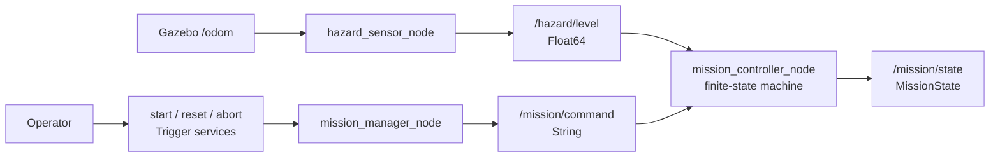
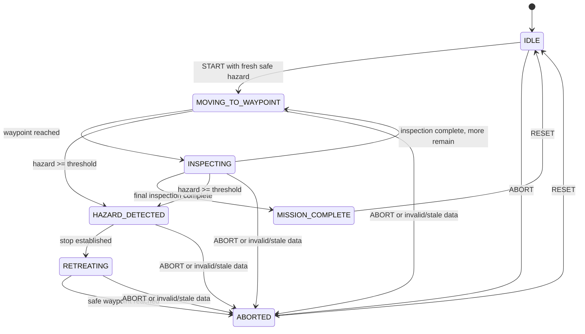

# Module 4 beginner guide — start here

> **Workspace-location check:** before building the custom message, run
> `pwd`. Use a Linux path without spaces, such as
> `~/ros2_projects/hazard_inspection_ws`. A mounted path containing
> `ROS2 Project` can break ROS 2 Humble interface generation even though the
> earlier Python and Xacro modules built successfully.

Read this before the complete Module 4 lesson or detailed code reference.

Module 3 answered: **How can ROS 2 exchange commands and simulated measurements
with Gazebo?**

Module 4 answers a different question: **How can a robot turn measurements and
operator requests into an explicit, inspectable decision state?**

This module adds no automatic driving. That is intentional. You will first
learn to distinguish continuous sensor data, configuration, discrete commands,
and stored mission state. Module 5 will then use those pieces to calculate
velocity commands.

## 1. The one lesson to remember

> Topics carry ongoing data, parameters configure a node, services request a
> discrete action, and a state machine remembers what the system is doing.

The Module 4 flow is:



In plain language:

1. Gazebo reports the rover position through odometry.
2. The hazard sensor calculates a value from distance to the hazard zone.
3. The operator calls a service such as `/mission/start`.
4. The manager converts that service request into a command event.
5. The controller checks current hazard data and applies a state transition.
6. The controller publishes a typed explanation of its current state.

## 2. Mechanical-engineering analogy

| ROS 2 concept | Test or control-system analogy |
|---|---|
| Topic | Continuously sampled measurement or signal bus |
| Parameter | Test configuration or controller setting |
| Service | Operator pushbutton with an acknowledgment |
| State machine | Operating-mode logic or test procedure |
| Custom message | Structured test record with defined fields |
| Stale-data timeout | Instrument-data validity requirement |
| NaN measurement | Explicit invalid-sensor indication |
| Random seed | Repeatable test-condition control |

The state machine is similar to an operating procedure that says which mode is
allowed after each event. It prevents the software from behaving as if every
command is always valid.

## 3. Why Module 4 comes before waypoint control

If sensing, services, safety checks, state transitions, and motion mathematics
were introduced at once, a stopped rover could have many possible causes:

- the controller calculated zero velocity;
- the mission never started;
- hazard data was stale;
- the hazard threshold was exceeded;
- a service command was rejected;
- the bridge failed;
- odometry was invalid.

Module 4 removes velocity control from the experiment. You can therefore
observe decisions directly before they cause motion.

## 4. Four ROS mechanisms that must not be confused

### Topic

Used for repeated or event-stream communication.

Examples:

- `/odom`;
- `/hazard/level`;
- `/mission/command`;
- `/mission/state`.

A topic does not return a response directly to its publisher.

### Parameter

Configuration owned by one node.

Examples:

- `peak`;
- `spread`;
- `hazard_threshold`;
- `hazard_timeout`.

Changing a parameter changes how a node behaves without editing its source.

### Service

A request/response interaction.

Examples:

- `/mission/start`;
- `/mission/reset`;
- `/mission/abort`.

The `Trigger` request is empty because the service name already identifies the
requested action. Its response contains `success` and `message`.

### State

Persistent internal memory that summarizes the current operating condition.

Examples:

- `IDLE`;
- `MOVING_TO_WAYPOINT`;
- `HAZARD_DETECTED`;
- `ABORTED`.

The state does not disappear after one message. The controller retains it until
an accepted event changes it.

## 5. Hazard model

The deterministic hazard model is:

\[
H(x,y)=b+p\exp\left(-\frac{(x-x_h)^2+(y-y_h)^2}{s}\right)
\epsilon
\]

with the final value clamped to zero or above.

Where:

- \(b\): baseline far from the zone;
- \(p\): increase at the zone centre;
- \((x_h,y_h)\): hazard-zone centre;
- \(s\): spread in square metres;
- \(\epsilon\): bounded uniform noise in
  \([-a,+a]\).

Default values:

```text
baseline = 0.20
peak = 10.0
zone = (3.50, 1.30) m
spread = 1.20 m²
noise amplitude = 0.05
seed = 42
```

At the zone centre, the reading is approximately:

```text
0.20 + 10.0 + noise ≈ 10.20
```

Far away, it approaches:

```text
0.20 + noise
```

The colored hazard disk in Gazebo does not generate the value. Its centre is
configured to match the mathematical model.

## 6. Why noise and a random seed are both used

Noise makes repeated readings slightly different, which is more realistic than
an exact mathematical value. A fixed random seed makes the generated sequence
repeatable when the same callback and timing sequence occurs.

Repeatability is valuable for debugging:

```text
same position + same parameters + same random sequence
→ same expected series of readings
```

The seed does not guarantee that an arbitrary `ros2 topic echo --once` command
will capture the same sample number after every launch.

## 7. Why invalid data becomes NaN

If odometry is unavailable, stale, or contains invalid coordinates, the hazard
sensor publishes `NaN` rather than inventing a safe-looking number.

```text
missing odometry
    ↓
hazard = NaN
    ↓
controller recognizes invalid measurement
    ↓
active mission becomes ABORTED
```

This is a fail-safe educational choice: unknown safety data is not treated as
zero hazard.

## 8. Why create a custom message

`std_msgs/String` could publish only text such as `"ABORTED"`. The custom
`MissionState` message carries:

- timestamp;
- numeric state code;
- readable state name;
- waypoint index;
- transition explanation.

The numeric field supports software logic. The name and detail support human
inspection. The custom message is justified because these related fields form
one stable interface contract.

Custom services are not needed. `std_srvs/srv/Trigger` already fits commands
that require no input arguments.

## 9. State-machine scope

All required states are defined:



Module 4 runtime exercises reach:

- `IDLE`;
- `MOVING_TO_WAYPOINT`;
- `HAZARD_DETECTED`;
- `ABORTED`.

The pure state-machine class already defines inspection, retreat, and completion
transitions. Module 5 will connect those transitions to waypoint arrival,
inspection timing, and commanded retreat motion.

`MOVING_TO_WAYPOINT` in Module 4 means the mission has been authorized. It does
not mean velocity is being published yet.

## 10. Read the files in this order

1. `hazard_math.py` — one equation without ROS;
2. `hazard_sensor.yaml` — values used by the equation;
3. `hazard_sensor_node.py` — odometry, noise, timing, and publication;
4. `MissionState.msg` — published state contract;
5. `mission_state_machine.py` — allowed transitions;
6. `mission_manager_node.py` — service-to-command gateway;
7. `mission_controller_node.py` — sensor checks and state publication;
8. `module_04_hazard_monitoring.launch.py` — integrated startup.

Read the package and build files after the runtime flow is understandable.

## 11. What to predict before running

1. What hazard value should appear at the starting position?
2. What happens if START is requested before valid hazard data arrives?
3. What state follows a valid START request?
4. Does the rover move automatically in Module 4?
5. What happens when hazard becomes greater than or equal to 6.0?
6. What happens if hazard becomes NaN during an active mission?
7. Why does RESET return the controller to IDLE?
8. Why does the manager's service response say to inspect `/mission/state`?

## 12. What you need to understand before Module 5

You do not need to memorize ROS message-generation or parameter API syntax.
You should be able to:

- choose between a topic, parameter, and service for a requirement;
- explain the hazard equation and each parameter;
- identify the authoritative producer of each topic;
- explain why invalid data is not treated as safe;
- trace START from service call to state transition;
- read a state diagram and identify an invalid transition;
- explain why the controller publishes no motion yet;
- change one parameter and predict its effect.

That understanding is the real completion criterion for Module 4.
