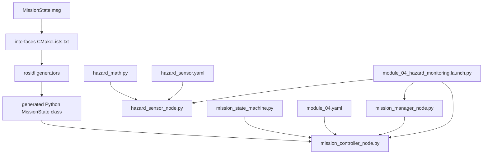
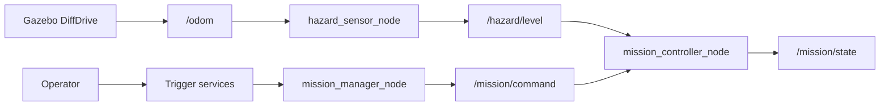
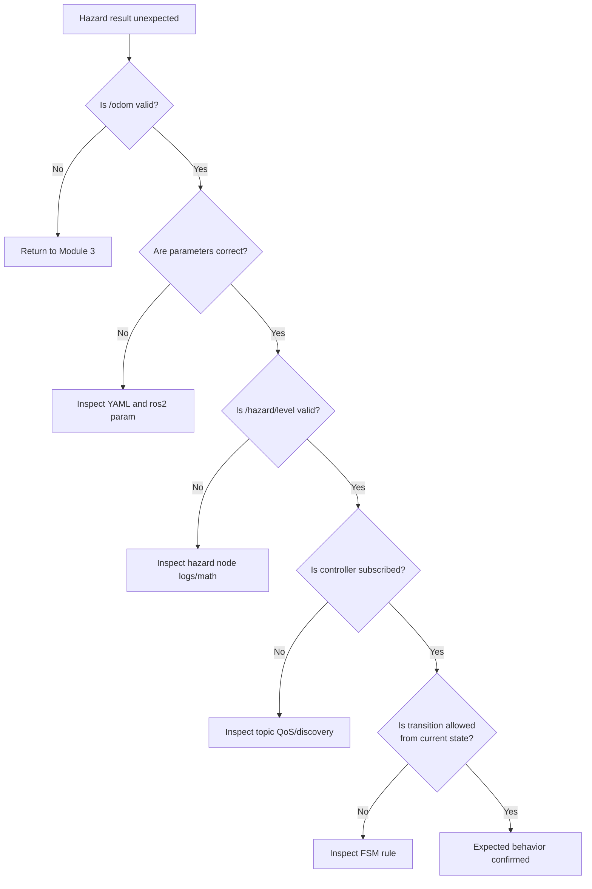

# Module 4 file-and-code guide

> **After Module 5:** `mission_controller_node.py` is expanded with waypoint
> motion, but `module_04.yaml` sets the read-only `enable_motion` parameter to
> `false`. This document explains the Module 4 checkpoint and its state-logic
> responsibilities; use the Module 5 file guide for the expanded source.

This document explains why each Module 4 file exists, how ROS 2 discovers it,
what its important code does, how to test it independently, and what safe
modifications can deepen your understanding.

Do not read this entire document before launching. First read the beginner
guide, complete one normal service sequence, and then return here with specific
questions.

## 1. File and communication structure

### Source-to-runtime flow



### Runtime ownership



## 2. Responsibility table

| File | Main responsibility | ROS discovery method |
|---|---|---|
| `MissionState.msg` | define typed state fields and constants | generated during interface-package build |
| interface `CMakeLists.txt` | invoke message generators | `ament_cmake` |
| interface `package.xml` | declare generator/runtime dependencies | `colcon`, `rosdep`, ament |
| `hazard_math.py` | deterministic hazard calculation | Python import |
| `hazard_sensor_node.py` | convert odometry into noisy hazard messages | console-script entry point |
| `hazard_sensor.yaml` | configure the hazard node | launch passes installed path |
| `mission_state_machine.py` | store state and apply allowed events | Python import |
| `mission_manager_node.py` | expose three services and publish commands | console-script entry point |
| `mission_controller_node.py` | validate hazard data and publish state | console-script entry point |
| `module_04.yaml` | configure controller safety limits | launch passes installed path |
| Module 4 launch | start simulation and three Module 4 nodes | `ros2 launch` package share lookup |
| modified `setup.py` files | install nodes and data resources | setuptools through `colcon` |
| modified manifests | declare new runtime dependencies | `rosdep` and build graph |

## 3. `MissionState.msg`

### Why it exists

A state report needs more than unstructured text. The custom message creates a
compile-time contract shared by publishers, subscribers, command-line tools,
and future logger code.

### Constants

```text
uint8 IDLE=0
uint8 MOVING_TO_WAYPOINT=1
...
uint8 ABORTED=6
```

These constants give software stable numeric codes. They must match
`MissionStateCode` in the Python state-machine file.

Using `uint8` is sufficient for seven values. The numbers are not priorities;
they are identifiers.

### Timestamp

```text
builtin_interfaces/Time stamp
```

The publishing node fills this from its ROS clock. With simulation time enabled,
the timestamp follows Gazebo `/clock`.

### State fields

```text
uint8 state
string state_name
```

`state` is machine-readable. `state_name` improves logs and CLI inspection.
Keeping both is a small redundancy chosen for clarity.

### Progress and explanation

```text
uint32 waypoint_index
string detail
```

The index supports future route logic. `detail` records the reason for the
latest accepted transition, such as an operator abort or threshold crossing.

### How it is discovered

`rosidl_generate_interfaces` generates Python, C, and C++ support during the
build. After sourcing:

```bash
ros2 interface show hazard_inspection_interfaces/msg/MissionState
```

### Inputs and outputs

This definition has no runtime process. It is an input to code generation and
produces language-specific message classes and middleware type support.

### Predict before modifying

What consumers would require rebuilding if the field `detail` were renamed?

### Two modifications

1. Add a carefully documented `float64 hazard_level` field on a temporary
   branch. Decide whether duplicating sensor data inside state is justified.
2. Change only a comment and observe that behavior is unchanged even though
   interface documentation improves.

Do not reorder or renumber state constants casually; recorded logs and
consumers may rely on them.

## 4. Interface-package `CMakeLists.txt`

### Package and dependencies

```cmake
project(hazard_inspection_interfaces)

find_package(ament_cmake REQUIRED)
find_package(builtin_interfaces REQUIRED)
find_package(rosidl_default_generators REQUIRED)
```

- `ament_cmake` provides the package build framework;
- `builtin_interfaces` supplies the timestamp type;
- `rosidl_default_generators` supplies message code generators.

### Generate interfaces

```cmake
rosidl_generate_interfaces(${PROJECT_NAME}
  "msg/MissionState.msg"
  DEPENDENCIES builtin_interfaces
)
```

The relative message path is an authored input. `DEPENDENCIES` tells the
generator that this interface contains a field from another interface package.

### Export runtime support

```cmake
ament_export_dependencies(rosidl_default_runtime)
ament_package()
```

Consumers need runtime type support after the build. `ament_package()` registers
the completed package.

### Independent test

```bash
colcon build --symlink-install \
  --packages-select hazard_inspection_interfaces
source install/setup.bash
ros2 interface show hazard_inspection_interfaces/msg/MissionState
```

### Two modifications

1. Add a temporary second `.msg` and include it in
   `rosidl_generate_interfaces`; confirm both appear in `ros2 interface list`.
2. Remove `builtin_interfaces` from `DEPENDENCIES` only as a prediction
   exercise, then explain the expected generator error without retaining it.

## 5. Interface-package `package.xml`

### Why `ament_cmake`

Interface generation is conventionally placed in an `ament_cmake` package even
when the consumer nodes are Python.

### Generator versus runtime dependencies

```xml
<build_depend>rosidl_default_generators</build_depend>
<exec_depend>rosidl_default_runtime</exec_depend>
```

Generators are required while building. Generated type support is required
while nodes execute.

```xml
<depend>builtin_interfaces</depend>
```

The timestamp definition is needed at build and runtime.

```xml
<member_of_group>rosidl_interface_packages</member_of_group>
```

This identifies the package as a ROS interface package to indexing and quality
tools.

### Independent test

```bash
ros2 pkg xml hazard_inspection_interfaces
rosdep check --from-paths src/hazard_inspection_interfaces --ignore-src
```

### Two modifications

1. Verify that the non-personal maintainer identity is consistent.
2. Compare build-time and runtime dependencies with one standard interface
   package and explain the difference.

## 6. `hazard_math.py`

### Why pure mathematics is separated

This file imports only Python's `math` module. It does not create a ROS node,
read parameters, subscribe to odometry, or generate noise. That makes the
calculation:

- easy to reason about;
- easy to reuse;
- deterministic;
- straightforward to unit test in Module 6.

### Function arguments

```python
def calculate_hazard(
    x: float,
    y: float,
    zone_x: float,
    zone_y: float,
    baseline: float,
    peak: float,
    spread: float,
    noise_offset: float = 0.0,
) -> float:
```

Everything affecting one output is explicit. The function does not silently
read global variables or ROS parameters.

### Validation

```python
if not all(math.isfinite(value) for value in values):
    raise ValueError(...)
```

NaN and positive/negative infinity are rejected. Baseline and peak must be
nonnegative; spread must be strictly positive.

Raising `ValueError` is appropriate because invalid model inputs represent a
programming or configuration error. Runtime odometry invalidity is handled
before calling the function.

### Equation

```python
distance_squared = (x - zone_x) ** 2 + (y - zone_y) ** 2
deterministic_value = baseline + peak * math.exp(
    -distance_squared / spread
)
```

No square root is needed because the formula uses squared distance. Avoiding an
unnecessary square root also makes the equation match its documentation.

### Nonnegative clamp

```python
return max(0.0, deterministic_value + noise_offset)
```

Negative random perturbation cannot produce a negative simulated
concentration.

### `is_valid_position`

This small helper defines the position-validity rule once:

```python
return math.isfinite(x) and math.isfinite(y)
```

### Independent test

```bash
python3 -c "from hazard_inspection_sim.hazard_math import calculate_hazard; print(calculate_hazard(3.5, 1.3, 3.5, 1.3, 0.2, 10.0, 1.2))"
```

Expected `10.2`.

### Predict before modifying

If spread doubles, does the centre value change? Does the hazard decay faster
or slower with distance?

### Two modifications

1. Calculate values at 0, 0.5, 1.0, and 2.0 m from the zone and plot them by
   hand or in MATLAB.
2. Temporarily pass `spread=0.0` and examine the deliberate `ValueError`.

## 7. `hazard_sensor.yaml`

### Why it exists

This YAML holds the selected scenario configuration separately from source
logic. A different experiment can use another parameter file without editing
the node.

### Node key

```yaml
hazard_sensor_node:
  ros__parameters:
```

The first key must match the runtime node name. `ros__parameters` is the
required ROS 2 YAML namespace.

### Model values

The hazard-zone coordinates match the visual marker in
`inspection_world.sdf`. Comments record units and noise distribution.

### Read-only values

`random_seed` and `publish_frequency` can be overridden at startup through
YAML, but their descriptors prevent runtime changes. Rebuilding the timer or
random sequence while callbacks execute would require additional lifecycle
logic not needed here.

### Discovery

`setup.py` installs all `config/*.yaml` files. The Module 4 launch resolves the
installed package share path and passes this file to the node.

### Independent test

```bash
ros2 run hazard_inspection_sim hazard_sensor_node \
  --ros-args --params-file \
  "$(ros2 pkg prefix --share hazard_inspection_sim)/config/hazard_sensor.yaml"
```

Without `/odom`, the node publishes NaN and warns. That is expected.

### Two modifications

1. Set `noise_amplitude: 0.0` and predict the stability of a stationary
   reading.
2. Change the seed in YAML, restart, and compare sequences under otherwise
   identical timing.

## 8. `hazard_sensor_node.py`

### Node purpose

The node subscribes to `/odom`, stores the latest valid planar position,
calculates hazard at a configured rate, and publishes `/hazard/level`.

### Constants

```python
ODOM_TOPIC = '/odom'
HAZARD_TOPIC = '/hazard/level'
WARNING_THROTTLE_SECONDS = 5.0
```

Named constants prevent topic spelling from being hidden inside callbacks.

### Initialization order

```text
declare parameters
→ validate startup values
→ register update validator
→ create seeded random generator
→ create publisher/subscriber
→ create timer
```

Invalid configuration therefore fails before normal data processing begins.

### Parameter descriptors

Each descriptor provides text returned by:

```bash
ros2 param describe /hazard_sensor_node <name>
```

Descriptions record units and read-only behavior.

### Initial validation

`_validate_initial_parameters` checks every numerical parameter for:

- numeric type;
- finite value;
- nonnegative or positive range as appropriate.

Startup YAML overrides are already present when `declare_parameter` returns, so
the validation checks the effective configuration.

### Update callback

```python
self.add_on_set_parameters_callback(
    self._validate_parameter_updates
)
```

The callback examines proposed values and returns `SetParametersResult`.
It does not change timers, random generators, or cached data. This is important
because another validation callback could reject the update later.

### Odometry callback

The node records receipt time using its ROS clock rather than trusting an
external header timestamp. Invalid x/y sets the stored position to `None`.

The subscriber callback does not publish hazard directly. Publication cadence
is owned by the configurable timer.

### Timer callback

The timer first checks:

1. has any position arrived?
2. is its age below `odom_timeout`?
3. are active parameters valid?

It then generates:

```python
noise_offset = self._random.uniform(
    -noise_amplitude,
    noise_amplitude,
)
```

and passes explicit values to `calculate_hazard`.

### Invalid measurement

```python
message.data = math.nan
```

NaN preserves the information that the measurement is unusable. It prevents
downstream software from confusing missing data with a safe zero.

### Warning throttling

Repeated 10 Hz invalid messages would otherwise produce 10 warnings per second.
The helper stores the last warning time by category and limits repeated logs.

### Shutdown

The `finally` block destroys the node and shuts down `rclpy` if necessary.
Only `KeyboardInterrupt` is handled; programming failures are not hidden by a
broad exception.

### Inputs and outputs

| Direction | Name | Type |
|---|---|---|
| input | `/odom` | `nav_msgs/msg/Odometry` |
| output | `/hazard/level` | `std_msgs/msg/Float64` |
| configuration | nine parameters | ROS parameter types |

### Independent tests

```bash
ros2 topic info /hazard/level --verbose
ros2 topic hz /hazard/level
ros2 param list /hazard_sensor_node
```

### Predict before modifying

What happens when odometry stops but the last stored position was at a safe
location?

### Two modifications

1. Change `odom_timeout` dynamically and observe invalid-measurement behavior.
2. Set `noise_amplitude` to zero at runtime and compare variance while the rover
   is stationary.

## 9. `mission_state_machine.py`

### Why it is separate from ROS

The state machine contains decision rules only. It has no publishers,
subscribers, timers, services, or parameter APIs. This makes transitions
independently testable and prevents middleware details from obscuring logic.

### `IntEnum`

```python
class MissionStateCode(IntEnum):
```

`IntEnum` members have readable names and integer values. The values match the
custom message constants.

### Active-state set

```python
ACTIVE_STATES = {...}
```

These states require continuing valid safety input. `IDLE`,
`MISSION_COMPLETE`, and `ABORTED` are stopped terminal/waiting conditions.

### Immutable transition result

```python
@dataclass(frozen=True)
class TransitionResult:
```

Every event reports:

- accepted or rejected;
- previous state;
- resulting state;
- reason.

`frozen=True` prevents callers from accidentally rewriting the event record.

### State properties

Read-only properties expose state, waypoint index, detail, and active status
without allowing outside code to assign arbitrary state values.

### Event methods

Each public method represents a meaningful event:

- `request_start`;
- `request_reset`;
- `request_abort`;
- `report_hazard`;
- `report_waypoint_reached`;
- `report_inspection_complete`;
- `begin_retreat`;
- `report_retreat_complete`.

The state cannot be changed through a generic public `set_state` method. That
forces transitions to pass through documented rules.

### Accepted and rejected helpers

`_transition` changes state and stored detail. `_reject` returns a result
without changing either.

### Independent test

Formal pytest tests are added in Module 6. For now, inspect the class with:

```bash
python3 -c "from hazard_inspection_control.mission_state_machine import MissionStateMachine; f=MissionStateMachine(); print(f.state.name); print(f.request_start())"
```

### Predict before modifying

What should happen if `report_waypoint_reached` is called from IDLE?

### Two modifications

1. Draw a table of every public event and the states from which it is accepted.
2. Add a temporary invalid-transition call in a small Python experiment and
   confirm state is unchanged.

## 10. `mission_manager_node.py`

### Purpose

This node is the operator-facing gateway. It exposes:

- `/mission/start`;
- `/mission/reset`;
- `/mission/abort`.

All use `std_srvs/srv/Trigger`.

### Why three services instead of one custom service

Each action needs no arguments, and its name clearly identifies intent.
`Trigger` already returns a Boolean and explanatory string, so a custom service
would add maintenance without educational benefit.

### Command publisher

```python
self._command_publisher = self.create_publisher(
    String,
    COMMAND_TOPIC,
    10,
)
```

The internal command event is simple and currently uses a standard String.
Only three documented values are produced: START, RESET, ABORT.

### Service callbacks

Each callback delegates to `_publish_command`, avoiding repeated discovery and
response logic.

The request argument begins with `_` because `Trigger.Request` has no fields and
is intentionally unused.

### Subscriber discovery check

```python
if self._command_publisher.get_subscription_count() == 0:
```

If no controller has been discovered, the service fails instead of claiming
delivery. DDS discovery may take a short time immediately after launch.

### Response meaning

A successful response means the command event was published while a subscriber
was discovered. It does not prove the controller accepted the transition. The
response explicitly directs the operator to `/mission/state`.

### Independent test

Run the manager alone and call START. It should report no controller. Run the
controller too and retry.

### Predict before modifying

Why would transient-local durability be dangerous for a command topic if a
controller restarted and received an old START event?

### Two modifications

1. Change one response message to include the service name and compare operator
   clarity.
2. Add a temporary publisher of an unknown command and verify the controller
   ignores it.

## 11. `mission_controller_node.py`

### Module 4 purpose

This is the ROS wrapper around `MissionStateMachine`. It subscribes to command
events and hazard readings, enforces data-validity rules, and publishes typed
state.

It intentionally has no `Twist` import and no `/cmd_vel` publisher.

### Parameters

- `hazard_threshold`: threshold comparison using `>=`;
- `hazard_timeout`: maximum receipt age while active;
- `status_publish_frequency`: periodic state rate, read-only at runtime.

Startup and dynamic validation reject non-finite and nonpositive values.

### State QoS

```python
QoSProfile(
    depth=1,
    reliability=ReliabilityPolicy.RELIABLE,
    durability=DurabilityPolicy.TRANSIENT_LOCAL,
)
```

Reliable delivery is appropriate for low-rate state. Transient-local durability
retains the latest sample for compatible late-joining consumers. The periodic
2 Hz publisher also supports ordinary volatile CLI subscribers.

### Hazard callback

The callback:

1. records receipt time;
2. rejects NaN, infinity, or negative values;
3. aborts an active mission on invalid data;
4. stores a valid measurement;
5. compares it with threshold;
6. reports a hazard event only from motion or inspection.

Using `>=` makes equality unsafe rather than safe.

### START handling

START requires:

- a stored valid hazard value;
- age no greater than `hazard_timeout`;
- value below `hazard_threshold`;
- current state IDLE.

If preconditions fail, state remains unchanged and a rejection detail is
published.

### ABORT and RESET

These commands call the pure state-machine methods. RESET also clears waypoint
index. ABORT from an unfinished state produces ABORTED.

### Freshness timer

The 0.10 s safety timer checks active missions even when no new hazard callback
arrives. Without it, complete sensor silence would never invoke the hazard
callback and could remain unnoticed.

### State publication

The node fills:

```text
stamp          node's current ROS time
state          integer enum value
state_name     enum name
waypoint_index state-machine progress
detail         stored transition or event explanation
```

### Inputs and outputs

| Direction | Name | Type |
|---|---|---|
| input | `/hazard/level` | `std_msgs/msg/Float64` |
| input | `/mission/command` | `std_msgs/msg/String` |
| output | `/mission/state` | custom `MissionState` |

### Independent test

Run with `use_sim_time:=false`, manually publish hazard and commands, and echo
state. The full lesson uses the integrated launch because it is less error
prone for a beginner.

### Predict before modifying

If the safety timer were removed, how would the controller detect a hazard
publisher that stopped completely?

### Two modifications

1. Change threshold dynamically and predict whether the next hazard callback
   causes a transition.
2. Temporarily change the comparison from `>=` to `>` on paper and explain the
   boundary-condition difference. Keep the implemented conservative comparison.

## 12. `module_04.yaml`

```yaml
mission_controller_node:
  ros__parameters:
    hazard_threshold: 6.0
    hazard_timeout: 1.0
    status_publish_frequency: 2.0
```

The node name must match the launch action. Values are selected in relation to
the hazard model and publication rate:

- threshold 6.0 lies well above baseline and below centre value;
- timeout 1.0 is ten nominal 10 Hz hazard periods;
- state at 2 Hz is readable without unnecessary traffic.

### Independent test

```bash
ros2 param dump /mission_controller_node
```

Compare effective values with this file.

### Two modifications

1. Set threshold to 8.0 and calculate the smaller threshold radius.
2. Set status frequency at startup to 1.0 and measure `/mission/state`.

## 13. Modified Python `setup.py` files

### Simulation package

```python
'hazard_sensor_node = '
'hazard_inspection_sim.hazard_sensor_node:main',
```

This console-script entry maps an executable name to the `main` function.
`setup.cfg` places it where `ros2 run` expects.

The existing `config/*.yaml` glob automatically installs
`hazard_sensor.yaml`; no new data-files rule was needed.

### Control package

Two new entry points install:

- `mission_controller_node`;
- `mission_manager_node`.

The existing launch and config globs install the new Module 4 files.

### Independent test

```bash
ros2 pkg executables hazard_inspection_sim
ros2 pkg executables hazard_inspection_control
```

### Two modifications

1. Trace executable name → Python module → `main` for all three nodes.
2. Temporarily misspell an entry-point module on paper and predict when the
   failure appears: build, discovery, or execution.

## 14. Modified package manifests

### Simulation dependencies

New dependencies support:

- `rclpy`: Python node API;
- `rcl_interfaces`: parameter descriptors/results;
- `std_msgs`: Float64 hazard output;
- existing `nav_msgs`: odometry input.

### Control dependencies

New dependencies support:

- `hazard_inspection_interfaces`: custom message import;
- `hazard_inspection_sim`: integrated launch dependency;
- `rcl_interfaces`: parameter validation;
- `std_srvs`: Trigger services;
- existing `rclpy`, `std_msgs`, launch packages.

`ament_python` is explicitly declared as the build tool.

### Two modifications

1. Map every non-standard Python import to its manifest dependency.
2. Use `rosdep check` to identify missing system dependencies without changing
   source.

## 15. `module_04_hazard_monitoring.launch.py`

### Purpose

This launch composes Module 3 rather than copying its Gazebo actions. Reusing
the simulation launch preserves one owner for world, bridge, spawn, and RViz
configuration.

### Resource paths

```python
control_share = Path(get_package_share_directory(CONTROL_PACKAGE))
sim_share = Path(get_package_share_directory(SIM_PACKAGE))
```

Installed package paths work regardless of the terminal's current directory.

### Forwarded arguments

The Module 4 launch declares `gui`, `rviz`, and `use_sim_time`, then forwards
them to Module 3. All Module 4 nodes also receive the same time selection.

### Parameter layering

```python
parameters=[
    str(hazard_parameters),
    {'use_sim_time': use_sim_time},
]
```

The YAML configures domain behavior. The dictionary applies launch-wide time
choice. Later entries override earlier entries if the same parameter appears.

### Node actions

The launch starts:

- `hazard_sensor_node` from the simulation package;
- `mission_controller_node` from the control package;
- `mission_manager_node` from the control package.

### Independent test

```bash
ros2 launch hazard_inspection_control \
  module_04_hazard_monitoring.launch.py --show-args
```

Headless:

```bash
ros2 launch hazard_inspection_control \
  module_04_hazard_monitoring.launch.py gui:=false rviz:=false
```

### Predict before modifying

If `use_sim_time` is false only for the controller, how can message-age checks
become inconsistent with simulator timing?

### Two modifications

1. Run all four GUI/RViz combinations and prove hazard/state topics remain.
2. Add a launch argument for an alternate hazard parameter file on a temporary
   branch, then explain when scenario selection justifies that complexity.

## 16. Complete command path

START follows:

```text
ros2 service call
→ /mission/start Trigger request
→ mission_manager_node callback
→ /mission/command "START"
→ mission_controller_node callback
→ freshness and threshold checks
→ MissionStateMachine.request_start()
→ /mission/state
```

Hazard follows:

```text
Gazebo DiffDrive
→ /odom
→ hazard_sensor_node
→ calculate_hazard()
→ bounded random noise
→ /hazard/level
→ mission_controller_node
→ threshold comparison
→ MissionStateMachine.report_hazard()
→ /mission/state
```

## 17. Failure-path reasoning



## 18. What Module 4 proves—and does not prove

After student verification, Module 4 can demonstrate:

- position-dependent simulated sensing;
- documented and validated configuration;
- service-based operator commands;
- typed mission-state publication;
- explicit transition logic;
- response to threshold, NaN, and stale data;
- separation of pure logic from ROS wrappers.

It does not demonstrate:

- waypoint tracking;
- collision avoidance;
- commanded stop or retreat motion;
- path publication;
- autonomous navigation;
- SLAM, AI, or machine learning;
- physical sensor calibration;
- field safety certification.

## 19. Compact mental model

```text
MissionState.msg
    defines the state-data contract

rosidl
    generates importable message code

hazard_math.py
    calculates one deterministic value

hazard_sensor_node.py
    adds odometry, timing, parameters, and noise

mission_manager_node.py
    converts operator services into command events

mission_state_machine.py
    owns allowed state transitions

mission_controller_node.py
    checks sensor validity and connects events to state

Module 4 launch
    composes simulation, sensing, services, and state publication
```

If you can trace START and a hazard threshold crossing through every interface,
explain one rejected transition, and distinguish configuration from data, you
have understood Module 4.
