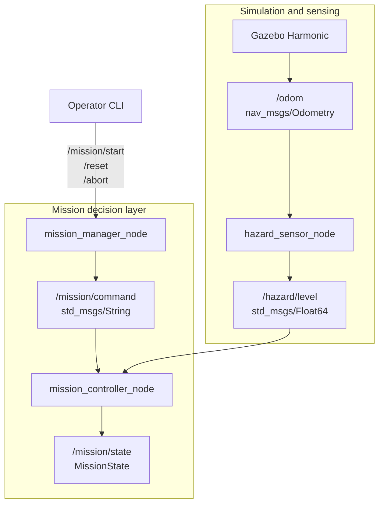

# Module 4 — Hazard sensing, parameters, services, and mission-state logic

> **After Module 5:** the shared controller executable contains motion code,
> but this lesson's `module_04.yaml` sets `enable_motion: false`. Module 4
> therefore remains a nonmoving state-logic exercise as documented here.

Estimated beginner time: **4–5 hours**

Complete this module after verifying Module 3 odometry. Module 4 uses `/odom`
as the position source for a mathematical hazard sensor and introduces
operator services and typed mission state. It deliberately does not publish
`/cmd_vel`.

## 1. Learning objectives

By the end of this module, you should be able to:

- explain when to use topics, parameters, services, and internal state;
- calculate the expected position-dependent hazard value;
- configure and inspect ROS 2 parameters;
- understand bounded random noise and reproducible seeds;
- build and inspect a custom ROS 2 message;
- call standard `Trigger` services;
- trace service requests through a command topic to a controller;
- read and exercise a finite-state machine;
- detect threshold crossings, invalid data, and stale data;
- distinguish a service-delivery acknowledgment from a controller decision;
- describe why Module 4 does not yet claim waypoint navigation.

## 2. Concepts introduced

- node-scoped ROS 2 parameters;
- parameter YAML files and descriptors;
- side-effect-free parameter validation callbacks;
- standard ROS 2 services;
- custom message generation with `rosidl`;
- explicit state codes and transition results;
- transient-local state publication;
- Gaussian-shaped spatial hazard model;
- bounded noise and deterministic random seeds;
- stale-data and NaN handling;
- separation between decision logic and motion control.

## 3. Files created or modified

```text
hazard_inspection_ws/
├── docs/
│   ├── module_04_beginner_start_here.md
│   ├── module_04_file_and_code_guide.md
│   └── module_04_hazard_monitoring.md
└── src/
    ├── hazard_inspection_interfaces/
    │   ├── CMakeLists.txt
    │   ├── package.xml
    │   └── msg/
    │       └── MissionState.msg
    ├── hazard_inspection_sim/
    │   ├── package.xml                         modified
    │   ├── setup.py                            modified
    │   ├── config/
    │   │   └── hazard_sensor.yaml
    │   └── hazard_inspection_sim/
    │       ├── hazard_math.py
    │       └── hazard_sensor_node.py
    └── hazard_inspection_control/
        ├── package.xml                         modified
        ├── setup.py                            modified
        ├── config/
        │   └── module_04.yaml
        ├── launch/
        │   └── module_04_hazard_monitoring.launch.py
        └── hazard_inspection_control/
            ├── mission_controller_node.py
            ├── mission_manager_node.py
            └── mission_state_machine.py
```

## 4. Runtime architecture



## 5. Interface selection rationale

| Requirement | Mechanism | Reason |
|---|---|---|
| Repeated position updates | Topic `/odom` | continuous data stream |
| Repeated hazard readings | Topic `/hazard/level` | continuous measurement |
| Change hazard-zone location | Parameters | node configuration |
| Ask once to start/reset/abort | Services | discrete request with acknowledgment |
| Transfer service intent internally | Topic `/mission/command` | event delivery between nodes |
| Publish current operating condition | Custom topic `/mission/state` | structured state record |

The service response confirms that the manager delivered the command event. The
controller may still reject START because data is unsafe or stale. Inspecting
`/mission/state` is therefore part of the command workflow.

## 6. Hazard mathematics

The implemented model is:

\[
d^2=(x-x_h)^2+(y-y_h)^2
\]

\[
H_\text{det}=b+p\exp(-d^2/s)
\]

\[
H=\max(0,H_\text{det}+\epsilon),
\qquad \epsilon\sim U(-a,a)
\]

Default values:

| Symbol | Parameter | Default | Unit or meaning |
|---|---|---:|---|
| \(b\) | `baseline` | 0.20 | hazard units |
| \(p\) | `peak` | 10.0 | hazard units |
| \(x_h\) | `hazard_zone_x` | 3.50 | m in `odom` |
| \(y_h\) | `hazard_zone_y` | 1.30 | m in `odom` |
| \(s\) | `spread` | 1.20 | m² |
| \(a\) | `noise_amplitude` | 0.05 | hazard units |
| — | `random_seed` | 42 | reproducibility |
| — | `publish_frequency` | 10.0 | Hz |
| — | `odom_timeout` | 1.0 | s |

At the hazard centre:

\[
H \approx 0.20+10.0+\epsilon=10.20+\epsilon.
\]

At the starting position \((-4.0,-2.5)\), distance squared is:

\[
(-4.0-3.5)^2+(-2.5-1.3)^2=70.69\ \text{m}^2.
\]

The exponential term is extremely small, so:

\[
H\approx0.20+\epsilon.
\]

With threshold 6.0 and noise ignored, the threshold radius is approximately:

\[
r=\sqrt{-s\ln\left(\frac{6.0-0.20}{10.0}\right)}
\approx0.81\ \text{m}.
\]

This is inside the 1.10 m visual hazard disk.

## 7. Build the packages

First run `pwd`. The workspace path must not contain spaces. Use a WSL Linux
path such as `~/ros2_projects/hazard_inspection_ws`, rather than a mounted
Windows path containing spaces. Custom interface generation in Humble is less
tolerant of spaces than the package types used earlier.

If the workspace is currently in that mounted path, copy only the authored
project files. Do not copy the failed `build/`, `install/`, or `log/` outputs:

```bash
WINDOWS_WS='/mnt/c/path/to/hazard_inspection_ws'
cd "$WINDOWS_WS"
mkdir -p ~/ros2_projects/hazard_inspection_ws
cp -a src docs README.md LICENSE .gitignore \
  ~/ros2_projects/hazard_inspection_ws/
cd ~/ros2_projects/hazard_inspection_ws
pwd
```

The final `pwd` output must contain no spaces. Reopen this Linux directory in
VS Code with `code .` if desired.

In the Ubuntu 22.04 WSL terminal:

```bash
cd ~/ros2_projects/hazard_inspection_ws
source /opt/ros/humble/setup.bash
rosdep install --from-paths src --ignore-src -r -y
colcon build --symlink-install \
  --packages-up-to hazard_inspection_control
source install/setup.bash
```

Expected package order includes:

```text
hazard_inspection_interfaces
hazard_inspection_description
hazard_inspection_sim
hazard_inspection_control
```

Exact order and timing may vary. The final summary should report successful
packages with no failed package.

## 8. Inspect the generated custom interface

```bash
ros2 interface show hazard_inspection_interfaces/msg/MissionState
```

Expected fields include:

```text
builtin_interfaces/Time stamp
uint8 state
string state_name
uint32 waypoint_index
string detail
```

The output also shows seven numeric constants from `IDLE` through `ABORTED`.

Check that executables were installed:

```bash
ros2 pkg executables hazard_inspection_sim
ros2 pkg executables hazard_inspection_control
```

Expected new executable names:

```text
hazard_sensor_node
mission_controller_node
mission_manager_node
```

## 9. Predict before launching

Write down:

1. expected starting hazard range;
2. initial mission state;
3. state after a valid START;
4. state after ABORT;
5. state after RESET;
6. state after moving the mathematical hazard zone to the rover;
7. whether any automatic movement should occur.

Do not change predictions after seeing the result.

## 10. Launch Module 4

```bash
ros2 launch hazard_inspection_control \
  module_04_hazard_monitoring.launch.py
```

This includes the Module 3 simulation and starts:

- Gazebo Harmonic;
- robot state publisher;
- ROS-Gazebo bridge;
- rover spawning;
- RViz2;
- hazard sensor;
- mission controller state scaffold;
- mission manager services.

Expected Module 4 logs include wording similar to:

```text
[hazard_sensor_node] Hazard sensor ready: odom=/odom, ...
[mission_controller_node] Mission controller state scaffold ready; ...
[mission_manager_node] Mission services ready: ...
```

The exact timestamps and process identifiers will differ.

## 11. Inspect nodes, topics, and services

In Terminal 2:

```bash
source /opt/ros/humble/setup.bash
cd ~/ros2_projects/hazard_inspection_ws
source install/setup.bash

ros2 node list
ros2 topic list -t
ros2 service list -t
```

Expected new nodes:

```text
/hazard_sensor_node
/mission_controller_node
/mission_manager_node
```

Expected new topics:

```text
/hazard/level [std_msgs/msg/Float64]
/mission/command [std_msgs/msg/String]
/mission/state [hazard_inspection_interfaces/msg/MissionState]
```

Expected services:

```text
/mission/start [std_srvs/srv/Trigger]
/mission/reset [std_srvs/srv/Trigger]
/mission/abort [std_srvs/srv/Trigger]
```

Parameter services will also appear automatically for each node.

## 12. Inspect the starting hazard value

```bash
ros2 topic echo /hazard/level
```

Observe several readings, then press `Ctrl+C`.

Expected at the start marker:

```text
approximately 0.15 to 0.25
```

Verify frequency:

```bash
ros2 topic hz /hazard/level
```

Expected approximately 10 Hz, subject to laptop and simulation load.

Check publishers and subscribers:

```bash
ros2 topic info /hazard/level --verbose
```

Expected:

- publisher: `hazard_sensor_node`;
- subscriber: `mission_controller_node`.

## 13. Inspect parameters

```bash
ros2 param list /hazard_sensor_node
ros2 param get /hazard_sensor_node hazard_zone_x
ros2 param get /hazard_sensor_node spread
ros2 param describe /hazard_sensor_node spread

ros2 param list /mission_controller_node
ros2 param get /mission_controller_node hazard_threshold
ros2 param describe /mission_controller_node hazard_threshold
```

Parameter descriptions should explain meaning and units.

Test invalid-value rejection:

```bash
ros2 param set /hazard_sensor_node spread -1.0
```

Expected: unsuccessful result explaining that spread must be greater than zero.

Test read-only configuration:

```bash
ros2 param set /hazard_sensor_node random_seed 99
```

Expected: rejection because the seed is read-only after startup.

## 14. Observe initial mission state

```bash
ros2 topic echo /mission/state
```

Expected repeated state:

```yaml
state: 0
state_name: IDLE
waypoint_index: 0
detail: Waiting for a start request.
```

Keep this terminal running during service tests if convenient.

## 15. Test START, ABORT, and RESET

Wait until `/hazard/level` shows valid low readings.

### Start

```bash
ros2 service call /mission/start std_srvs/srv/Trigger "{}"
```

Expected service response:

```text
success=true
START request published; inspect /mission/state for the controller decision.
```

Expected state transition:

```text
IDLE → MOVING_TO_WAYPOINT
```

The rover remains stationary because Module 4 publishes no `/cmd_vel`.

### Abort

```bash
ros2 service call /mission/abort std_srvs/srv/Trigger "{}"
```

Expected transition:

```text
MOVING_TO_WAYPOINT → ABORTED
```

### Reset

```bash
ros2 service call /mission/reset std_srvs/srv/Trigger "{}"
```

Expected transition:

```text
ABORTED → IDLE
```

### Invalid repeated start

Call START twice:

```bash
ros2 service call /mission/start std_srvs/srv/Trigger "{}"
ros2 service call /mission/start std_srvs/srv/Trigger "{}"
```

The manager can deliver both requests. The controller accepts the first and
rejects the second because START is valid only from IDLE. Inspect controller
logs and `/mission/state`.

Reset afterward:

```bash
ros2 service call /mission/reset std_srvs/srv/Trigger "{}"
```

## 16. Trigger a hazard without driving

This test moves the **mathematical zone**, not the rover. It isolates sensing
and state logic from motion.

First start the mission:

```bash
ros2 service call /mission/start std_srvs/srv/Trigger "{}"
```

Move the hazard centre to the starting pose:

```bash
ros2 param set /hazard_sensor_node hazard_zone_x -4.0
ros2 param set /hazard_sensor_node hazard_zone_y -2.5
```

Expected:

- hazard rises to approximately 10.15–10.25;
- threshold 6.0 is exceeded;
- state changes to `HAZARD_DETECTED`;
- no retreat motion occurs yet.

Restore the configured zone:

```bash
ros2 param set /hazard_sensor_node hazard_zone_x 3.5
ros2 param set /hazard_sensor_node hazard_zone_y 1.3
ros2 service call /mission/reset std_srvs/srv/Trigger "{}"
```

The controller does not automatically leave `HAZARD_DETECTED` merely because
the value decreases. An explicit recovery policy is required; Module 5 will
establish stop and retreat behavior.

## 17. Test invalid hazard-data handling

Start a safe mission, then deliberately publish one invalid value:

```bash
ros2 service call /mission/start std_srvs/srv/Trigger "{}"
ros2 topic pub --once /hazard/level std_msgs/msg/Float64 "{data: .nan}"
```

Expected transition:

```text
MOVING_TO_WAYPOINT → ABORTED
```

The real hazard sensor continues publishing valid data afterward, but ABORTED
persists until RESET.

```bash
ros2 service call /mission/reset std_srvs/srv/Trigger "{}"
```

This temporary second publisher is only a deliberate integration test.

## 18. Test stale/invalid propagation using odometry timeout

Set an unrealistically short odometry timeout:

```bash
ros2 service call /mission/start std_srvs/srv/Trigger "{}"
ros2 param set /hazard_sensor_node odom_timeout 0.001
```

Because odometry normally arrives slower than one millisecond, the hazard
sensor should begin publishing NaN between odometry updates. The active mission
should become ABORTED.

Restore:

```bash
ros2 param set /hazard_sensor_node odom_timeout 1.0
ros2 service call /mission/reset std_srvs/srv/Trigger "{}"
```

This test is intentionally conservative and timing-dependent. If the result
fluctuates, use the explicit NaN test in the previous section as primary
evidence.

## 19. Inspect the service contract

```bash
ros2 interface show std_srvs/srv/Trigger
ros2 service type /mission/start
ros2 service info /mission/start
```

`Trigger` has an empty request and returns:

```text
bool success
string message
```

The response confirms command publication, not necessarily state transition.
This is why its text tells the operator to inspect `/mission/state`.

## 20. Test components independently

### Hazard mathematics without ROS

Run this command yourself in the sourced WSL terminal:

```bash
python3 -c "from hazard_inspection_sim.hazard_math import calculate_hazard; print(calculate_hazard(3.5, 1.3, 3.5, 1.3, 0.2, 10.0, 1.2))"
```

Expected:

```text
10.2
```

Far-field example:

```bash
python3 -c "from hazard_inspection_sim.hazard_math import calculate_hazard; print(calculate_hazard(-4.0, -2.5, 3.5, 1.3, 0.2, 10.0, 1.2))"
```

Expected approximately `0.2`.

### Mission manager

If run without a controller subscriber:

```bash
ros2 run hazard_inspection_control mission_manager_node
```

Calling `/mission/start` should return `success=false` and report that no
controller subscribes to `/mission/command`.

### State machine logic

The pure class has no ROS imports. Module 6 will formally test it with pytest.
For now, read and draw the allowed sequence:

```text
IDLE
→ MOVING_TO_WAYPOINT
→ INSPECTING
→ MOVING_TO_WAYPOINT or MISSION_COMPLETE
```

and the safety branch:

```text
MOVING_TO_WAYPOINT or INSPECTING
→ HAZARD_DETECTED
→ RETREATING
→ ABORTED
```

## 21. Expected behavior summary

| Test | Expected result |
|---|---|
| Launch | Module 3 simulation plus three Module 4 nodes |
| Start position | hazard approximately 0.15–0.25 |
| Valid START | `IDLE → MOVING_TO_WAYPOINT` |
| Second START | rejected; state unchanged |
| ABORT | unfinished state becomes `ABORTED` |
| RESET | state becomes `IDLE`, waypoint index zero |
| Zone moved to rover | hazard approximately 10.2 |
| Hazard ≥ 6.0 while active | state becomes `HAZARD_DETECTED` |
| NaN while active | state becomes `ABORTED` |
| Invalid spread parameter | parameter update rejected |
| Change random seed at runtime | rejected as read-only |
| Module 4 state says moving | rover still stationary by design |

## 22. Common errors and troubleshooting

### `list index: 1 out of range` during `rosidl_generate_interfaces`

Inspect the path printed in the error. If it contains a directory such as
`ROS2 Project`, the space is being interpreted incorrectly by Humble's
interface-generation CMake logic. Copy the source workspace to a Linux path
without spaces, build there, and do not copy the old `build/`, `install/`, or
`log/` directories.

This is a workspace-location problem, not an error in `MissionState.msg`.

### rosdep cannot resolve `ament_python`

The Python packages declare their build type under the `<export>` section; they
should not also list `ament_python` as a rosdep-resolved dependency. Use the
corrected Module 4 `package.xml` files, run `rosdep update`, and repeat the
dependency command. Do not change the build type to `ament_cmake`.

### `Package 'hazard_inspection_interfaces' not found`

The custom message package did not build or the overlay is not sourced:

```bash
source /opt/ros/humble/setup.bash
colcon build --symlink-install \
  --packages-up-to hazard_inspection_control
source install/setup.bash
ros2 interface show hazard_inspection_interfaces/msg/MissionState
```

### `ModuleNotFoundError: hazard_inspection_interfaces`

Usually the interface package failed before the Python control package was
installed, or the new overlay was not sourced. Read the first build error, not
only the final dependent-package error.

### `No mission controller is subscribed`

The service manager checks topic discovery. Wait two seconds and retry:

```bash
ros2 node list
ros2 topic info /mission/command --verbose
```

If the controller node is absent, inspect its launch error.

### START response says success, but state stays IDLE

The service succeeded in delivering the request. Inspect:

```bash
ros2 topic echo /mission/state
ros2 topic echo /hazard/level --once
```

START is rejected if hazard is missing, stale, invalid, or above threshold.

### Hazard is NaN at startup

The hazard sensor has not received usable `/odom` yet:

```bash
ros2 topic echo /odom --once
ros2 topic info /odom --verbose
```

Allow Gazebo to spawn the rover and publish odometry. If `/odom` is absent,
return to Module 3 bridge and DiffDrive checks.

### Hazard remains near baseline at the red disk

The visual disk and mathematical parameters are separate. Check:

```bash
ros2 param get /hazard_sensor_node hazard_zone_x
ros2 param get /hazard_sensor_node hazard_zone_y
ros2 topic echo /odom --once
```

Compare odometry x/y with the configured centre.

### Parameter change reports wrong type

Declared parameter types are fixed. Use decimal values for double parameters:

```bash
ros2 param set /hazard_sensor_node peak 8.0
```

not an integer-looking value if the CLI interprets it as an integer.

### State echo misses the most recent transition detail

The controller republishes state at 2 Hz. A rejected-event explanation may be
followed by the persistent state's stored detail. Use the controller log for
the complete event history.

### Mission becomes ABORTED after the simulator is overloaded

Hazard data may exceed its timeout if the simulation is severely delayed.
Measure:

```bash
ros2 topic hz /hazard/level
ros2 param get /mission_controller_node hazard_timeout
```

Do not immediately increase the timeout. First determine whether odometry,
hazard publication, or system load is the cause.

### Rover does not move after START

Correct Module 4 behavior. The controller state scaffold does not create a
`/cmd_vel` publisher. Module 5 adds proportional waypoint control.

## 23. Student exercises

### Exercise A — derive threshold radius

Derive the distance at which deterministic hazard reaches 4.0, 6.0, and 8.0.
Explain how the safe region changes when `spread` increases.

### Exercise B — tune the hazard shape

Predict the effect of changing:

```bash
ros2 param set /hazard_sensor_node spread 2.4
```

Move the zone near the rover or manually position the rover and compare
readings. Restore 1.2 afterward unless you document the new choice.

### Exercise C — inspect message generation

Use:

```bash
ros2 interface show hazard_inspection_interfaces/msg/MissionState
```

Then locate the installed generated Python package. Explain why you authored
only `.msg` text but Python can import a class.

### Exercise D — rejected transition

Call START twice and ABORT twice. Record:

- service response;
- controller log;
- state before and after;
- why service delivery and state acceptance differ.

## 24. Debugging tasks

Complete at least one:

1. Set `spread` negative and explain which layer rejects it.
2. Run the manager without the controller and verify its subscriber check.
3. Publish NaN during an active mission and trace the resulting abort.
4. Temporarily set `hazard_threshold` to 0.10. Predict whether START at the
   normal starting position is accepted, then restore 6.0.

Change one variable at a time and keep the smallest justified correction.

## 25. Evidence to capture

- successful build summary;
- `ros2 interface show` output for `MissionState`;
- node, topic, and service lists;
- several starting hazard readings;
- `/hazard/level` measured frequency;
- parameter listing and one description;
- rejected invalid parameter result;
- START, ABORT, and RESET service responses;
- mission-state transitions;
- hazard-zone relocation test;
- invalid-data abort test;
- written prediction comparison;
- one debugging note.

## 26. Completion checklist

- [ ] Interface package builds and `MissionState` is discoverable.
- [ ] All three new executables are discoverable.
- [ ] Module 4 launch includes the Module 3 simulation.
- [ ] Hazard sensor receives `/odom`.
- [ ] `/hazard/level` publishes near 10 Hz.
- [ ] Starting hazard is near baseline.
- [ ] Parameter values and descriptions are inspectable.
- [ ] Invalid parameters are rejected.
- [ ] Mission services are listed with `Trigger` type.
- [ ] Initial mission state is `IDLE`.
- [ ] Valid START changes state to `MOVING_TO_WAYPOINT`.
- [ ] ABORT changes unfinished mission to `ABORTED`.
- [ ] RESET returns state to `IDLE`.
- [ ] Moving the hazard zone to the rover triggers `HAZARD_DETECTED`.
- [ ] NaN during an active mission triggers `ABORTED`.
- [ ] Student can explain why the rover does not move automatically.
- [ ] Evidence and one exercise are saved.

## 27. Questions before Module 5

1. When should a ROS 2 parameter be used instead of a topic?
2. Why does the hazard function use distance squared?
3. What does the spread parameter control?
4. Why is the random seed read-only during runtime?
5. Why publish NaN rather than zero when odometry is missing?
6. Why is `MissionState` custom while the services use `Trigger`?
7. What exactly does a successful service response guarantee?
8. Why does START require fresh hazard data?
9. Why does decreasing hazard not automatically clear `HAZARD_DETECTED`?
10. Which new events will Module 5 connect to the state machine?

## 28. Primary references

- [ROS 2 Humble parameter concepts](https://docs.ros.org/en/humble/Concepts/Basic/About-Parameters.html)
- [Using parameters in a Python class](https://docs.ros.org/en/humble/Tutorials/Beginner-Client-Libraries/Using-Parameters-In-A-Class-Python.html)
- [ROS 2 Humble QoS concepts](https://docs.ros.org/en/humble/Concepts/Intermediate/About-Quality-of-Service-Settings.html)
- [Standard Trigger service](https://docs.ros.org/en/humble/p/std_srvs/srv/Trigger.html)
- [Creating custom ROS 2 interfaces](https://docs.ros.org/en/humble/Tutorials/Beginner-Client-Libraries/Custom-ROS2-Interfaces.html)

## 29. Suggested Git commit

After the checklist passes:

```bash
# Run this once from the workspace root if Git is not initialized yet:
git init

git status
git add src/hazard_inspection_interfaces \
  src/hazard_inspection_sim \
  src/hazard_inspection_control \
  docs/module_04_beginner_start_here.md \
  docs/module_04_hazard_monitoring.md \
  docs/module_04_file_and_code_guide.md \
  README.md docs/architecture.md
git commit -m "feat: add simulated hazard sensor and mission state logic"
```

Do not add `build/`, `install/`, `log/`, or captured CSV/runtime files.

## 30. Report before continuing

Please report:

- build summary;
- first five hazard readings;
- measured hazard frequency;
- START, ABORT, and RESET results;
- state reached when the zone is moved to the rover;
- result of invalid parameter and NaN tests;
- exact warnings or errors;
- exercise completed.

Module 5 should begin only after these interfaces and transitions behave as
expected or a specific remaining problem has been diagnosed.
