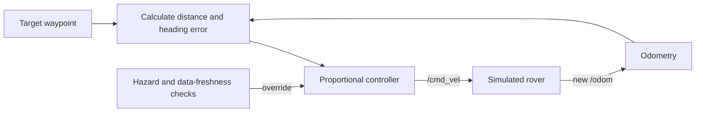
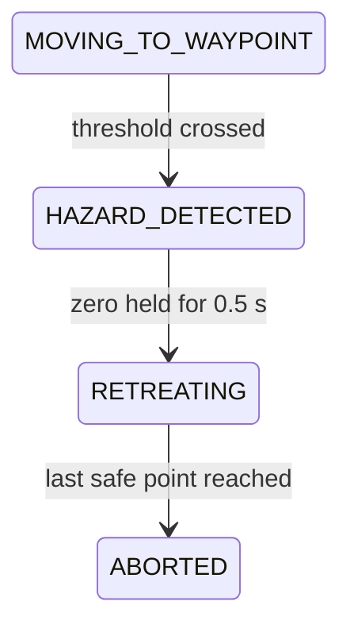
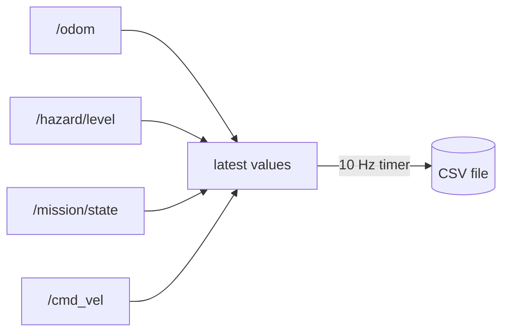

# Module 5 beginner guide — start here

Read this guide before opening the full lesson or controller source code.

> Build from `~/ros2_projects/hazard_inspection_ws`. The path must not contain
> spaces. If these files were generated in the mounted Windows copy, copy the
> authored `src`, `docs`, `README.md`, `LICENSE`, and `.gitignore` files to the
> Linux workspace without copying `build/`, `install/`, or `log/`.

## 1. The main lesson

Module 5 turns separate ROS components into a **closed feedback loop**:



The controller repeatedly asks:

1. Where is the rover?
2. Where is the current waypoint?
3. Which direction should the rover face?
4. How fast may it move?
5. Is the hazard and sensor data safe enough to continue?

That repeated measurement–decision–command cycle is the heart of feedback
control. The mathematics is intentionally simple so you can see the ROS 2
integration clearly.

## 2. What Module 5 is not

This is not Nav2, SLAM, path planning, obstacle avoidance, optimal control, or
field-ready safety software. The waypoints are chosen in advance for one known
world. The laser scan is displayed as evidence of sensor integration, but it is
not used by the controller or included in the basic CSV logger.
There is also no independent command watchdog for a controller-process crash.

An honest portfolio description is:

> I integrated a proportional waypoint controller with odometry, simulated
> hazard sensing, explicit mission states, stale-data checks, retreat behavior,
> ROS services, RViz visualization, and CSV logging.

## 3. Mechanical-engineering analogy

Think of a test stand with:

- a displacement sensor;
- a desired displacement;
- a controller that drives an actuator;
- hard limits on actuator speed;
- an independent interlock that removes the command after an unsafe reading;
- a data-acquisition system recording the test.

The ROS equivalents are:

| Test-system element | Module 5 element |
|---|---|
| Measured displacement | `/odom` |
| Environmental interlock | `/hazard/level` |
| Control output | `/cmd_vel` |
| Test mode | `/mission/state` |
| Operator buttons | start/reset/abort services |
| Test record | timestamped CSV file |

## 4. Route structure

The default route contains three points in the `odom` frame:

| Index | Coordinate | Type | Purpose |
|---:|---:|---|---|
| 0 | `(-1.60, -1.50)` | inspection | stop at station 1 |
| 1 | `(2.40, -1.50)` | transit | pass through and leave the narrow corridor |
| 2 | `(3.50, 1.30)` | inspection | approach station 2 and its hazard zone |


The transit point matters. A straight line from station 1 to station 2 would
intersect a barrier. This point is a fixed route-design decision, not automatic
obstacle avoidance.

## 5. Controller mathematics

For rover position `(x, y)` and target `(x_t, y_t)`:

```text
delta_x = x_t - x
delta_y = y_t - y
distance = sqrt(delta_x² + delta_y²)
desired_heading = atan2(delta_y, delta_x)
heading_error = normalize(desired_heading - yaw)
```

The proportional commands are:

```text
requested_linear  = linear_gain  × distance
requested_angular = angular_gain × heading_error
```

If the heading error is too large, linear speed is set to zero. The rover turns
first and then moves forward. Both outputs are clamped to configured limits.
Because linear speed is proportional to distance, the rover naturally slows
near a waypoint.

## 6. Why angle normalization exists

Angles wrap around at `+pi` and `-pi`. Without normalization, a small rotation
across that boundary could appear to be almost a full revolution.

```text
raw error:        +6.20 rad
normalized error: -0.083 rad
```

`normalize_angle()` keeps the heading error between `-pi` and `+pi`, allowing
the rover to choose the shorter turn.

## 7. How safety overrides motion

Normal feedback is not allowed to overrule safety. The controller publishes an
explicit zero velocity if:

- hazard reaches or exceeds the threshold;
- hazard data becomes NaN, negative, missing, or stale;
- odometry becomes invalid, missing, or stale;
- the operator requests abort or reset;
- the state is IDLE, INSPECTING, MISSION_COMPLETE, or ABORTED.

The hazard sequence is:



The rover turns and drives forward toward the previous safe point. Here,
“retreat” means returning to a recorded safe coordinate; it does not mean that
the wheels must run backward.

## 8. Why `HAZARD_DETECTED` is visible

It would be possible to jump directly from motion to retreat, but an explicit
intermediate state makes the safety sequence inspectable:

1. detect threshold crossing;
2. publish zero immediately;
3. display the hazard state;
4. select the last safe point;
5. begin controlled retreat.

This separation is useful for debugging and explaining design intent.

## 9. Why there is a transit waypoint type

An inspection waypoint enters `INSPECTING` and waits for
`inspection_duration`. A transit waypoint updates the safe return point and
continues without pretending an inspection happened there.

The finite-state machine can therefore remain readable while the route still
contains geometry needed to pass through the known environment.

## 10. CSV logging mental model

The logger does not try to make messages arrive at exactly the same instant.
It stores the latest value from each topic and writes one snapshot at 10 Hz:



This is adequate for a basic mission summary but is not precision sensor-time
synchronization. That limitation should be stated honestly.

## 11. What RViz2 shows

Module 5 adds:

- a cyan planned route on `/mission/path`;
- colored text above the rover on `/mission/status_marker`;
- mission state and hazard value in that marker;
- the existing robot model, TF, odometry, and laser scan.

The path is a planned sequence of known points. It is not a path computed by a
planner and is not evidence of autonomous mapping.

## 12. File reading order

Do not begin with the largest node. Read in this order:

1. `inspection_params.yaml` — see the route and tunable values.
2. `control_math.py` — understand distance, heading, and saturation.
3. `mission_state_machine.py` — review legal state transitions.
4. `mission_controller_node.py` — see ROS callbacks around those ideas.
5. `mission_logger_node.py` — understand latest-value CSV sampling.
6. `inspection_demo.launch.py` — see how the complete system starts.
7. `setup.py` and `package.xml` — understand discovery and dependencies.

## 13. What to predict before running

Write your predictions before launching:

1. Which state follows START?
2. Why will angular velocity usually appear before linear velocity?
3. At which point will the state become INSPECTING?
4. Why does the transit point not enter INSPECTING?
5. What velocity should be published immediately after a high hazard reading?
6. Where should the rover retreat?
7. Which final state is expected in the default configuration?
8. Why can the CSV contain `nan` in its earliest rows?

## 14. Minimum understanding before Module 6

You do not need to memorize every ROS API call. You should be able to explain:

- how pose error becomes a velocity command;
- why angles need normalization;
- why speed saturation is independent of proportional gain;
- how the finite-state machine controls which behavior may run;
- why stale-data checks must lead to zero velocity;
- why the default mission retreats instead of completing;
- how the logger discovers four topics and writes a fixed schema;
- what the one launch command starts;
- why this remains an educational controller rather than general autonomy.

If you can explain those points while referring to the files, you are learning
the intended engineering ideas. You are not expected to recite the code.
