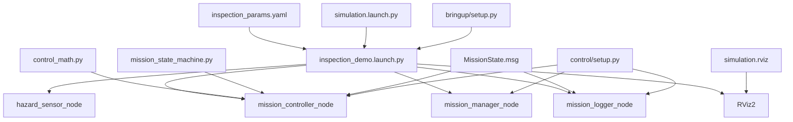
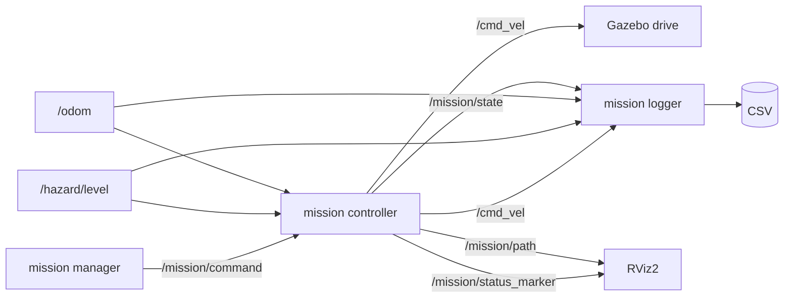
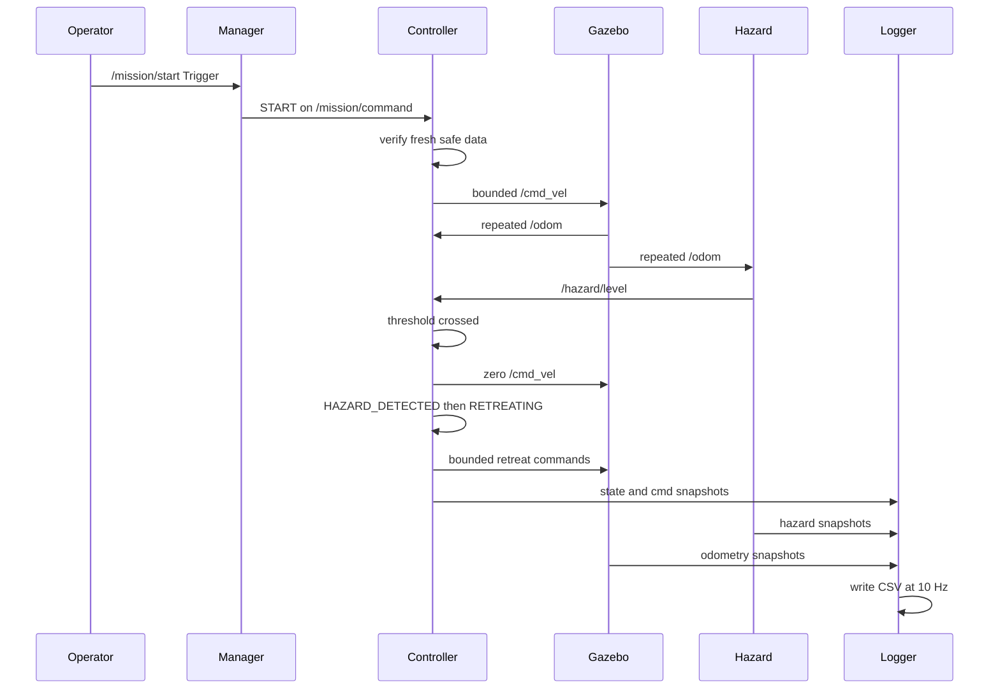
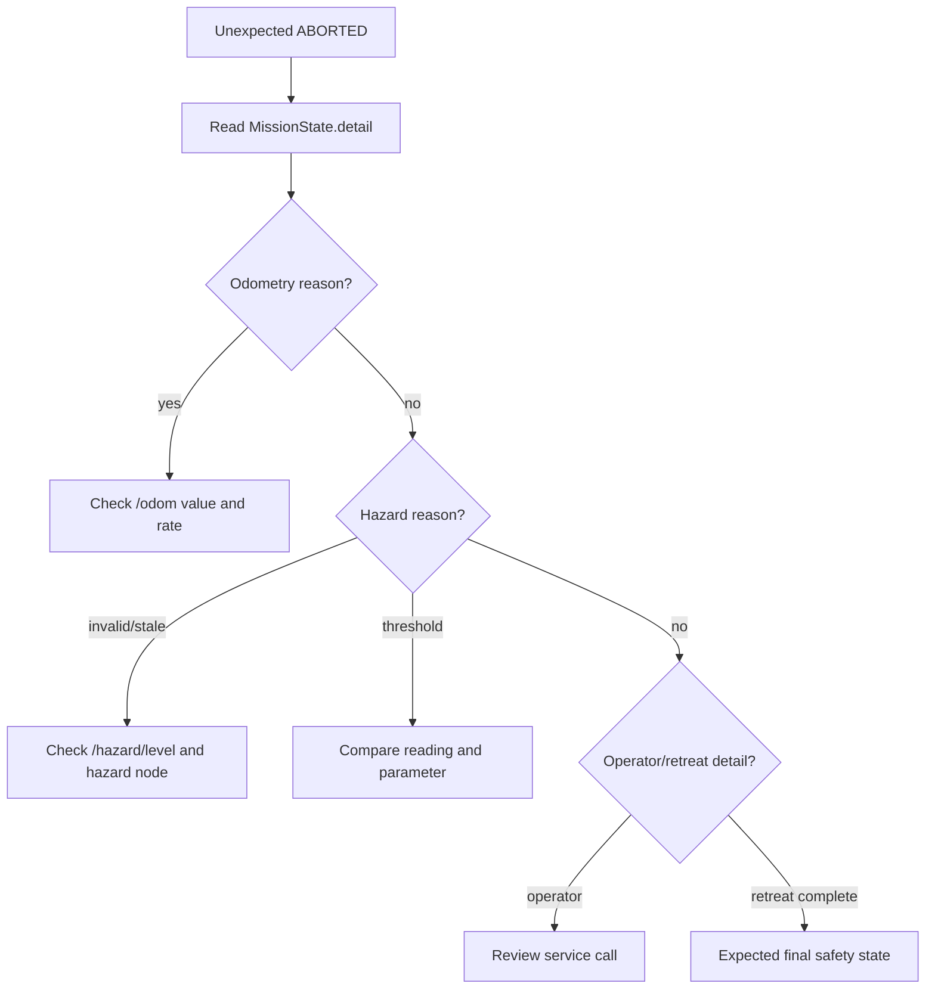

# Module 5 file-and-code guide

This reference explains why every Module 5 file exists, how ROS 2 discovers
it, what it receives and produces, and how to test it independently. Read the
beginner guide first. You are expected to understand the responsibility and
data flow of each file, not memorize every line.

## 1. Source-to-runtime chart



At build time, setup files install Python packages, executable entry points,
launch files, and YAML resources. At runtime, the launch file locates those
installed resources through the ament index.

## 2. Runtime communication chart



## 3. Responsibility table

| File | Responsibility | Discovery mechanism |
|---|---|---|
| `control_math.py` | pure geometry and clamping | Python import |
| `mission_state_machine.py` | legal mission transitions | Python import |
| `mission_controller_node.py` | feedback, safety, state, path, marker | console entry point |
| `mission_logger_node.py` | latest-value CSV snapshots | console entry point |
| control `setup.py` | install Python code/resources/executables | setuptools + ament index |
| control `package.xml` | declare runtime dependencies | package manifest |
| `inspection_params.yaml` | integrated route and tuning | node parameter-file lookup |
| bringup `setup.py` | install launch/configuration package | setuptools + ament index |
| bringup `package.xml` | declare launch-time package dependencies | package manifest |
| `inspection_demo.launch.py` | start the complete graph | `ros2 launch` lookup |
| `simulation.rviz` | configure path and marker displays | RViz `-d` argument |

## 4. `control_math.py`

### Why it exists

Geometry should be testable without ROS, Gazebo, timers, or message objects.
Separating pure functions reduces the amount of behavior hidden inside node
callbacks and allows focused pytest tests in Module 6.

### `WaypointError`

```python
@dataclass(frozen=True)
class WaypointError:
    distance: float
    desired_heading: float
    heading_error: float
```

The dataclass groups three values that always belong together. `frozen=True`
prevents accidental modification after calculation.

### `normalize_angle`

```python
return math.atan2(math.sin(angle), math.cos(angle))
```

Sine and cosine represent the same direction for angles separated by an
integer multiple of `2*pi`. `atan2` converts that direction back to the
principal interval `[-pi, pi]`.

The function rejects NaN and infinity instead of silently producing an invalid
command.

### `quaternion_to_yaw`

Odometry orientation is a quaternion `(x, y, z, w)`, not a single yaw angle.
The function:

1. rejects non-finite components;
2. rejects a zero-norm quaternion;
3. normalizes the quaternion;
4. applies the standard planar yaw relation.

Normalization makes the calculation tolerant of small numerical norm errors.
It does not make an arbitrary invalid orientation meaningful.

### `calculate_waypoint_error`

```python
delta_x = target_x - x
delta_y = target_y - y
desired_heading = math.atan2(delta_y, delta_x)
distance = math.hypot(delta_x, delta_y)
heading_error = normalize_angle(desired_heading - yaw)
```

Inputs are the current planar pose and one target coordinate. Output is a
`WaypointError`. The function has no ROS input or output.

### `clamp` and `saturate_velocity`

`clamp` enforces one lower and upper limit. `saturate_velocity` applies
symmetric speed limits to linear and angular commands. It validates that limits
are positive and values are finite.

Saturation remains necessary even with small gains because route distance and
heading error can vary. Gain controls sensitivity; saturation controls the
absolute command envelope.

### Independent test

After a successful package build and source:

```bash
python3 -c "from hazard_inspection_control.control_math import calculate_waypoint_error; print(calculate_waypoint_error(0.0, 0.0, 0.0, 3.0, 4.0))"
```

Predict `distance=5.0` before running. Formal automated tests arrive in
Module 6.

### Two intentional modifications

1. Calculate the output for yaw `pi` before changing the code.
2. Add a separately tested deadband helper without changing waypoint geometry.

## 5. `mission_state_machine.py`

### Why it remains separate

The state machine answers “is this transition allowed?” It does not calculate
geometry, publish velocity, or know about DDS. Keeping those responsibilities
separate makes transition tests deterministic.

### New transit transition

```python
def report_transit_waypoint_reached(
    self,
    more_waypoints: bool,
) -> TransitionResult:
```

An inspection point enters `INSPECTING`. A transit point advances the waypoint
index while remaining in `MOVING_TO_WAYPOINT`. This avoids claiming that the
rover inspected an unmarked corridor point.

The transition can be from `MOVING_TO_WAYPOINT` back to the same named state.
Although the state name does not change, the accepted event changes waypoint
index and detail. That is useful, observable state-machine progress.

### Inputs and outputs

- Input: method calls representing events.
- Output: immutable `TransitionResult` records.
- ROS topics: none.
- Files: none.

### Independent test

On paper, follow:

```text
request_start
report_waypoint_reached
report_inspection_complete(more_waypoints=True)
report_transit_waypoint_reached(more_waypoints=True)
```

Predict the state and waypoint index after every call. Module 6 turns this into
a pytest sequence.

### Two intentional modifications

1. Change only a transition detail string and observe `/mission/state`.
2. Add a unit-test prediction for transit called from IDLE; it must be rejected.

## 6. `mission_controller_node.py`

### Purpose

This node owns the mission state and velocity output. It combines:

- route configuration;
- odometry and hazard subscriptions;
- command subscription;
- proportional feedback;
- freshness checks;
- state transitions;
- planned path publication;
- RViz status publication.

### ROS discovery

The control package `setup.py` contains:

```python
'mission_controller_node = '
'hazard_inspection_control.mission_controller_node:main'
```

After colcon installs that entry point, this works:

```bash
ros2 run hazard_inspection_control mission_controller_node
```

The main bringup launch uses the same executable name.

### Topic inputs and outputs

| Direction | Name | Type |
|---|---|---|
| subscribe | `/odom` | `nav_msgs/msg/Odometry` |
| subscribe | `/hazard/level` | `std_msgs/msg/Float64` |
| subscribe | `/mission/command` | `std_msgs/msg/String` |
| publish | `/cmd_vel` | `geometry_msgs/msg/Twist` |
| publish | `/mission/state` | custom `MissionState` |
| publish | `/mission/path` | `nav_msgs/msg/Path` |
| publish | `/mission/status_marker` | `visualization_msgs/msg/Marker` |

### Route parameters

```python
waypoints_x = [-1.60, 2.40, 3.50]
waypoints_y = [-1.50, -1.50, 1.30]
waypoint_types = ['inspection', 'transit', 'inspection']
```

The arrays must be nonempty, equal length, finite, and have recognized types.
They are read-only after startup because changing route length while a mission
is active would make waypoint indexing ambiguous.

`enable_motion` is also read-only. Module 4 sets it false so its historical
state-logic lab remains nonmoving after the controller is expanded. Module 5
sets it true in the integrated YAML.

### Numeric parameter validation

`_validate_initial_parameters()` rejects invalid YAML at startup.
`_validate_parameter_updates()` checks dynamic tuning requests before ROS
applies them. The callback has no side effects: it returns success or a reason
for rejection.

Positive constraints apply to gains, speeds, tolerances, durations, timeouts,
and rates. `hazard_stop_duration` may be zero. Heading alignment tolerance may
not exceed `pi`.

### Why `isinstance(value, bool)` is checked

In Python, `bool` is a subclass of `int`. Without the explicit exclusion,
`True` could pass a numeric-parameter check as `1`. A speed parameter should
not accept a Boolean merely because of that language relationship.

### Odometry callback

The callback records receipt time separately from message content. It converts
the quaternion to yaw and rejects invalid pose data. Receipt time supports a
freshness check; a numerically valid pose may still be unsafe if it is old.

If invalid odometry arrives during an active mission, the node publishes zero
and requests `ABORTED`.

### Hazard callback

The callback:

1. records receipt time;
2. rejects NaN, infinity, and negative values;
3. stores valid hazard;
4. compares it with `hazard_threshold` only during normal motion/inspection;
5. publishes zero immediately at or above the threshold;
6. enters `HAZARD_DETECTED`.

Retreating does not repeatedly trigger `HAZARD_DETECTED`; the rover must be
allowed to leave the zone. Hazard data must still remain valid and fresh.

### Command callback

`START` requires:

- state IDLE, enforced by the state machine;
- fresh pose;
- fresh hazard;
- current hazard below threshold.

On accepted START, the current pose becomes both mission start and initial safe
return point.

`ABORT` and `RESET` publish zero before applying their state event. RESET also
clears inspection timers and safe-point history. It does not reset Gazebo pose.

### Control timer

At `control_frequency`, `_control_step()` first checks state and data freshness.
Only then does it select state-specific behavior. This ordering makes safety
conditions gate all normal feedback commands.

### `_drive_toward`

```python
requested_linear = linear_gain * error.distance
if abs(error.heading_error) > heading_tolerance:
    requested_linear = 0.0
requested_angular = angular_gain * error.heading_error
```

The result passes through `saturate_velocity` before publication. Normal motion
and retreat use different linear limits but share the same angular limit and
geometric law.

### Waypoint arrival

Arrival is distance-only: `distance <= position_tolerance`. The controller does
not require a final orientation because the inspection task has no directional
sensor requirement in this version.

At a safe arrival:

- the command becomes zero;
- the point becomes the last safe pose;
- inspection points enter `INSPECTING`;
- transit points advance immediately.

### Inspection timer

The node-clock timestamp is stored on entry. During inspection it repeatedly
publishes zero. After `inspection_duration`, the state machine either advances
to the next waypoint or enters `MISSION_COMPLETE`.

### Hazard stop and retreat

`HAZARD_DETECTED` holds zero for `hazard_stop_duration`. This creates observable
separation between detection and retreat. After the delay, the state enters
`RETREATING` and uses the same feedback law with the lower
`retreat_linear_speed` limit.

Reaching the last safe point produces `ABORTED`, not MISSION_COMPLETE. The
operator must inspect the event and RESET.

### Planned path

`_publish_path()` creates a `nav_msgs/Path` in `odom`. Before START it includes
configured route points. After START it prepends the measured start pose.

Every `PoseStamped` has identity orientation because the path communicates
positions, not a planned heading trajectory. This path is visualization data,
not a planner output.

### Status marker

`Marker.TEXT_VIEW_FACING` attaches to `base_link`, so TF makes the text follow
the rover. The marker reuses namespace and ID, causing RViz to update one
object instead of accumulating text markers.

Color is a display aid:

- blue: moving;
- green: inspecting;
- red: hazard;
- orange: retreating;
- pink: aborted.

The custom `/mission/state` remains the machine-readable source of truth.

### QoS

State, path, and marker publishers use reliable, transient-local QoS with depth
one. Late subscribers can receive the latest retained status. High-rate sensor
and velocity topics use ordinary volatile queues.

### Shutdown

`stop()` publishes a final zero before node destruction. This is a useful
defensive action, but a production safety design would not rely on application
shutdown delivery as its only stop mechanism.

### Independent tests

```bash
ros2 node info /mission_controller_node
ros2 topic echo /cmd_vel
ros2 topic echo /mission/state
```

Run the node through the main launch because it needs real odometry and hazard
data for meaningful behavior.

### Predict before modifying

Predict how doubling `linear_gain` differs from doubling `max_linear_speed`.
One changes requested sensitivity; the other changes the absolute ceiling.

### Two intentional modifications

1. Reduce `heading_alignment_tolerance` and predict the change in turn-first
   behavior.
2. Increase `hazard_stop_duration` and predict which state lasts longer without
   changing the threshold location.

## 7. `mission_logger_node.py`

### Purpose

The logger records a fixed eight-column mission dataset:

```text
time, x, y, yaw, linear_velocity, angular_velocity,
hazard_level, mission_state
```

It is observational. It publishes no command and cannot change the mission.

### Discovery

Control `setup.py` installs:

```python
'mission_logger_node = '
'hazard_inspection_control.mission_logger_node:main'
```

### Why latest-value sampling is used

Four topics publish at different rates. Each callback stores its newest value;
a 10 Hz timer writes one combined snapshot. This produces a readable bounded
file without requiring exact time synchronization.

It means values in a row may originate from slightly different message times.
State this limitation when discussing the project.

### CSV schema constant

```python
CSV_COLUMNS = (
    'time', 'x', 'y', 'yaw',
    'linear_velocity', 'angular_velocity',
    'hazard_level', 'mission_state',
)
```

A single constant prevents header order and row dictionaries from drifting.

### Output path

`Path(...).expanduser()` converts `~` to the WSL user's home directory. The UTC
timestamp prevents ordinary launches from overwriting earlier logs.

The node uses wall time for the filename because simulated time may begin at
zero. CSV row time uses the ROS node clock so it aligns with simulation time.

### File error handling

Directory creation and file opening catch `OSError`, the expected family for
filesystem failures. On failure, the node logs the exact path and disables CSV
writing without raising a broad catch-all exception.

Write and flush operations also catch `OSError`. `close()` is idempotent: a
second call safely does nothing.

### Missing data

Before the first odometry or hazard message, numeric fields are `nan` and state
is `UNKNOWN`. Missing data is not replaced with a believable but false zero.

### Flush policy

The logger flushes every `flush_every_rows` rows and again during shutdown.
Frequent flushing improves recoverability but increases file I/O. Ten rows is
a reasonable educational compromise at 10 Hz.

### Independent test

```bash
ros2 node info /mission_logger_node
ros2 param get /mission_logger_node output_directory
ls -lh ~/.ros/hazard_inspection_rover/logs
```

### Predict before modifying

Predict how changing logging frequency from 10 Hz to 2 Hz affects file size and
whether it changes the controller frequency. It should affect only logging.

### Two intentional modifications

1. Add `waypoint_index` using the existing mission-state subscription.
2. Change the UTC filename prefix and predict which file contents remain the
   same.

## 8. Control-package `setup.py`

### `packages=find_packages(exclude=['test'])`

Setuptools searches for Python directories containing `__init__.py`. Tests are
excluded from the installed runtime package because they are source-time tools.

### `data_files`

These entries install:

- the ament resource marker;
- `package.xml`;
- configuration YAML files;
- launch files.

Without installation, source files may exist but `ros2 launch` will not find
them in the package share directory.

### `install_requires=['setuptools']`

This declares the ordinary Python packaging tool required to install the
package. It does not install ROS message packages; those belong in
`package.xml` and are resolved by ROS/rosdep.

### `entry_points`

Each string follows:

```text
executable_name = python_package.module_name:function_name
```

For the logger:

```text
mission_logger_node
= hazard_inspection_control.mission_logger_node:main
```

ROS 2 discovers the installed console script, and that script calls `main()`.

### Independent test

```bash
ros2 pkg executables hazard_inspection_control
```

### Two intentional modifications

1. Temporarily misspell an entry-point module on paper and identify whether the
   failure occurs at build discovery or execution.
2. Explain why adding a Python file alone does not create a `ros2 run`
   executable.

## 9. Control-package `package.xml`

### Why new dependencies exist

| Dependency | Used for |
|---|---|
| `geometry_msgs` | Twist and PoseStamped |
| `nav_msgs` | Odometry and Path |
| `visualization_msgs` | RViz text Marker |
| `hazard_inspection_interfaces` | custom MissionState |
| `rclpy` | Python ROS nodes |
| `std_msgs` | hazard and command topics |
| `std_srvs` | manager Trigger services |

`exec_depend` is appropriate because these Python modules and interfaces are
needed when the installed nodes run. The `<export>` build type remains
`ament_python`; it is not a rosdep dependency line.

### Independent test

```bash
rosdep check --from-paths src --ignore-src --rosdistro humble
```

### Two intentional modifications

1. Trace each import in the controller to one manifest dependency.
2. Explain why `csv`, `math`, and `pathlib` are not ROS package dependencies;
   they are Python standard-library modules.

## 10. `inspection_params.yaml`

### Purpose

This is the committed integrated configuration. It separates tunable values
from control logic and records the exact default demonstration conditions.

### Node keys

```yaml
mission_controller_node:
  ros__parameters:
    ...

mission_logger_node:
  ros__parameters:
    ...
```

ROS applies each block only to the node with the matching runtime name. A typo
in the key can leave the node using code defaults without a Python exception.

### Route arrays

Three arrays are parallel: element zero of x, y, and type describes one route
point. Their lengths must match.

### Tuning groups

- route geometry;
- proportional gains and saturation;
- arrival and heading tolerances;
- inspection and control timing;
- data freshness and hazard threshold;
- logger directory, rate, and flush interval.

### Independent test

```bash
ros2 param dump /mission_controller_node
ros2 param dump /mission_logger_node
```

Compare runtime values with the YAML.

### Predict before modifying

Predict why changing `waypoints_x` requires a restart while changing
`max_linear_speed` can be accepted dynamically.

### Two intentional modifications

1. Set inspection duration to 1.0 and measure the state duration.
2. Set a different user-owned output directory through the launch argument.

## 11. Bringup-package `package.xml`

### Why a separate package exists

The bringup package owns system assembly, not robot behavior or simulation
physics. It depends on control and simulation packages and includes their
installed resources.

This boundary lets each component package retain an independent test launch
while one final launch represents the portfolio demonstration.

### Dependencies

- `ament_index_python`: locate installed package shares;
- `hazard_inspection_control`: controller, manager, logger;
- `hazard_inspection_sim`: simulation launch and hazard configuration;
- `launch` and `launch_ros`: create launch actions and ROS nodes.

### Two intentional modifications

1. Remove one dependency on paper and predict which package lookup may fail.
2. Explain why Gazebo-specific dependencies remain in the sim manifest rather
   than being duplicated here.

## 12. Bringup `setup.py`, `setup.cfg`, resource marker, and `__init__.py`

### `setup.py`

The file installs the package marker, manifest, YAML, and launch file.
`find_packages()` includes the Python package containing `__init__.py`, even
though this package has no executable node.

### `setup.cfg`

It defines the conventional install location for console scripts. Bringup has
no scripts now, but retaining the standard ament Python structure keeps package
behavior predictable if a helper is added later.

### Resource marker

`resource/hazard_inspection_bringup` registers the package name in the ament
resource index. `get_package_share_directory()` relies on the installed index.

### `__init__.py`

It marks `hazard_inspection_bringup/` as a Python package for setuptools.

### Independent test

```bash
ros2 pkg prefix hazard_inspection_bringup
ros2 pkg xml hazard_inspection_bringup
```

### Two intentional modifications

1. Add a README resource to `data_files` and inspect its installed location.
2. Explain the difference between the outer package directory and inner Python
   package directory.

## 13. `inspection_demo.launch.py`

### Purpose

One command starts:

- Gazebo server/client;
- robot state publisher;
- rover spawning;
- ROS–Gazebo bridge;
- RViz2 when enabled;
- hazard sensor;
- mission controller;
- mission manager;
- mission logger.

The first five are provided by including the simulator launch rather than
copying its actions.

### Resource lookup

```python
get_package_share_directory(BRINGUP_PACKAGE)
get_package_share_directory(SIM_PACKAGE)
```

These calls locate installed package resources. They do not search arbitrary
source directories, which is why rebuilding and sourcing after adding files is
necessary.

### Launch configurations

`gui`, `rviz`, and `use_sim_time` are forwarded to the included simulation.
`log_directory` overrides the logger's YAML value. The later parameter
dictionary has higher precedence than the earlier YAML file.

### Included launch

`IncludeLaunchDescription` reuses the tested Module 3 simulation assembly. This
reduces duplication and preserves package ownership.

### Node actions

Every Node action uses package, executable, runtime name, screen output, and
parameters. YAML node keys match the explicit names.

### Independent tests

```bash
ros2 launch hazard_inspection_bringup \
  inspection_demo.launch.py --show-args
```

```bash
ros2 launch hazard_inspection_bringup \
  inspection_demo.launch.py gui:=false rviz:=false
```

### Predict before modifying

Predict whether `rviz:=false` disables topics or only the RViz process. Topics
should remain available.

### Two intentional modifications

1. Change the default log directory through an argument, not source code.
2. Set GUI false for a CLI-only validation and prove motion still works.

## 14. `simulation.rviz`

### Existing displays

Grid, RobotModel, LaserScan, Odometry, and TF came from Module 3.

### MissionPath display

The Path display subscribes to `/mission/path`, uses reliable transient-local
QoS, and draws a cyan line with small pose axes. The fixed frame is `odom`,
matching the path header.

### MissionStatus display

The Marker display subscribes to `/mission/status_marker`. The marker itself
contains type, frame, position, text, size, and color, so RViz configuration
mostly selects the topic and QoS.

### Independent test

```bash
ros2 topic echo /mission/path --once
ros2 topic echo /mission/status_marker --once
```

If both messages exist but no display appears, inspect RViz fixed frame and
display QoS before changing controller code.

### Two intentional modifications

1. Change only the route line color in RViz.
2. Change marker `scale.z` in the controller and predict text-size change.

## 15. Complete runtime path



## 16. Failure reasoning chart



Use the published detail field as evidence. Do not start by randomly changing
gains, timeouts, and route points.

## 17. What Module 5 proves

The student can honestly demonstrate:

- multi-package ROS 2 integration;
- a transparent proportional feedback calculation;
- explicit state-dependent control;
- configurable saturation and tolerances;
- immediate stop and controlled retreat in simulation;
- invalid and stale data handling;
- typed status, path, and marker publication;
- timestamped CSV logging with file error handling;
- one-command launch composition;
- understanding of system limitations.

## 18. What Module 5 does not prove

It does not demonstrate:

- SLAM or global localization;
- automatic map-based route planning;
- lidar obstacle avoidance;
- Nav2;
- optimal or model-predictive control;
- formal verification;
- safety certification;
- an independent drive-command watchdog for controller-process failure;
- hardware robustness;
- reliable operation in an unknown industrial facility.

Those boundaries make the portfolio more credible, not less. A reviewer can
see exactly which engineering problem was solved and which problems remain.

## 19. Compact mental model

```text
control_math.py
    calculates errors and limits

mission_state_machine.py
    decides which transitions are legal

mission_controller_node.py
    combines feedback, state, and safety into commands

mission_logger_node.py
    observes latest data and writes CSV snapshots

inspection_params.yaml
    records route and tuning

inspection_demo.launch.py
    starts the complete system

simulation.rviz
    makes route and status visible
```

If you can trace START from the service call through the command topic, state
transition, feedback command, Gazebo odometry, hazard override, retreat, and CSV
row, then you understand the intended Module 5 architecture.
