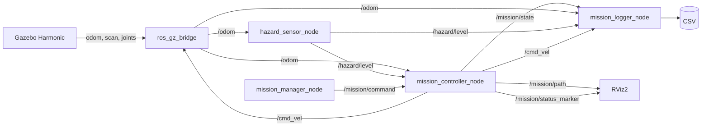

# Module 5 — Waypoint control, safety retreat, logging, and integration

Estimated beginner time: **4–5 hours**.

Complete this module only after Module 4 builds and its hazard, parameter,
service, and state checks pass. Run all commands yourself in Ubuntu 22.04 WSL.
The code should not be presented as a general navigation system.

## 1. Learning objectives

By the end of Module 5, you should be able to:

- explain a proportional 2D waypoint controller;
- calculate distance and normalized heading error;
- distinguish inspection and transit route points;
- explain velocity saturation and heading alignment;
- connect odometry and hazard feedback to `/cmd_vel`;
- stop on high, missing, stale, or invalid safety data;
- explain the visible stop-before-retreat sequence;
- publish a planned `nav_msgs/Path` and RViz status marker;
- record mission snapshots safely to CSV;
- explain package entry points, launch inclusion, and parameter layering;
- launch the complete system with one command;
- describe the controller's limitations accurately.

## 2. Concepts introduced

- closed-loop feedback;
- proportional control;
- angle normalization;
- velocity saturation;
- rotate-then-translate behavior;
- route points versus inspection points;
- data freshness and fail-stopped behavior;
- latest-value data logging;
- `nav_msgs/msg/Path`;
- `visualization_msgs/msg/Marker`;
- package-level bringup integration;
- launch arguments and parameter overrides;
- safe file creation, flushing, and shutdown.

## 3. Files created or modified

```text
src/
├── hazard_inspection_control/
│   ├── package.xml                         modified
│   ├── setup.py                            modified
│   └── hazard_inspection_control/
│       ├── control_math.py                 new
│       ├── mission_controller_node.py      expanded
│       ├── mission_logger_node.py          new
│       └── mission_state_machine.py        modified
├── hazard_inspection_sim/
│   └── rviz/
│       └── simulation.rviz                 modified
└── hazard_inspection_bringup/              new package
    ├── package.xml
    ├── setup.cfg
    ├── setup.py
    ├── resource/
    │   └── hazard_inspection_bringup
    ├── hazard_inspection_bringup/
    │   └── __init__.py
    ├── config/
    │   └── inspection_params.yaml
    └── launch/
        └── inspection_demo.launch.py

docs/
├── module_05_beginner_start_here.md
├── module_05_file_and_code_guide.md
└── module_05_mission_integration.md
```

## 4. Runtime architecture



The controller is the decision owner. The manager translates services into
command events. The logger observes but does not influence behavior.

## 5. Route and expected default mission

| Index | x | y | Type | Expected action |
|---:|---:|---:|---|---|
| 0 | -1.60 | -1.50 | inspection | stop for 2 s |
| 1 | 2.40 | -1.50 | transit | update safe point and continue |
| 2 | 3.50 | 1.30 | inspection | hazard should interrupt approach |

Expected default state sequence:

```text
IDLE
→ MOVING_TO_WAYPOINT
→ INSPECTING
→ MOVING_TO_WAYPOINT
→ HAZARD_DETECTED
→ RETREATING
→ ABORTED
```

The second `MOVING_TO_WAYPOINT` covers both travel to the transit point and
travel toward station 2. The state machine records the waypoint index to make
the route progress explicit.

## 6. Control mathematics

For pose `(x, y, yaw)` and target `(x_t, y_t)`:

\[
d_x=x_t-x,\qquad d_y=y_t-y
\]

\[
d=\sqrt{d_x^2+d_y^2}
\]

\[
\theta_t=\operatorname{atan2}(d_y,d_x)
\]

\[
e_\theta=\operatorname{wrap}_{[-\pi,\pi]}
(\theta_t-\theta)
\]

Requested commands are:

\[
v_r=K_v d,\qquad \omega_r=K_\omega e_\theta
\]

When `abs(heading_error)` is greater than
`heading_alignment_tolerance`, the controller sets `v_r = 0`. Commands are
then clamped:

\[
v=\operatorname{clamp}(v_r,-v_{max},v_{max})
\]

\[
\omega=\operatorname{clamp}
(\omega_r,-\omega_{max},\omega_{max})
\]

This is a deliberately simple rotate-then-translate proportional controller.
It is not trajectory optimization and provides no formal stability or
collision-avoidance guarantee for arbitrary environments.

## 7. Safety ordering

The control timer evaluates conditions in this order:

```text
if mission is stopped:
    publish zero
elif odometry is invalid, missing, or stale:
    publish zero; enter ABORTED
elif hazard is invalid, missing, or stale:
    publish zero; enter ABORTED
elif state is MOVING_TO_WAYPOINT:
    run waypoint feedback
elif state is INSPECTING:
    publish zero and wait
elif state is HAZARD_DETECTED:
    publish zero before retreat
elif state is RETREATING:
    drive toward last safe point
else:
    publish zero
```

The hazard subscriber also publishes zero immediately when the threshold is
crossed. The next control timer observes `HAZARD_DETECTED`, so a later motion
command cannot continue the normal waypoint behavior.

These checks run inside the controller process. They do not replace an
independent drive-command watchdog that would stop the rover if the controller
itself crashed; that remains a limitation of this educational simulation.

## 8. Predict before building

Write down your answers:

1. Why is the first command likely angular rather than linear?
2. Why does proportional linear speed decrease near a waypoint?
3. Which route point becomes the retreat target before station 2?
4. Why is laser data not part of the control equation?
5. What should happen if `/odom` stops for more than 0.5 s?
6. Why might the first CSV rows contain `UNKNOWN` or `nan`?
7. What does service `success=true` prove, and what does it not prove?

## 9. Synchronize the no-space WSL workspace

If the authored files are in a mounted Windows copy, set its generic location
and synchronize only source-controlled content:

```bash
WINDOWS_WS='/mnt/c/path/to/hazard_inspection_ws'
cd "$WINDOWS_WS"
mkdir -p ~/ros2_projects/hazard_inspection_ws
cp -a src docs README.md LICENSE .gitignore \
  ~/ros2_projects/hazard_inspection_ws/
```

Do not copy `build/`, `install/`, or `log/`.

## 10. Resolve dependencies and build

```bash
cd ~/ros2_projects/hazard_inspection_ws
source /opt/ros/humble/setup.bash

rosdep install --from-paths src \
  --ignore-src --rosdistro humble -r -y

colcon build --symlink-install \
  --packages-up-to hazard_inspection_bringup

source install/setup.bash
```

Expected final build lines resemble:

```text
Finished <<< hazard_inspection_interfaces
Finished <<< hazard_inspection_description
Finished <<< hazard_inspection_sim
Finished <<< hazard_inspection_control
Finished <<< hazard_inspection_bringup

Summary: 5 packages finished
```

Exact order and timing may differ.

## 11. Inspect package discovery before launch

```bash
ros2 pkg executables hazard_inspection_control
ros2 pkg prefix hazard_inspection_bringup
ros2 launch hazard_inspection_bringup inspection_demo.launch.py --show-args
```

Expected control executables include:

```text
hazard_inspection_control mission_controller_node
hazard_inspection_control mission_logger_node
hazard_inspection_control mission_manager_node
```

Expected launch arguments include `gui`, `rviz`, `use_sim_time`, and
`log_directory`.

## 12. Start the complete system

```bash
ros2 launch hazard_inspection_bringup inspection_demo.launch.py
```

Wait for Gazebo to spawn the rover. Expected logs include wording similar to:

```text
[hazard_sensor_node] Hazard sensor ready ...
[mission_controller_node] Educational waypoint controller ready ...
[mission_manager_node] Mission services ready ...
[mission_logger_node] Mission CSV log: ~/.ros/hazard_inspection_rover/logs/mission_...csv
```

The rover should remain stopped in `IDLE`. Launching the system is not the same
as authorizing a mission.

### Optional lighter launch

```bash
ros2 launch hazard_inspection_bringup inspection_demo.launch.py \
  gui:=false rviz:=false
```

This is useful for CLI validation, but it does not provide visual evidence.

### Select another log directory

```bash
mkdir -p ~/mission_logs
ros2 launch hazard_inspection_bringup inspection_demo.launch.py \
  log_directory:=~/mission_logs
```

## 13. Inspect the integrated ROS graph

In another WSL terminal:

```bash
cd ~/ros2_projects/hazard_inspection_ws
source /opt/ros/humble/setup.bash
source install/setup.bash

ros2 node list
ros2 topic list -t
ros2 service list -t
```

Expected application nodes:

```text
/hazard_sensor_node
/mission_controller_node
/mission_logger_node
/mission_manager_node
/robot_state_publisher
/ros_gz_bridge
```

Expected mission topics:

| Topic | Type | Purpose |
|---|---|---|
| `/cmd_vel` | `geometry_msgs/msg/Twist` | controller output |
| `/odom` | `nav_msgs/msg/Odometry` | pose feedback |
| `/hazard/level` | `std_msgs/msg/Float64` | safety measurement |
| `/mission/command` | `std_msgs/msg/String` | manager-to-controller events |
| `/mission/state` | custom `MissionState` | typed mission status |
| `/mission/path` | `nav_msgs/msg/Path` | planned route for RViz |
| `/mission/status_marker` | `visualization_msgs/msg/Marker` | RViz text |

## 14. Inspect configuration

```bash
ros2 param get /mission_controller_node waypoints_x
ros2 param get /mission_controller_node waypoint_types
ros2 param get /mission_controller_node max_linear_speed
ros2 param get /mission_controller_node hazard_threshold
ros2 param get /mission_logger_node output_directory
```

Try an invalid speed:

```bash
ros2 param set /mission_controller_node max_linear_speed -0.2
```

Expected: unsuccessful, with a reason that the value must be finite and
positive.

Try changing the read-only route:

```bash
ros2 param set /mission_controller_node waypoints_x \
  "[-1.0, 2.0, 3.0]"
```

Expected: rejection because the route is read-only after startup.

## 15. Observe IDLE before START

```bash
ros2 topic echo /mission/state --once
ros2 topic echo /cmd_vel --once
ros2 topic echo /mission/path --once
```

Expected state:

```text
state_name: IDLE
waypoint_index: 0
```

Expected velocity components are zero. The path contains the three configured
route poses. After START it also contains the measured mission-start pose.

## 16. Start the mission

Keep these observations open in separate terminals if possible:

```bash
ros2 topic echo /mission/state
```

```bash
ros2 topic echo /cmd_vel
```

Then call:

```bash
ros2 service call /mission/start std_srvs/srv/Trigger "{}"
```

Expected response:

```text
success=True
message='START request published; inspect /mission/state ...'
```

Expected controller behavior:

1. `IDLE → MOVING_TO_WAYPOINT`;
2. rotate toward station 1;
3. move forward and slow near station 1;
4. publish zero and enter `INSPECTING` for approximately 2 s;
5. continue through the narrow passage;
6. pass the transit point without entering `INSPECTING`;
7. approach station 2;
8. publish zero when hazard reaches 6.0;
9. show `HAZARD_DETECTED`, then `RETREATING`;
10. return to the transit point and finish in `ABORTED`.

Depending on laptop performance and acceleration limits, the sequence should
take roughly 35–60 seconds.

## 17. Verify velocity saturation

During motion:

```bash
ros2 topic echo /cmd_vel
```

Expected limits:

```text
abs(linear.x)  <= 0.35 during normal motion
abs(linear.x)  <= 0.25 during retreat
abs(angular.z) <= 1.20
```

The controller commands zero linear speed when the heading error exceeds 0.35
radians. Gazebo may apply its own acceleration limits after receiving commands.

## 18. Verify RViz2

RViz2 should show:

- robot model;
- TF frames;
- orange laser scan points;
- odometry axes;
- cyan mission path;
- colored text above the rover containing state and hazard.

If the path or marker is missing, inspect:

```bash
ros2 topic info /mission/path --verbose
ros2 topic echo /mission/path --once
ros2 topic info /mission/status_marker --verbose
ros2 topic echo /mission/status_marker --once
```

## 19. Inspect the CSV log

After allowing the mission to run, list the directory:

```bash
ls -lh ~/.ros/hazard_inspection_rover/logs
```

Select the newest filename shown and inspect it explicitly:

```bash
head -n 5 ~/.ros/hazard_inspection_rover/logs/mission_TIMESTAMP.csv
tail -n 10 ~/.ros/hazard_inspection_rover/logs/mission_TIMESTAMP.csv
```

Expected header:

```csv
time,x,y,yaw,linear_velocity,angular_velocity,hazard_level,mission_state
```

Example row shape:

```csv
42.300000,2.681234,-0.782345,1.204567,0.000000,0.000000,6.153200,HAZARD_DETECTED
```

Your values will differ. Early rows may contain `nan` or `UNKNOWN` because the
logger can start before the first messages arrive. That is honest missing-data
representation, not a fabricated zero measurement.

Stop the launch with `Ctrl+C`. The logger should flush and close its file.

## 20. Verify abort and reset

During a new mission:

```bash
ros2 service call /mission/abort std_srvs/srv/Trigger "{}"
```

Expected:

- immediate zero `/cmd_vel`;
- state `ABORTED`;
- no automatic restart.

Then:

```bash
ros2 service call /mission/reset std_srvs/srv/Trigger "{}"
```

Expected state `IDLE` and waypoint index zero. RESET does not teleport the
rover; it resets software mission progress only.

## 21. Demonstrate MISSION_COMPLETE separately

The default threshold intentionally causes retreat. To test the normal
completion branch while stopped in IDLE:

```bash
ros2 param set /mission_controller_node hazard_threshold 20.0
ros2 service call /mission/start std_srvs/srv/Trigger "{}"
```

The simulated peak is approximately 10.2, so the rover should reach station 2,
inspect, and enter `MISSION_COMPLETE`.

After the test:

```bash
ros2 service call /mission/reset std_srvs/srv/Trigger "{}"
ros2 param set /mission_controller_node hazard_threshold 6.0
```

This test changes a parameter; it does not remove the default safety
demonstration from the committed configuration.

## 22. Test stale-data fail-stop behavior

Do this only in simulation. Start a mission, then make the hazard sensor declare
odometry stale between updates:

```bash
ros2 service call /mission/start std_srvs/srv/Trigger "{}"
ros2 param set /hazard_sensor_node odom_timeout 0.001
```

Expected chain:

```text
stale odometry at hazard node
→ NaN /hazard/level
→ controller publishes zero
→ ABORTED
```

Restore configuration:

```bash
ros2 param set /hazard_sensor_node odom_timeout 1.0
ros2 service call /mission/reset std_srvs/srv/Trigger "{}"
```

Also inspect that the final logged velocity is zero.

## 23. Component-level checks

### Control mathematics

Read `control_math.py` and calculate this case by hand:

```text
pose:   x=0, y=0, yaw=0
target: x=3, y=4
```

Prediction:

```text
distance = 5
desired heading = atan2(4, 3) ≈ 0.927 rad
heading error ≈ 0.927 rad
```

Formal pytest coverage is added in Module 6. Do not replace understanding with
copying a test result.

### Logger without permission

The logger catches `OSError` during directory or file creation, reports that
CSV logging is disabled, and leaves the rest of the mission running. Do not
intentionally alter system permissions just to demonstrate this on your main
workspace; reviewing the code path is sufficient for this module.

## 24. Expected behavior table

| Test | Expected result |
|---|---|
| Launch only | rover remains IDLE and stopped |
| START with fresh safe data | state becomes MOVING_TO_WAYPOINT |
| Large heading error | zero linear, bounded angular command |
| Near waypoint | proportional linear command decreases |
| Station 1 reached | INSPECTING for about 2 s |
| Transit point reached | continue without INSPECTING |
| Hazard ≥ 6.0 | immediate zero and HAZARD_DETECTED |
| Stop delay elapsed | RETREATING toward last safe point |
| Safe point reached | zero and ABORTED |
| Stale/invalid safety input | zero and ABORTED |
| Threshold set to 20 | final inspection and MISSION_COMPLETE |
| Logger active | timestamped CSV with eight required columns |
| RViz active | model, TF, scan, path, and status marker visible |

## 25. Common errors and troubleshooting

### `Package 'hazard_inspection_bringup' not found`

```bash
cd ~/ros2_projects/hazard_inspection_ws
source /opt/ros/humble/setup.bash
colcon build --symlink-install \
  --packages-up-to hazard_inspection_bringup
source install/setup.bash
ros2 pkg prefix hazard_inspection_bringup
```

### `No executable found` for the logger

Confirm the entry point and rebuild:

```bash
grep -n "mission_logger_node" \
  src/hazard_inspection_control/setup.py
colcon build --symlink-install \
  --packages-select hazard_inspection_control
source install/setup.bash
ros2 pkg executables hazard_inspection_control
```

### START is rejected

The controller requires fresh valid pose and hazard data:

```bash
ros2 topic echo /odom --once
ros2 topic echo /hazard/level --once
ros2 param get /mission_controller_node odom_timeout
ros2 param get /mission_controller_node hazard_timeout
```

Wait for Gazebo to spawn the rover. Do not increase timeouts before identifying
which publisher is absent or slow.

### Rover rotates forever

Inspect pose and target:

```bash
ros2 topic echo /odom --once
ros2 topic echo /cmd_vel
ros2 param get /mission_controller_node waypoints_x
ros2 param get /mission_controller_node waypoints_y
```

Confirm odometry yaw changes and angular commands remain within ±1.2. A wheel,
joint, bridge, or TF issue from Module 3 can prevent physical response.

### Rover hits the passage barrier

Confirm the route transit point remains `(2.4, -1.5)` and that station 1 is
`(-1.6, -1.5)`. Also verify the rover begins near `(-4.0, -2.5)` in the same
`odom` coordinate convention. This controller does not correct an incorrectly
configured route using laser data.

### Mission does not retreat

```bash
ros2 topic echo /hazard/level
ros2 topic echo /mission/state
ros2 param get /mission_controller_node hazard_threshold
```

The default threshold is 6.0 and hazard peak approximately 10.2. If a previous
completion exercise left the threshold at 20.0, restore 6.0 while IDLE.

### Mission enters ABORTED unexpectedly

Read the `detail` field:

```bash
ros2 topic echo /mission/state --once
ros2 topic hz /odom
ros2 topic hz /hazard/level
```

The detail distinguishes operator abort, stale odometry, stale hazard, invalid
data, and retreat completion. Do not hide the symptom by increasing every
timeout.

### RViz path is missing

```bash
ros2 topic echo /mission/path --once
ros2 topic info /mission/path --verbose
```

If the topic exists, add or enable a Path display with fixed frame `odom` and
topic `/mission/path`.

### RViz status text is missing

```bash
ros2 topic echo /mission/status_marker --once
ros2 run tf2_ros tf2_echo odom base_link
```

The marker is attached to `base_link`. Both the marker topic and TF connection
must exist.

### CSV file is not created

Inspect the logger startup message and parameters:

```bash
ros2 param get /mission_logger_node output_directory
ros2 node info /mission_logger_node
```

Use a directory owned by your WSL user:

```bash
mkdir -p ~/mission_logs
ros2 launch hazard_inspection_bringup inspection_demo.launch.py \
  log_directory:=~/mission_logs
```

### CSV file looks empty while running

Rows are flushed every ten samples. Wait at least one second or stop the launch
with `Ctrl+C` so the file closes safely. Avoid opening the CSV in an editor that
locks the file while the mission is running.

### Workspace path error returns

```bash
pwd
```

Build from `~/ros2_projects/hazard_inspection_ws`, not a path containing
`ROS2 Project`. Do not reuse build outputs from the mounted copy.

## 26. Student exercises

### Exercise A — predict and tune heading behavior

Before changing anything, predict whether reducing `angular_gain` from 2.0 to
1.0 will make turns faster or slower. Change it dynamically, observe one turn,
then restore it.

```bash
ros2 param set /mission_controller_node angular_gain 1.0
```

### Exercise B — observe saturation independently from gain

Increase `linear_gain` while leaving `max_linear_speed` unchanged. Explain why
far-away commanded speed still cannot exceed the configured limit.

### Exercise C — shorten inspection

Set `inspection_duration` to 1.0 while IDLE and predict which state durations
change and which motion segments do not.

### Exercise D — classify route points

Explain why the passage exit is `transit`. Predict what would happen if it were
changed to `inspection` in YAML and the package rebuilt.

### Exercise E — add one CSV column on paper

Design a `waypoint_index` column. Identify the subscription data already
available in `MissionState` and list every code location that would need a
small change. Implementing it is optional; the required schema is already met.

## 27. Intentional modification exercises for major files

For every major file, make at least one prediction before editing:

| File | Modification idea 1 | Modification idea 2 |
|---|---|---|
| `control_math.py` | add a deadband helper | change angle interval convention |
| `mission_state_machine.py` | alter reset detail | add a rejected transit test case |
| `mission_controller_node.py` | tune heading tolerance | change stop-before-retreat time |
| `mission_logger_node.py` | change flush interval | add waypoint index column |
| `inspection_params.yaml` | tune speed limits | change inspection duration |
| `inspection_demo.launch.py` | launch headless by default | change default log directory |
| `simulation.rviz` | change path color | resize status text |

Do not change several control parameters simultaneously. One-variable changes
make the result interpretable.

## 28. Debugging tasks

1. Use `ros2 node info /mission_controller_node` to identify every publisher,
   subscriber, and service-related command topic.
2. Use `ros2 topic hz` to compare odometry, hazard, state, and command rates.
3. Explain one ABORTED `detail` message from evidence rather than guessing.
4. Locate the exact callback that publishes zero immediately on hazard.
5. Locate the exact timer path that detects stale odometry.
6. Trace one CSV column back to its source topic and callback.
7. Explain why a successful service response does not guarantee START was
   accepted by the controller.

## 29. Evidence to capture

- successful five-package build summary;
- one-command launch terminal;
- Gazebo rover at the starting area;
- RViz model, TF, laser, cyan route, and status text;
- `/mission/state` during station 1 inspection;
- `/cmd_vel` showing bounded commands;
- hazard value near threshold;
- `HAZARD_DETECTED` and zero command;
- rover retreating;
- final `ABORTED` detail after reaching the safe point;
- CSV header and representative rows;
- separate `MISSION_COMPLETE` threshold test;
- stale-data test with zero command.

## 30. Completion checklist

- [ ] Workspace path contains no spaces.
- [ ] rosdep resolves without unresolved keys.
- [ ] All five packages build.
- [ ] Main launch starts simulation, sensing, control, manager, logger, RViz.
- [ ] Rover remains stopped before START.
- [ ] START produces MOVING_TO_WAYPOINT.
- [ ] Station 1 produces INSPECTING.
- [ ] Transit point does not produce an inspection delay.
- [ ] Linear and angular commands remain saturated.
- [ ] Hazard crossing publishes zero immediately.
- [ ] States show HAZARD_DETECTED and RETREATING.
- [ ] Rover returns to the last safe point.
- [ ] Default mission ends ABORTED after retreat.
- [ ] Invalid/stale data causes stopped ABORTED state.
- [ ] High-threshold test reaches MISSION_COMPLETE.
- [ ] RViz shows model, TF, scan, path, and status marker.
- [ ] Logger creates and safely closes a CSV.
- [ ] CSV contains all eight required columns.
- [ ] You can explain limitations without exaggerated claims.

## 31. Questions before Module 6

1. Why is this a closed-loop controller?
2. What do `linear_gain` and `angular_gain` multiply?
3. Why is angle normalization necessary?
4. Why have both gain and saturation?
5. Why turn before moving forward?
6. How does a transit waypoint differ from an inspection waypoint?
7. Why is the last safe point updated before approaching station 2?
8. Which callbacks and timers can force zero velocity?
9. Why is stale valid-looking data still unsafe?
10. Why is the CSV logger not exact time synchronization?
11. Why does the controller not qualify as obstacle avoidance?
12. What evidence demonstrates integration rather than advanced autonomy?

## 32. Primary references

- [ROS 2 Humble topic concepts](https://docs.ros.org/en/humble/Concepts/Basic/About-Topics.html)
- [ROS 2 Humble parameter concepts](https://docs.ros.org/en/humble/Concepts/Basic/About-Parameters.html)
- [ROS 2 Humble launch system](https://docs.ros.org/en/humble/Tutorials/Intermediate/Launch/Launch-system.html)
- [`nav_msgs/msg/Path`](https://docs.ros.org/en/humble/p/nav_msgs/msg/Path.html)
- [`visualization_msgs/msg/Marker`](https://docs.ros.org/en/humble/p/visualization_msgs/msg/Marker.html)

## 33. Suggested Git commits

After completing and understanding the controller behavior:

```bash
git status
git add src/hazard_inspection_control \
  src/hazard_inspection_bringup \
  src/hazard_inspection_sim/rviz/simulation.rviz
git commit -m "feat: implement waypoint mission and safety retreat"
```

After verifying logging and teaching documents:

```bash
git add docs/module_05_beginner_start_here.md \
  docs/module_05_mission_integration.md \
  docs/module_05_file_and_code_guide.md \
  README.md docs/architecture.md
git commit -m "feat: add CSV mission logging and integrated bringup"
```

Do not commit generated `build/`, `install/`, `log/`, or CSV files.

## 34. Report before continuing

Please report:

- build summary;
- default state sequence;
- maximum observed linear and angular commands;
- state and velocity at hazard detection;
- retreat target and final state;
- CSV path, header, and three representative rows;
- RViz displays observed;
- MISSION_COMPLETE test result;
- stale-data test result;
- any error output.

Module 6 should begin only after this evidence is reviewed.
