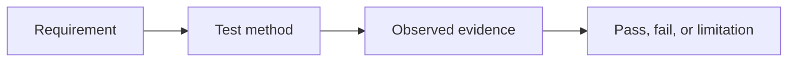
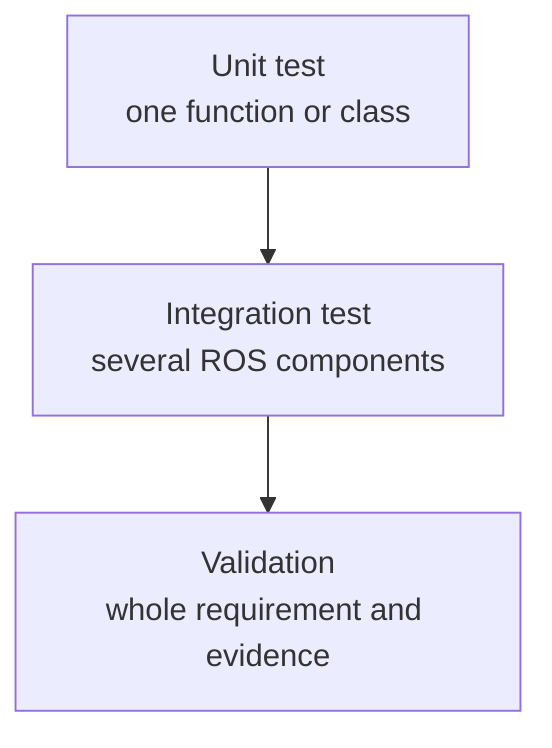
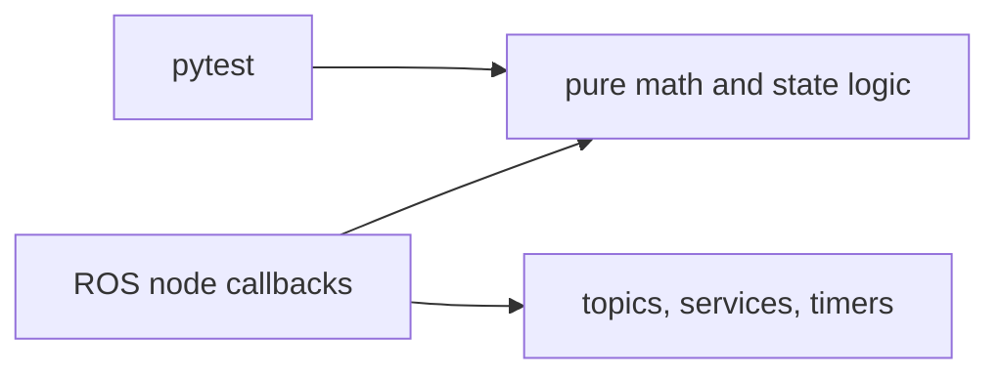

# Module 6 beginner guide — start here

Read this short guide before opening the tests or the final README.

> You have reached the final course module. Module 6 does not add a more
> complicated robot behavior. It teaches you how to determine whether the
> behavior already built is correct, repeatable, and honestly documented.

## 1. The main lesson

The main lesson is **an engineering claim needs evidence**.

“The robot worked once” is an observation. A defensible conclusion connects a
requirement to a test and a recorded result:



For example:

| Weak statement | Evidence-based statement |
|---|---|
| The robot is safe. | In simulation, a reading above 6.0 caused `/cmd_vel` to become zero before the controller entered its retreat state. |
| The controller works. | Unit tests checked angle wrapping and speed clamping; an integration run checked the waypoint and retreat sequence. |
| The project is autonomous. | The rover follows a predefined route in one known world; it does not plan around obstacles. |

The second column is more credible because its scope is clear.

## 2. Three levels of checking



### Unit test

A unit test checks a small deterministic piece without starting ROS or Gazebo.
Examples include `normalize_angle()` and `calculate_hazard()`.

### Integration test

An integration test checks that components exchange the expected ROS data.
Examples include calling `/mission/start`, observing `/mission/state`, and
checking that a CSV file is written.

### Validation

Validation asks whether the complete project meets a stated requirement. It
combines commands, observations, screenshots, logs, and test results. You fill
the `Actual result` and `Pass/fail` columns yourself after running each check.

## 3. Why pure functions were separated from ROS nodes

The mathematical files do not create publishers, subscribers, or timers. This
is intentional:



The same logic used by a node can be tested quickly without launching a
simulator. If a math test fails, the problem is probably in the math. If the
math passes but the rover does not move, investigate ROS configuration,
topics, frames, bridges, or timing.

## 4. What tests prove—and what they do not

Passing tests provide evidence only for the cases that were tested. They do
not prove:

- operation in every possible world;
- safe behavior on physical hardware;
- correct behavior after a controller-process crash;
- collision avoidance;
- certification to a safety standard.

This limitation is normal. Good engineering reports define the boundary of
their evidence.

## 5. File reading order

Read only one layer at a time:

1. `test_control_math.py` — familiar equations with explicit expected values.
2. `test_hazard_math.py` — the Gaussian hazard model and invalid inputs.
3. `test_state_machine.py` — permitted state transitions.
4. `validation_plan.md` — complete-system evidence.
5. `demo_storyboard.md` — how to communicate the result concisely.
6. `learning_review.md` — participation scope and questions for continued study.
7. `README.md` — the complete public-facing project description.

You do not need to memorize pytest. Focus on the pattern:

```python
result = function_under_test(known_input)
assert result == expected_value
```

## 6. One test, read slowly

```python
def test_velocity_saturation() -> None:
    linear, angular = saturate_velocity(
        linear_velocity=2.5,
        angular_velocity=-4.0,
        max_linear_speed=0.35,
        max_angular_speed=1.2,
    )

    assert linear == pytest.approx(0.35)
    assert angular == pytest.approx(-1.2)
```

- The name states the behavior being checked.
- The requested speeds deliberately exceed the limits.
- The function is called with known inputs.
- `assert` states the required result.
- `pytest.approx` allows tiny floating-point rounding differences.

That is the essential structure of most tests in this module.

## 7. Predict before running

Write down your answers:

1. Will the unit tests open Gazebo? Why or why not?
2. What state should follow a hazard event during waypoint motion?
3. What should happen to a request of `2.5 m/s` when the limit is `0.35 m/s`?
4. Can passing unit tests prove that `/odom` is bridged correctly?
5. Which evidence would you capture for the single-launch requirement?

## 8. Minimum understanding before completion

You are ready to finish when you can explain:

- the difference between unit and integration testing;
- why invalid sensor data is tested;
- how an assertion describes expected behavior;
- why the validation matrix keeps blank result columns;
- one genuine limitation of the project;
- one change you made and re-tested yourself.

## 9. Two intentional modification exercises

1. Add a test showing that a velocity already inside the limits is unchanged.
2. Add a state-machine test showing that reset returns `ABORTED` to `IDLE`.

Predict the result first, change only the test file, run the selected package
tests, and explain why the result supports the requirement.

## 10. The final course output

After you complete and document the validation matrix, the output is a
GitHub-ready educational ROS 2 workspace containing:

- a Xacro differential-drive robot and TF tree;
- a lightweight Gazebo Harmonic industrial world;
- ROS-Gazebo bridges for motion, odometry, joints, lidar, TF, and time;
- a position-dependent hazard sensor;
- a service-controlled mission state machine;
- a proportional known-route controller with data checks and retreat;
- RViz2 visualization and CSV mission records;
- focused unit tests and a manual integration-validation plan;
- six guided modules, architecture notes, a demo plan, and learning review questions.

It is evidence that you learned ROS 2 system integration and validation. It is
not evidence that you developed SLAM, AI, general autonomous navigation, or a
field-ready safety system.
