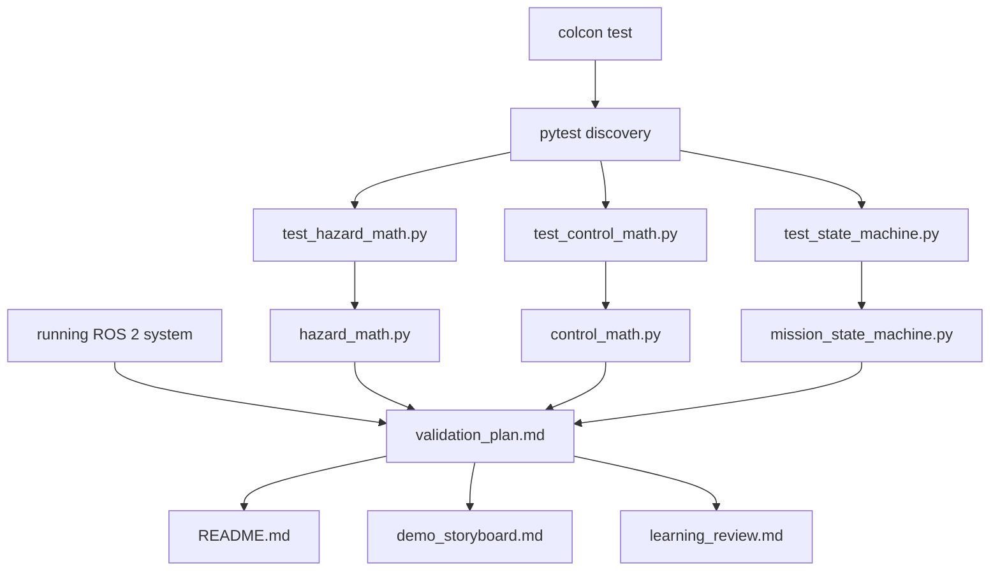

# Module 6 file and code guide

This document explains why every Module 6 file exists, how the test system
discovers it, its inputs and outputs, and how to test or modify it. Read the
beginner guide first.

## 1. Module structure



There are two paths:

- pytest calls small Python functions/classes and compares their output with
  known expectations;
- the student operates the full ROS 2 system and records integration evidence
  in the validation matrix.

## 2. How pytest discovers a file

By convention, pytest searches for files named `test_*.py`, then functions
named `test_*` inside them. No ROS 2 console-script entry point is required.

The packages declare:

```xml
<test_depend>python3-pytest</test_depend>
```

in `package.xml`. That line tells rosdep and package reviewers which tool is
required for testing. It does not run the tests. `colcon test` performs that
step.

The test directories are excluded from installed runtime Python packages by:

```python
packages=find_packages(exclude=['test'])
```

in `setup.py`. Tests belong in the source repository and build/test workflow;
the rover does not import them while operating.

## 3. `test_hazard_math.py`

### Why it exists

The hazard node includes random noise, subscriptions, timers, and ROS
parameters. Testing all of those at once makes a mathematical failure hard to
locate. This file tests the deterministic equation separately.

### Inputs and outputs

| Tested function | Input | Output |
|---|---|---|
| `calculate_hazard` | position, zone, baseline, peak, spread, optional noise offset | nonnegative hazard value or `ValueError` |
| `is_valid_position` | planar x and y | Boolean validity result |

### Import block

```python
import math

import pytest

from hazard_inspection_sim.hazard_math import (
    calculate_hazard,
    is_valid_position,
)
```

- `math` supplies `nan` and `inf` invalid cases.
- `pytest` supplies approximate comparison, parametrization, and exception
  checks.
- the final import brings in the same production functions used by the node.
  The test does not contain a duplicate hazard equation.

### Center-value test

```python
value = calculate_hazard(
    x=2.0,
    y=3.0,
    zone_x=2.0,
    zone_y=3.0,
    baseline=0.2,
    peak=10.0,
    spread=1.5,
)

assert value == pytest.approx(10.2)
```

At the center, squared distance is zero and `exp(0) = 1`. The exact model is
therefore `0.2 + 10.0 = 10.2`. Named arguments make the engineering meaning of
each number visible.

`pytest.approx` is used because many floating-point calculations cannot be
represented exactly in binary. It permits a very small numerical difference,
not a different engineering result.

### Far-field test

A point at `(100, 100)` has a very negative exponential argument. The peak
contribution becomes nearly zero, so the value approaches the baseline. This
checks the physical shape of the model, not only the center.

### Noise and nonnegative clamp test

The pure function receives `noise_offset`; it does not generate randomness.
This keeps the test repeatable. A negative offset larger than a far-field
reading checks that the final result clamps at zero.

### Parametrized validity test

```python
@pytest.mark.parametrize(
    ('x', 'y', 'expected'),
    [
        (0.0, 1.0, True),
        (math.nan, 1.0, False),
        (0.0, math.inf, False),
    ],
)
```

Parametrization runs one test function three times. It avoids three almost
identical functions while making the cases visible in failure output.

### Exception test

```python
with pytest.raises(ValueError):
    calculate_hazard(...)
```

This assertion passes only if invalid model parameters raise `ValueError`.
Silently producing a number from a zero spread would hide a configuration
fault.

### Independent command

```bash
python3 -m pytest -q \
  src/hazard_inspection_sim/test/test_hazard_math.py
```

### Intentional modifications

1. Calculate the expected value one spread-distance away and add that case.
2. Add a case proving that a negative baseline is rejected.

Predict the expected result before editing.

## 4. `test_control_math.py`

### Why it exists

Waypoint geometry and command saturation determine what the controller asks
the rover to do. The functions are deterministic, so testing them without
Gazebo is faster and gives clearer failure messages.

### Inputs and outputs

| Function | Input | Output |
|---|---|---|
| `normalize_angle` | finite angle | equivalent angle in `[-pi, pi]` |
| `calculate_waypoint_error` | pose and target | distance, desired heading, heading error |
| `saturate_velocity` | requested speeds and limits | clamped speed pair |
| `quaternion_to_yaw` | quaternion components | yaw or `ValueError` |

### Angle boundary cases

```python
(math.pi + 0.1, -math.pi + 0.1)
```

The two values describe the same physical direction. This case protects
against asking the rover to rotate nearly a complete turn across the wrap
boundary.

### Known 3–4–5 geometry

The position moves from `(1, 2)` toward `(4, 6)`, so:

```text
delta_x = 3
delta_y = 4
distance = sqrt(3² + 4²) = 5
heading = atan2(4, 3)
```

Using a result known by inspection makes the test understandable and reduces
the risk of copying the same error into the test.

### Velocity saturation test

```python
linear, angular = saturate_velocity(
    linear_velocity=2.5,
    angular_velocity=-4.0,
    max_linear_speed=0.35,
    max_angular_speed=1.2,
)
```

The requests deliberately exceed both limits and have different signs. The
assertions prove the function respects magnitude and sign. This test does not
prove that a physical motor has a speed limit; it proves what command the
educational software returns.

### Invalid quaternion tests

A quaternion containing NaN has no usable orientation. A quaternion of all
zeros has no direction and cannot be normalized. Both must be rejected before
feedback control uses them.

### Independent command

```bash
python3 -m pytest -q \
  src/hazard_inspection_control/test/test_control_math.py
```

### Intentional modifications

1. Add a test that in-limit commands pass through unchanged.
2. Add a test that nonpositive speed limits raise `ValueError`.

## 5. `test_state_machine.py`

### Why it exists

The state machine defines legal mission sequences. It is independent of ROS,
so a test can drive it with explicit events rather than waiting for a rover to
reach a physical coordinate.

### Input and output model

Input is an event such as `request_start()`, `report_hazard()`, or
`report_retreat_complete()`. Output is a `TransitionResult`, and the machine's
properties reflect the new state and route index.

### Initial-state test

```python
machine = MissionStateMachine()

assert machine.state == MissionStateCode.IDLE
assert machine.waypoint_index == 0
assert not machine.is_active
```

An explicit stopped initial condition prevents behavior from depending on an
uninitialized value.

### Hazard-transition test

```python
machine.request_start()
result = machine.report_hazard(6.25)
```

The arrange step starts the machine. The act step reports the threshold event.
The assertions then check acceptance, the prior state, the new state, and the
diagnostic detail. The test does not decide whether 6.25 exceeds a configured
threshold; the ROS controller makes that comparison before issuing this event.

### Invalid-data test boundary

The state machine does not parse sensor values. The ROS node rejects invalid
data and calls `request_abort(reason)`. Therefore the pure state test verifies
that this event reaches `ABORTED`, while the manual integration test publishes
NaN to verify the node creates the event.

This illustrates an important test-design rule: test each responsibility at
the layer that owns it.

### Retreat sequence

```text
IDLE
  request_start
MOVING_TO_WAYPOINT
  report_hazard
HAZARD_DETECTED
  begin_retreat
RETREATING
  report_retreat_complete
ABORTED
```

The explicit intermediate assertions make a failure easier to localize.

### Independent command

```bash
python3 -m pytest -q \
  src/hazard_inspection_control/test/test_state_machine.py
```

### Intentional modifications

1. Test that reset from `ABORTED` returns to `IDLE` and index zero.
2. Test that a hazard event is rejected while already `IDLE`.

## 6. `validation_plan.md`

### Why it exists

Unit tests cannot see Gazebo, TF, ROS topic connections, RViz, services, or the
created CSV. The validation plan covers these system-level requirements.

### How it is used

The first three columns are specified before a run:

```text
Requirement | Test method | Expected result
```

The student fills the last columns afterward:

```text
Actual result | Pass/fail
```

Do not change the expected result to match an unexpected observation. A
failure is useful information and should produce a focused diagnosis.

### Inputs and outputs

- Inputs: running project, CLI commands, screenshots, logs, test summaries.
- Output: a traceable table of observed results and evidence references.
- ROS discovery: none; this is an engineering document, not runtime code.

### Intentional modifications

1. Add a row for the parameter experiment you selected.
2. Add an environment row recording WSL2/GUI performance relevant to your run.

## 7. `demo_storyboard.md`

### Why it exists

A short demonstration should show evidence in a logical order. Without a plan,
too much time is often spent waiting for windows or explaining claims that are
not visible.

### Inputs and outputs

- Inputs: validated commands, selected screenshots, test and CSV output.
- Output: a 60–90 second factual screen recording and narration.
- ROS discovery: none.

The storyboard does not replace live understanding. Be ready to reproduce
each command and answer why the state changed.

### Intentional modifications

1. Rewrite the narration in your own speaking style without expanding claims.
2. Rebalance two time segments after a rehearsal while keeping the total under
   90 seconds.

## 8. `learning_review.md`

This file records the scope of guided participation and lists questions for
continued study. It contains no application essays or claim of independent
implementation. Future observations should be recorded in the learner's own
words and supported by an actual run or capture. Review prompts are not
completed accomplishments.

## 9. Root `README.md`

### Why it exists

GitHub renders `README.md` at the repository root as the entry point for a
reviewer. It must explain motivation, architecture, installation, operation,
testing, limitations, and evidence without requiring the reviewer to open
every tutorial.

### How it is discovered

GitHub recognizes the root file by name. ROS 2 does not load it. Its links use
repository-relative paths so they work on GitHub.

### Inputs and outputs

- Inputs: package contracts, configuration, validated commands, evidence.
- Output: a public technical overview and navigation page.

### Intentional modifications

1. Add your own verified screenshot and demonstration-video link.
2. Replace example validation placeholders with a short summary linking to
   your completed matrix.

## 10. Why no new ROS node is added

Module 6 checks the responsibilities introduced in Modules 1–5. Adding another
runtime feature would change the system just as validation begins and would
blur the course objective. Tests and documentation are deliverable software
engineering work even though they do not command the rover.

## 11. Full independent verification

```bash
cd ~/ros2_projects/hazard_inspection_ws
source /opt/ros/humble/setup.bash
colcon build --symlink-install \
  --packages-up-to hazard_inspection_bringup
source install/setup.bash
colcon test --event-handlers console_direct+ \
  --packages-select hazard_inspection_sim hazard_inspection_control
colcon test-result --verbose
```

Then follow the integration and evidence procedure in
`module_06_testing_and_portfolio.md`.

## 12. What you should be able to explain

You do not need to memorize every pytest decorator. You should be able to
point to:

- one equation and its known expected result;
- one invalid input and why it is unsafe to use;
- one legal and one rejected state transition;
- one ROS behavior that cannot be proven by a pure unit test;
- one limitation that remains after all tests pass;
- one modification you predicted, implemented, and re-tested.
