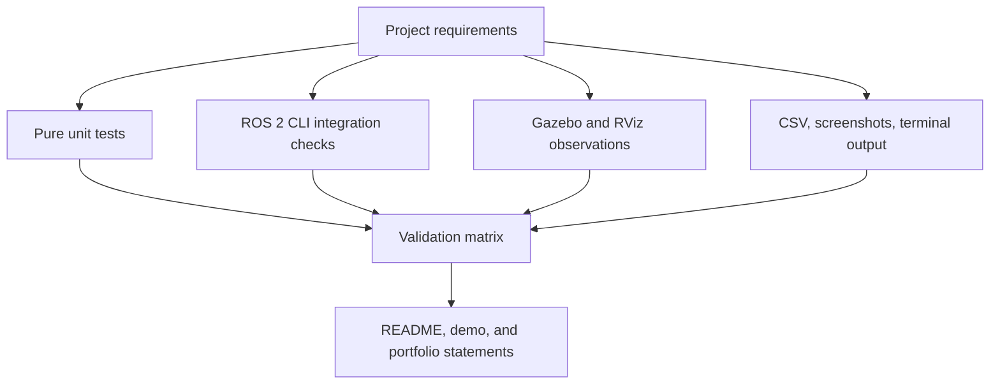

# Module 6 — testing, validation, and portfolio preparation

**Estimated time:** 3–5 hours  
**Course position:** final module  
**Prerequisite:** Module 5 has been built and its default mission has completed
the hazard-stop and retreat sequence.

## Learning objectives

By the end of this module, you should be able to:

1. distinguish unit, integration, and requirement-validation tests;
2. read and modify small pytest tests;
3. verify hazard mathematics, waypoint calculations, speed saturation, state
   transitions, and invalid-data rejection;
4. collect repeatable ROS 2 CLI, RViz2, Gazebo, CSV, and terminal evidence;
5. record actual results without changing the expected result after a failure;
6. describe the project accurately in GitHub, a resume, an SOP, and an
   interview;
7. state important technical limitations without minimizing the work.

## Concepts introduced

- deterministic unit tests;
- arrange–act–assert test structure;
- pytest parametrization and approximate floating-point comparisons;
- integration testing through ROS 2 CLI observations;
- verification versus validation;
- traceability from requirement to evidence;
- regression testing after a code change;
- technical portfolio communication.

## Files created or modified

| File | Purpose |
|---|---|
| `src/hazard_inspection_sim/test/test_hazard_math.py` | Tests the hazard equation and bad position/model inputs. |
| `src/hazard_inspection_control/test/test_control_math.py` | Tests angle, waypoint, quaternion, and saturation helpers. |
| `src/hazard_inspection_control/test/test_state_machine.py` | Tests mission transitions independently of ROS. |
| `docs/module_06_beginner_start_here.md` | Provides the mental model before reading tests. |
| `docs/module_06_testing_and_portfolio.md` | Gives the complete guided procedure. |
| `docs/module_06_file_and_code_guide.md` | Explains every new file and important test statement. |
| `docs/validation_plan.md` | Maps requirements to repeatable checks and blank result fields. |
| `docs/demo_storyboard.md` | Plans a factual 60–90 second demonstration. |
| `docs/learning_review.md` | Records guided-learning scope and questions for continued study. |
| `README.md` | Becomes the complete public-facing project document. |

## System-evidence structure



Unit tests cover deterministic logic. They do not launch ROS. Integration
checks cover the running graph. The validation matrix keeps these evidence
types connected to the original requirements.

## Before running: student predictions

Record your predictions in a notebook or issue:

1. How many tests do you expect in each Python package?
2. What should `normalize_angle(pi + 0.1)` return approximately?
3. Why should a zero-norm quaternion raise an error?
4. What state should follow `RETREATING` when the safe point is reached?
5. Which test requires Gazebo: velocity saturation or end-to-end retreat?
6. What result would show that the CSV logger is receiving all four inputs?

## Part A — synchronize and inspect the tests

If you keep the authored repository on mounted Windows storage, synchronize it
to the Linux workspace used for Modules 1–5. Copy `src`, `docs`, `README.md`,
`LICENSE`, and `.gitignore`; do not copy `build`, `install`, or `log`.

In the WSL terminal:

```bash
cd ~/ros2_projects/hazard_inspection_ws
find src/hazard_inspection_sim/test \
  src/hazard_inspection_control/test -maxdepth 1 -type f -print
```

Expected file names include:

```text
src/hazard_inspection_sim/test/test_hazard_math.py
src/hazard_inspection_control/test/test_control_math.py
src/hazard_inspection_control/test/test_state_machine.py
```

Open `test_control_math.py`. Identify one input, the function call, and the
asserted output before continuing.

## Part B — install dependencies and build

```bash
cd ~/ros2_projects/hazard_inspection_ws
source /opt/ros/humble/setup.bash

rosdep install --from-paths src \
  --ignore-src --rosdistro humble -r -y

colcon build --symlink-install \
  --packages-up-to hazard_inspection_bringup

source install/setup.bash
```

Expected build summary:

```text
Summary: 5 packages finished
```

The exact timing and build order may differ. There should be no failed
package. A warning is not automatically a failure; read its content.

## Part C — run the unit tests

Run only the two packages that contain Module 6 tests:

```bash
colcon test --event-handlers console_direct+ \
  --packages-select hazard_inspection_sim hazard_inspection_control

colcon test-result --verbose
```

Expected result:

```text
Summary: 2 packages finished
Summary: 28 tests, 0 errors, 0 failures, 0 skipped
```

The wording can vary with the installed colcon/pytest versions. The important
result is zero failures and zero errors. The current three files contain 28
test cases after parametrized cases are expanded.

To run one test file while learning:

```bash
python3 -m pytest -q \
  src/hazard_inspection_control/test/test_control_math.py
```

To run one named test:

```bash
python3 -m pytest -q \
  src/hazard_inspection_control/test/test_control_math.py \
  -k velocity_saturation
```

Expected focused output resembles:

```text
1 passed, 9 deselected
```

### What each test group establishes

| Requirement | Test file | Evidence |
|---|---|---|
| Hazard value follows the documented equation | `test_hazard_math.py` | Center equals baseline plus peak; distant value approaches baseline. |
| Invalid hazard inputs are rejected | `test_hazard_math.py` | NaN position is invalid; bad spread and peak raise `ValueError`. |
| Angles are normalized | `test_control_math.py` | Values across ±π wrap to the equivalent short rotation. |
| Waypoint error is calculated | `test_control_math.py` | A 3–4–5 case returns distance 5 and the expected `atan2` heading. |
| Commands are speed-limited | `test_control_math.py` | Requests beyond limits return ±configured limits. |
| Invalid orientation/pose is rejected | `test_control_math.py` | NaN and zero quaternion cases raise `ValueError`. |
| Hazard interrupts motion | `test_state_machine.py` | Moving state changes to `HAZARD_DETECTED`. |
| Retreat ends stopped | `test_state_machine.py` | Hazard → retreat → `ABORTED`. |

## Part D — intentionally observe a regression test

This exercise demonstrates why a test is useful. Do not change production
code.

1. In `test_velocity_saturation`, temporarily change expected linear speed
   from `0.35` to `0.36`.
2. Predict the failure message.
3. Run the one named test.
4. Read the `Obtained` and `Expected` values.
5. Restore `0.35`.
6. Run the test again and confirm it passes.

Do not commit the intentionally wrong expectation. This exercise shows that a
test is an executable requirement, not decoration.

## Part E — launch the integrated system

Terminal 1:

```bash
cd ~/ros2_projects/hazard_inspection_ws
source /opt/ros/humble/setup.bash
source install/setup.bash
ros2 launch hazard_inspection_bringup inspection_demo.launch.py
```

Expected visible result:

- Gazebo Harmonic opens the light industrial world;
- the rover spawns on the green start area;
- RViz2 shows RobotModel, TF, odometry, laser scan, cyan route, and status;
- the initial mission state is `IDLE`;
- the hazard level is near its baseline at the start.

If the laptop is resource constrained, validate without GUIs first:

```bash
ros2 launch hazard_inspection_bringup inspection_demo.launch.py \
  gui:=false rviz:=false
```

## Part F — inspect the ROS graph

Terminal 2:

```bash
source /opt/ros/humble/setup.bash
source ~/ros2_projects/hazard_inspection_ws/install/setup.bash

ros2 node list
ros2 topic list
ros2 service list | grep '^/mission/'
ros2 topic info /odom --verbose
ros2 topic info /hazard/level --verbose
ros2 topic info /cmd_vel --verbose
```

Expected project nodes include:

```text
/hazard_sensor_node
/mission_controller_node
/mission_logger_node
/mission_manager_node
/robot_state_publisher
```

Gazebo bridge, spawn, and RViz node names may include namespaces or generated
suffixes. Expected mission services are `/mission/start`, `/mission/reset`,
and `/mission/abort`.

## Part G — validate the default hazard-retreat mission

Keep Terminal 1 running. In Terminal 2, observe state messages:

```bash
ros2 topic echo /mission/state
```

Terminal 3:

```bash
source /opt/ros/humble/setup.bash
source ~/ros2_projects/hazard_inspection_ws/install/setup.bash
ros2 service call /mission/start std_srvs/srv/Trigger "{}"
```

Expected accepted response contains:

```text
success=True
```

Expected mission sequence:

```text
IDLE
MOVING_TO_WAYPOINT
INSPECTING
MOVING_TO_WAYPOINT
HAZARD_DETECTED
RETREATING
ABORTED
```

The state stream repeats because status is published periodically. Confirm the
important ordering rather than expecting exactly one message per state.

During `HAZARD_DETECTED`, sample the command:

```bash
ros2 topic echo /cmd_vel --once
```

Expected safety command:

```text
linear:
  x: 0.0
angular:
  z: 0.0
```

Because the visible stop lasts only 0.5 seconds, a single manual sample can
miss it. The state sequence and CSV rows give more reliable retrospective
evidence.

## Part H — validate start, abort, and reset services

Reset, start, abort, then reset again:

```bash
ros2 service call /mission/reset std_srvs/srv/Trigger "{}"
ros2 service call /mission/start std_srvs/srv/Trigger "{}"
ros2 service call /mission/abort std_srvs/srv/Trigger "{}"
ros2 service call /mission/reset std_srvs/srv/Trigger "{}"
```

Expected states are `IDLE`, `MOVING_TO_WAYPOINT`, `ABORTED`, then `IDLE`.
Each accepted service response should report `success=True`.

## Part I — validate invalid hazard handling

This test deliberately publishes one invalid sensor sample to an active
controller. First reset and start:

```bash
ros2 service call /mission/reset std_srvs/srv/Trigger "{}"
ros2 service call /mission/start std_srvs/srv/Trigger "{}"
ros2 topic pub --once /hazard/level std_msgs/msg/Float64 \
  "{data: .nan}"
```

Expected controller behavior:

- it logs that hazard data is invalid;
- it publishes zero velocity;
- the mission becomes `ABORTED`.

Confirm:

```bash
ros2 topic echo /mission/state --once
```

The simulator's hazard publisher will continue publishing valid values later,
but an aborted mission remains aborted until reset.

## Part J — validate the completion branch

The default threshold intentionally creates a retreat. A separate run checks
the completion branch. Stop the launch with `Ctrl+C`, then temporarily change
`hazard_threshold: 6.00` to `20.00` in
`src/hazard_inspection_bringup/config/inspection_params.yaml`, rebuild the
bringup package, source the workspace, and launch again:

```bash
colcon build --symlink-install \
  --packages-select hazard_inspection_bringup
source install/setup.bash
ros2 launch hazard_inspection_bringup inspection_demo.launch.py
```

Start the mission. Expected final state: `MISSION_COMPLETE`. Restore the
threshold to `6.00`, rebuild, and rerun tests afterward.

## Part K — inspect the CSV evidence

After a mission, stop the launch cleanly with `Ctrl+C` so the logger closes its
file. Then inspect the newest log:

```bash
ls -lt ~/.ros/hazard_inspection_rover/logs
LATEST_LOG=$(find ~/.ros/hazard_inspection_rover/logs \
  -maxdepth 1 -type f -name 'mission_*.csv' \
  -printf '%T@ %p\n' | sort -nr | head -n 1 | cut -d' ' -f2-)
echo "$LATEST_LOG"
head -n 5 "$LATEST_LOG"
tail -n 10 "$LATEST_LOG"
```

Expected header:

```text
time,x,y,yaw,linear_velocity,angular_velocity,hazard_level,mission_state
```

Expected evidence includes changing `x`, `y`, and yaw; nonzero command values
during motion; increasing hazard near the zone; and final `ABORTED` or
`MISSION_COMPLETE` rows depending on the run.

## Part L — inspect TF and sensor behavior

While the system is running:

```bash
ros2 run tf2_ros tf2_echo odom base_link
```

The transform should update while the rover moves. Stop with `Ctrl+C`.

Create a frame graph:

```bash
cd ~/ros2_projects/hazard_inspection_ws
ros2 run tf2_tools view_frames
```

Expected output includes `frames.pdf`. Confirm the connected chain from
`odom` through `base_footprint` and `base_link` to wheels and sensor frames.

Check sensor frequencies:

```bash
ros2 topic hz /odom
ros2 topic hz /scan
ros2 topic hz /hazard/level
```

Rates can fluctuate under WSL2 load. Record observed values; do not invent
perfect values.

## Part M — fill the validation matrix

Open `docs/validation_plan.md`. For every row you actually test:

1. leave the requirement and expected result unchanged;
2. write the observed result, including a measured value where useful;
3. link or name the evidence file;
4. mark Pass or Fail;
5. if it fails, create a small issue or debugging note before changing code.

Suggested evidence directory for GitHub:

```text
docs/evidence/
├── gazebo_world.png
├── rviz_integrated_view.png
├── hazard_state_sequence.txt
├── frames.pdf
├── test_results.txt
└── csv_excerpt.txt
```

Do not commit a large video or every generated CSV to the repository. Host the
demo video separately and link it from the README.

## Part N — prepare the portfolio

Use the checklist in `docs/demo_storyboard.md` to record a 60–90 second video.
Use `docs/learning_review.md` to review concepts and accurately distinguish
guided execution from independent implementation. Add only observations you
actually made; the questions do not imply that all exercises were completed.

## Expected topic and node behavior

| Item | Expected behavior |
|---|---|
| `/odom` | Updates rover position and orientation during motion. |
| `/scan` | Publishes range data; shown in RViz, not used for control. |
| `/hazard/level` | Rises according to distance from the configured zone. |
| `/cmd_vel` | Bounded motion commands; zero in stopped states. |
| `/mission/state` | Reports the seven-state finite-state-machine status. |
| `/mission/path` | Publishes the fixed known route for RViz. |
| `/mission/status_marker` | Displays state/hazard text above the rover. |
| logger | Samples latest topic values to a timestamped CSV and closes on shutdown. |

## Common errors and troubleshooting

### `ModuleNotFoundError` during direct pytest

Cause: the workspace was not built or sourced.

Smallest correction:

```bash
source /opt/ros/humble/setup.bash
cd ~/ros2_projects/hazard_inspection_ws
colcon build --symlink-install
source install/setup.bash
python3 -m pytest -q src/hazard_inspection_control/test
```

### `colcon test-result` shows an old failure

Cause: results under `build/` can include a previous run.

First inspect the named result and rerun only the affected package. Do not
delete all build products reflexively:

```bash
colcon test --packages-select hazard_inspection_control \
  --event-handlers console_direct+
colcon test-result --verbose
```

### A floating-point assertion differs by a tiny amount

Use `pytest.approx` for calculated floating-point results. Do not weaken a test
with a very large tolerance merely to make it pass.

### `Package 'hazard_inspection_bringup' ... was not found`

Confirm the Linux copy contains the package and source the base ROS setup:

```bash
ls src/hazard_inspection_bringup/package.xml
source /opt/ros/humble/setup.bash
colcon list
```

If it is absent from `colcon list`, you are in the wrong workspace or did not
synchronize Module 5/6 source files.

### Gazebo or RViz is slow in WSL2

Run `gui:=false rviz:=false` for CLI validation. Close unrelated GUI programs.
Record performance as a test-environment limitation rather than changing
control gains until a visual symptom disappears.

### The default mission reaches `MISSION_COMPLETE` instead of retreating

Check the actual `hazard_threshold` and hazard-zone parameters:

```bash
ros2 param get /mission_controller_node hazard_threshold
ros2 param get /hazard_sensor_node hazard_zone_x
ros2 param get /hazard_sensor_node hazard_zone_y
```

Compare the loaded values with the YAML files. Rebuild and re-source after a
non-symlink-installed configuration change.

### No CSV appears

Read the logger startup output for the exact path and any file-creation error.
Confirm the directory parameter:

```bash
ros2 param get /mission_logger_node output_directory
```

Stop the launch cleanly with `Ctrl+C`; abrupt WSL termination can prevent the
final buffer from being flushed.

## Student exercises

### Exercise 1 — add an in-range saturation test

Add a test proving that `(0.2, -0.5)` remains unchanged under limits `(0.35,
1.2)`. Explain why both “clamps excessive values” and “preserves valid values”
matter.

### Exercise 2 — add a reset transition test

Drive the pure state machine to `ABORTED`, call `request_reset()`, and assert
`IDLE` and waypoint index zero.

### Exercise 3 — one controlled parameter experiment

Choose exactly one parameter, predict the effect, run the mission, and record
the result. Good choices are `max_linear_speed`, `inspection_duration`, or
`hazard_threshold`. Restore the baseline afterward.

## Questions you should answer before publishing

1. Why is `atan2` used instead of `atan(delta_y / delta_x)`?
2. Why are speed limits tested separately from Gazebo?
3. What makes the hazard model reproducible despite simulated noise?
4. What is the difference between a safe coordinate and obstacle avoidance?
5. Why does invalid or stale data cause an abort?
6. Why is the laser scan displayed but not a controller input?
7. What does the CSV timestamp represent, and what synchronization limitation
   does latest-value sampling have?
8. Which evidence supports the claim that the project launches with one
   command?

## Completion checklist

- [ ] I can explain unit, integration, and validation testing.
- [ ] Both tested ROS packages build successfully.
- [ ] `colcon test-result --verbose` reports zero failures and errors.
- [ ] I completed both intentional test modifications and restored the files.
- [ ] I observed the default hazard-stop-retreat sequence.
- [ ] I validated start, reset, and abort services.
- [ ] I verified invalid hazard data causes a stopped `ABORTED` state.
- [ ] I ran and recorded the high-threshold completion branch.
- [ ] I inspected a CSV header and representative rows.
- [ ] I checked the TF chain and key topic behavior.
- [ ] I filled the validation matrix with actual—not expected—observations.
- [ ] I captured the planned screenshots and a 60–90 second demonstration.
- [ ] I replaced student metadata and can explain every portfolio claim.
- [ ] I documented at least one limitation and one modification I made.

## Expected evidence to report

Send the instructor:

1. the `colcon test-result --verbose` summary;
2. the observed default state sequence;
3. the high-threshold final state;
4. the invalid-hazard final state;
5. the CSV path, header, and two representative rows;
6. one RViz2 screenshot and one Gazebo screenshot;
7. three validation rows with actual result and Pass/Fail filled;
8. the parameter experiment and whether your prediction was correct;
9. one concept that remains unclear.

## Suggested Git commits

If you prefer small, reviewable commits:

```bash
git add src/hazard_inspection_sim/test \
  src/hazard_inspection_control/test
git commit -m "test: add controller and sensor unit tests"

git add README.md docs
git commit -m "docs: complete project documentation"
```

Before committing, run:

```bash
git status
git diff --check
```

Do not add generated `build/`, `install/`, `log/`, or mission CSV files.

## Module conclusion

Module 6 completes the six-module course. The final result is not simply a
moving simulation; it is a traceable engineering portfolio artifact. The
student has separated deterministic logic from middleware, checked edge cases,
validated a multi-node ROS 2 system, recorded evidence, and defined the
project's limitations. Those habits transfer directly to graduate laboratory
work: state a requirement, design a test, record what happened, investigate
failures, and make only claims supported by the evidence.

Stop here after completing the checklist. Report your results before calling
the course complete.
