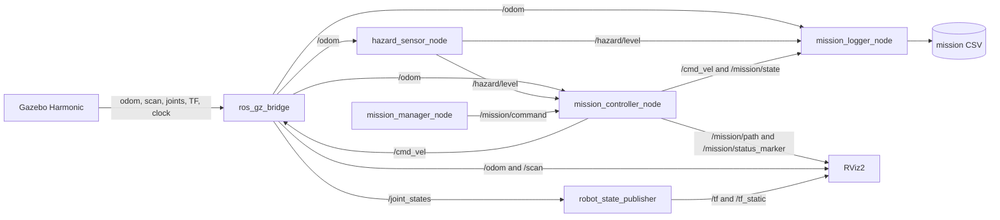
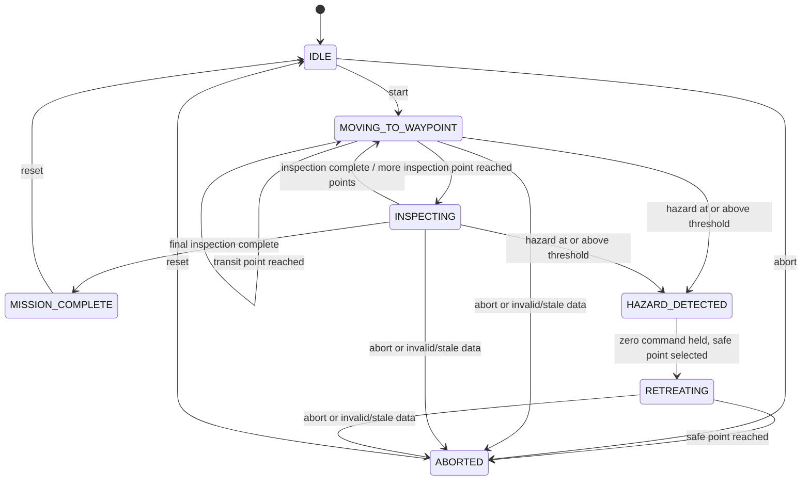
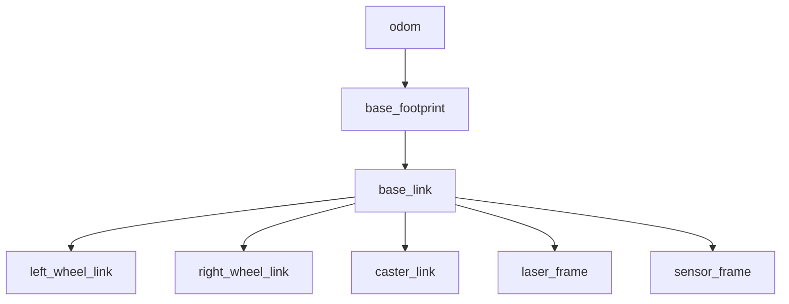

# Technical reference

AI-generated learning material for the supplied ROS 2 example. Features described here are not a claim of independently authored software. See the [learning overview](../README.md) for my role.

## System architecture

The workspace uses five packages because model assets, simulation, interfaces,
behavior, and launch configuration change for different reasons.

| Package | Build type | Responsibility |
|---|---|---|
| `hazard_inspection_description` | `ament_cmake` | Xacro robot, inertial/collision geometry, static RViz setup |
| `hazard_inspection_sim` | `ament_python` | Gazebo world, spawn launch, bridges, RViz simulation view, hazard node |
| `hazard_inspection_control` | `ament_python` | Introductory nodes, control math, state machine, controller, manager, logger |
| `hazard_inspection_interfaces` | `ament_cmake` | Custom `MissionState` message contract |
| `hazard_inspection_bringup` | `ament_python` | Integrated parameters and one-command main launch |

Standard `std_srvs/srv/Trigger` services are used for start, reset, and abort.
A custom service would add complexity without carrying useful request data.
The custom message is justified because mission status contains a state code,
name, waypoint index, timestamp, and diagnostic detail.

More design detail is in [docs/architecture.md](architecture.md).

### Node-and-topic graph



### Finite-state machine



`HAZARD_DETECTED` is intentionally observable: normal motion is stopped before
retreat begins. After retreat the mission remains `ABORTED` until an operator
reset; the controller does not silently resume an interrupted inspection.

### TF frame tree



| Frame | Meaning and owner |
|---|---|
| `odom` | Locally continuous simulated odometry reference; Gazebo diff-drive system provides its dynamic transform. |
| `base_footprint` | Ground-plane projection used as the diff-drive child frame. |
| `base_link` | Main body reference at the chassis center; fixed transform from Xacro. |
| wheel frames | Rotating drive components; Xacro joints plus `/joint_states`. |
| `caster_link` | Simplified passive support; fixed body transform. |
| `laser_frame` | Origin of `LaserScan` range measurements. |
| `sensor_frame` | Conceptual location of the simulated environmental sensor. |

Inspect TF while running:

```bash
ros2 run tf2_ros tf2_echo odom base_link
ros2 run tf2_tools view_frames
```

## Controller mathematics

For rover pose `(x, y, yaw)` and target `(x_t, y_t)`:

```text
delta_x         = x_t - x
delta_y         = y_t - y
distance        = sqrt(delta_x² + delta_y²)
desired_heading = atan2(delta_y, delta_x)
heading_error   = normalize(desired_heading - yaw)
```

The unsaturated proportional commands are:

```text
linear  = linear_gain  × distance
angular = angular_gain × heading_error
```

If absolute heading error exceeds the alignment tolerance, linear velocity is
zero so the rover rotates first. Both commands are clamped to their configured
limits. Proportional linear speed naturally decreases near a waypoint. This is
an educational controller for a known route, not a production navigation
algorithm.

### Hazard model

For distance squared `d²` from the configured zone center:

```text
hazard = baseline + peak × exp(-d² / spread) + noise
noise  ~ Uniform(-noise_amplitude, +noise_amplitude)
```

The result is clamped nonnegative. The default seed is fixed for reproducible
noise. `spread` has square-metre units in this equation. Missing, stale, or
invalid odometry makes the sensor publish NaN so downstream safety logic can
stop rather than interpret missing evidence as a low hazard.

### State-machine pseudocode

```text
if mission is inactive:
    publish zero velocity
elif odometry or hazard is missing, stale, or invalid:
    publish zero and enter ABORTED
elif hazard >= threshold during motion or inspection:
    publish zero and enter HAZARD_DETECTED
elif state is MOVING_TO_WAYPOINT:
    calculate waypoint error and publish saturated proportional command
elif state is INSPECTING:
    publish zero until the inspection timer completes
elif state is HAZARD_DETECTED:
    hold zero, choose previous safe point, then enter RETREATING
elif state is RETREATING:
    drive toward safe point; stop and enter ABORTED when reached
```

## Software prerequisites

Required course environment:

- Ubuntu 22.04.5 LTS Jammy under WSL2;
- Linux `6.6.87.2-microsoft-standard-WSL2`;
- Python 3.10.12 through `python3`;
- ROS 2 Humble;
- Gazebo Harmonic / Gazebo Sim 8, not Gazebo Classic;
- VS Code connected using the WSL extension.

Keep the build workspace in a Linux path without spaces, such as
`~/ros2_projects/hazard_inspection_ws`. Avoid building from mounted Windows
paths; spaces can break Humble interface-generation paths, and mounted storage
is slower for colcon.

ROS 2 Humble normally pairs with Gazebo Fortress. This course intentionally
uses the OSRF Harmonic repository and `ros-humble-ros-gzharmonic`, as required.
Do not also install the default `ros-humble-ros-gz` metapackage into the same
environment.

## Native Ubuntu/WSL installation

Run these commands in Ubuntu WSL, not PowerShell. First verify Jammy:

```bash
grep -E '^(PRETTY_NAME|VERSION_ID|UBUNTU_CODENAME)=' /etc/os-release
```

### Locale and ROS 2 Humble

```bash
sudo apt update
sudo apt install -y locales software-properties-common curl
sudo locale-gen en_US en_US.UTF-8
sudo update-locale LC_ALL=en_US.UTF-8 LANG=en_US.UTF-8
export LANG=en_US.UTF-8

sudo add-apt-repository universe
export ROS_APT_SOURCE_VERSION=$(curl -s \
  https://api.github.com/repos/ros-infrastructure/ros-apt-source/releases/latest \
  | grep -F "tag_name" | awk -F'"' '{print $4}')
curl -L -o /tmp/ros2-apt-source.deb \
  "https://github.com/ros-infrastructure/ros-apt-source/releases/download/${ROS_APT_SOURCE_VERSION}/ros2-apt-source_${ROS_APT_SOURCE_VERSION}.$(. /etc/os-release && echo ${UBUNTU_CODENAME:-${VERSION_CODENAME}})_all.deb"
sudo dpkg -i /tmp/ros2-apt-source.deb
sudo apt update
sudo apt install -y ros-humble-desktop ros-dev-tools \
  python3-colcon-common-extensions python3-rosdep python3-pytest
```

Initialize dependency metadata once:

```bash
sudo rosdep init
rosdep update
```

If `rosdep init` says sources already exist, continue with `rosdep update`.

### Gazebo Harmonic and ROS integration

```bash
sudo apt-get update
sudo apt-get install -y curl lsb-release gnupg
sudo curl https://packages.osrfoundation.org/gazebo.gpg \
  --output /usr/share/keyrings/pkgs-osrf-archive-keyring.gpg
echo "deb [arch=$(dpkg --print-architecture) signed-by=/usr/share/keyrings/pkgs-osrf-archive-keyring.gpg] https://packages.osrfoundation.org/gazebo/ubuntu-stable $(lsb_release -cs) main" \
  | sudo tee /etc/apt/sources.list.d/gazebo-stable.list > /dev/null
sudo apt-get update
sudo apt-get install -y gz-harmonic ros-humble-ros-gzharmonic
```

### Project tools

```bash
sudo apt install -y ros-humble-xacro \
  ros-humble-joint-state-publisher \
  ros-humble-joint-state-publisher-gui \
  ros-humble-robot-state-publisher ros-humble-rviz2 \
  ros-humble-tf2-tools liburdfdom-tools
```

Configure new terminals:

```bash
echo "source /opt/ros/humble/setup.bash" >> ~/.bashrc
source ~/.bashrc
printenv ROS_DISTRO
python3 --version
gz sim --versions
```

Expected key values are `humble`, Python 3.10, and Gazebo Sim 8.x. WSL GUI
applications require WSLg and a nonempty `DISPLAY`.

Official references:
[ROS 2 Humble Ubuntu installation](https://docs.ros.org/en/humble/Installation/Ubuntu-Install-Debians.html),
[Gazebo Harmonic installation](https://gazebosim.org/docs/harmonic/install_ubuntu/),
and [ROS/Gazebo version guidance](https://gazebosim.org/docs/latest/ros_installation/).

## Build

```bash
cd ~/ros2_projects/hazard_inspection_ws
source /opt/ros/humble/setup.bash

rosdep install --from-paths src \
  --ignore-src --rosdistro humble -r -y

colcon build --symlink-install \
  --packages-up-to hazard_inspection_bringup

source install/setup.bash
```

Run `source install/setup.bash` in every new terminal after sourcing Humble.

## Run

Start the full project:

```bash
ros2 launch hazard_inspection_bringup inspection_demo.launch.py
```

Optional launch arguments:

```bash
# Headless system check
ros2 launch hazard_inspection_bringup inspection_demo.launch.py \
  gui:=false rviz:=false

# Choose a different CSV directory
ros2 launch hazard_inspection_bringup inspection_demo.launch.py \
  log_directory:=~/mission_logs
```

In a second sourced terminal, start the mission:

```bash
ros2 service call /mission/start std_srvs/srv/Trigger "{}"
```

Other operator commands:

```bash
ros2 service call /mission/abort std_srvs/srv/Trigger "{}"
ros2 service call /mission/reset std_srvs/srv/Trigger "{}"
```

## Expected behavior

The default route is expressed in the `odom` frame:

| Index | Coordinate | Type | Behavior |
|---:|---:|---|---|
| 0 | `(-1.60, -1.50)` | inspection | Stop for 2 seconds at station 1. |
| 1 | `(2.40, -1.50)` | transit | Pass the known narrow route and update safe return point. |
| 2 | `(3.50, 1.30)` | inspection | Approach station 2 and the hazard center. |

With threshold 6.0, the expected state progression is:

```text
IDLE → MOVING_TO_WAYPOINT → INSPECTING → MOVING_TO_WAYPOINT
     → HAZARD_DETECTED → RETREATING → ABORTED
```

The rover returns to the transit point and waits for reset. Setting the
threshold to 20.0 for a separate validation run should allow final
`MISSION_COMPLETE`. Restore the default afterward.

## ROS 2 interface reference

### Nodes

| Node | Main responsibility |
|---|---|
| `/robot_state_publisher` | Expands joint states and Xacro structure into TF. |
| `/ros_gz_bridge` | Translates configured Gazebo Transport and ROS messages. |
| `/hazard_sensor_node` | Converts odometry position into a noisy hazard reading. |
| `/mission_controller_node` | Runs state, safety, and proportional waypoint control. |
| `/mission_manager_node` | Converts operator services into command events. |
| `/mission_logger_node` | Samples latest mission values to CSV. |
| `/rviz2` | Visualizes robot, frames, scan, odometry, path, and status. |

Gazebo and spawn process names may vary slightly by installed ros_gz version.

### Topics

| Topic | Type | Producer | Main consumers |
|---|---|---|---|
| `/cmd_vel` | `geometry_msgs/msg/Twist` | controller | bridge/diff drive, logger |
| `/odom` | `nav_msgs/msg/Odometry` | Gazebo bridge | controller, hazard node, logger, RViz |
| `/scan` | `sensor_msgs/msg/LaserScan` | Gazebo bridge | RViz |
| `/joint_states` | `sensor_msgs/msg/JointState` | Gazebo bridge | robot state publisher |
| `/tf` | `tf2_msgs/msg/TFMessage` | bridge and state publisher | RViz/TF tools |
| `/tf_static` | `tf2_msgs/msg/TFMessage` | robot state publisher | RViz/TF tools |
| `/clock` | `rosgraph_msgs/msg/Clock` | Gazebo bridge | nodes using simulation time |
| `/hazard/level` | `std_msgs/msg/Float64` | hazard node | controller, logger |
| `/mission/command` | `std_msgs/msg/String` | manager | controller |
| `/mission/state` | `hazard_inspection_interfaces/msg/MissionState` | controller | logger, CLI |
| `/mission/path` | `nav_msgs/msg/Path` | controller | RViz |
| `/mission/status_marker` | `visualization_msgs/msg/Marker` | controller | RViz |

### Services

| Service | Type | Result |
|---|---|---|
| `/mission/start` | `std_srvs/srv/Trigger` | Requests transition from `IDLE` to route motion. |
| `/mission/reset` | `std_srvs/srv/Trigger` | Stops and returns any mission progress to `IDLE`. |
| `/mission/abort` | `std_srvs/srv/Trigger` | Stops an unfinished mission in `ABORTED`. |

The Trigger response confirms that the manager published the command. Inspect
`/mission/state` for the controller's final decision.

### Important parameters

| Node | Parameter | Default | Purpose |
|---|---|---:|---|
| hazard | `baseline` | 0.20 | Far-field hazard. |
| hazard | `peak` | 10.0 | Increase at zone center. |
| hazard | `hazard_zone_x`, `hazard_zone_y` | 3.50, 1.30 | Zone center in `odom`. |
| hazard | `spread` | 1.20 | Exponential spread in m². |
| hazard | `noise_amplitude` | 0.05 | Uniform noise bound. |
| hazard | `random_seed` | 42 | Reproducible random sequence. |
| hazard | `publish_frequency` | 10.0 Hz | Reading rate. |
| controller | `waypoints_x`, `waypoints_y` | three route values | Known 2D route. |
| controller | `waypoint_types` | inspection/transit/inspection | Stop semantics. |
| controller | `max_linear_speed` | 0.35 m/s | Linear command limit. |
| controller | `max_angular_speed` | 1.20 rad/s | Angular command limit. |
| controller | `position_tolerance` | 0.12 m | Waypoint arrival radius. |
| controller | `hazard_threshold` | 6.00 | Stop/retreat threshold. |
| controller | `inspection_duration` | 2.00 s | Inspection stop time. |
| controller | `odom_timeout` | 0.50 s | Maximum accepted odometry age. |
| controller | `hazard_timeout` | 1.00 s | Maximum accepted hazard age. |
| logger | `output_directory` | `~/.ros/.../logs` | CSV destination. |
| logger | `logging_frequency` | 10.0 Hz | Latest-value sampling rate. |

Inspect a loaded value:

```bash
ros2 param get /mission_controller_node hazard_threshold
ros2 param get /hazard_sensor_node random_seed
ros2 param list /mission_controller_node
```

## Configuration

Integrated controller/logger settings are in
`src/hazard_inspection_bringup/config/inspection_params.yaml`. Hazard settings
are in `src/hazard_inspection_sim/config/hazard_sensor.yaml`. Bridge direction
and message types are in `src/hazard_inspection_sim/config/bridge.yaml`.

Change one parameter at a time:

1. predict the effect;
2. edit the appropriate YAML source file;
3. rebuild the owning package;
4. source `install/setup.bash`;
5. run the relevant unit and integration checks;
6. restore or document the new baseline.

## Testing

The results below summarize stored 2026-08-08 records. They are not a new test run of this revision; the original tested Git revision was not recorded.

Run deterministic tests:

```bash
cd ~/ros2_projects/hazard_inspection_ws
source /opt/ros/humble/setup.bash
source install/setup.bash

colcon test --event-handlers console_direct+ \
  --packages-select hazard_inspection_sim hazard_inspection_control
colcon test-result --verbose
```

The current suite contains 28 expanded cases covering:

- hazard center/far-field values, nonnegative noise result, and invalid model
  data;
- position validity, quaternion validity, angle normalization, waypoint
  distance/heading, and velocity saturation;
- start, inspection, transit, completion, hazard, retreat, abort, and rejected
  transition behavior.

Full integration instructions are in
[Module 6](module_06_testing_and_portfolio.md). Complete the
[validation plan](validation_plan.md) with actual results.

## Validation matrix summary

| Requirement | Test method | Expected result | Actual result | Pass/fail |
|---|---|---|---|---|
| One-command bringup | Launch main file | Full ROS/Gazebo/RViz system starts | Required nodes and interfaces discovered; Gazebo/RViz visible | Pass |
| Hazard response | Default mission + state/CSV evidence | Stop, retreat, final `ABORTED` | Hazard 6.041 triggered stop, retreat, and final `ABORTED` | Pass for state sequence; hazard-event CSV row not captured (optional supporting evidence) |
| Completion branch | Threshold 20.0 test | Final `MISSION_COMPLETE` | Both inspections, transit waypoint, and final `MISSION_COMPLETE` observed | Pass |
| Invalid data | Publish NaN while active | Zero command and `ABORTED` | NaN produced explicit invalid-data `ABORTED` state and zero Twist | Pass |
| Unit logic | `colcon test` | 28 cases, zero failures/errors | 10 simulation and 18 control cases passed | Pass |
| Mission record | Inspect CSV | All required columns and changing rows | Required header plus moving, inspecting, and complete rows recorded | Pass |

The complete 32-row matrix is in [docs/validation_plan.md](validation_plan.md).

## Example CSV output

Illustrative format only; use your own recorded data as portfolio evidence:

```csv
time,x,y,yaw,linear_velocity,angular_velocity,hazard_level,mission_state
12.100000,-4.000000,-2.500000,0.000000,0.000000,0.000000,0.214281,IDLE
18.300000,-3.742100,-2.410200,0.335000,0.350000,0.041200,0.193401,MOVING_TO_WAYPOINT
41.700000,2.986200,0.012800,1.203500,0.000000,0.000000,6.084220,HAZARD_DETECTED
55.900000,2.401800,-1.497000,-1.614000,0.000000,0.000000,1.212440,ABORTED
```

Numeric rows above are examples, not claimed measurements.

## Troubleshooting

### `ros2`, `colcon`, or `rosdep` is not found

Verify Jammy and source Humble:

```bash
grep -E '^(PRETTY_NAME|VERSION_ID|UBUNTU_CODENAME)=' /etc/os-release
source /opt/ros/humble/setup.bash
```

If `/opt/ros/humble` is absent, complete the native installation above.

### Bringup package is not found

```bash
cd ~/ros2_projects/hazard_inspection_ws
ls src/hazard_inspection_bringup/package.xml
source /opt/ros/humble/setup.bash
colcon list
```

An absent file means the Module 5/6 source was not synchronized to this Linux
workspace or the terminal is in the wrong directory.

### Interface generation fails with a split path

Build under a Linux path without spaces. A path such as `/Work/ROS2 Project/`
can be split during Humble interface generation. Do not copy `build/`,
`install/`, or `log/` between Windows and Linux workspaces.

### Gazebo opens but the rover does not spawn

Read the `spawn_hazard_inspection_rover` output. Confirm the world is running
and the Xacro expands:

```bash
xacro src/hazard_inspection_description/urdf/hazard_rover.urdf.xacro \
  simulation:=true > /tmp/hazard_rover.urdf
check_urdf /tmp/hazard_rover.urdf
```

### Robot does not move after launch

The mission starts in `IDLE`. Call `/mission/start`, then inspect:

```bash
ros2 topic echo /mission/state --once
ros2 topic info /cmd_vel --verbose
ros2 topic info /odom --verbose
```

### Wheel slider did not visibly rotate in Module 2

RViz is not a physics simulator. A symmetric wheel can appear unchanged while
its frame rotates, which is why the model includes an orange wheel marker.
Module 3+ motion is owned by Gazebo, not the joint-state GUI.

### Tests cannot import a project package

Build and source first:

```bash
colcon build --symlink-install
source install/setup.bash
python3 -m pytest -q src/hazard_inspection_control/test
```

### No CSV file appears

Read the logger's startup path/error, query `output_directory`, and stop cleanly
with `Ctrl+C`. File creation failure disables logging but should not crash the
other nodes.

Additional module-specific troubleshooting is included in each guided lesson.

## Repository structure

```text
hazard_inspection_ws/
├── .gitignore
├── LICENSE
├── README.md
├── docs/
│   ├── architecture.md
│   ├── course_completion_status.md
│   ├── course_outline.tex
│   ├── module_01_beginner_start_here.md
│   ├── module_01_file_and_code_guide.md
│   ├── module_01_ros2_fundamentals.md
│   ├── module_02_beginner_start_here.md
│   ├── module_02_file_and_code_guide.md
│   ├── module_02_robot_model.md
│   ├── module_03_beginner_start_here.md
│   ├── module_03_file_and_code_guide.md
│   ├── module_03_gazebo_simulation.md
│   ├── module_04_beginner_start_here.md
│   ├── module_04_file_and_code_guide.md
│   ├── module_04_hazard_monitoring.md
│   ├── module_05_beginner_start_here.md
│   ├── module_05_file_and_code_guide.md
│   ├── module_05_mission_integration.md
│   ├── module_06_beginner_start_here.md
│   ├── module_06_file_and_code_guide.md
│   ├── module_06_testing_and_portfolio.md
│   ├── demo_storyboard.md
│   ├── evidence/
│   │   └── README.md
│   ├── publication_checklist.md
│   ├── learning_review.md
│   └── validation_plan.md
└── src/
    ├── hazard_inspection_description/
    ├── hazard_inspection_sim/
    │   └── test/test_hazard_math.py
    ├── hazard_inspection_control/
    │   └── test/
    │       ├── test_control_math.py
    │       └── test_state_machine.py
    ├── hazard_inspection_interfaces/
    └── hazard_inspection_bringup/
```

Generated `build/`, `install/`, `log/`, Python caches, and mission CSV files are
ignored by Git.

## Six-module guided course

| Module | Main learning point | Guides |
|---|---|---|
| 1. ROS 2 fundamentals | Nodes communicate through typed topics; package metadata makes code discoverable. | [Start](module_01_beginner_start_here.md), [Lesson](module_01_ros2_fundamentals.md), [Code guide](module_01_file_and_code_guide.md) |
| 2. Robot model | A robot model is a coordinate and physical-property contract, not only a 3D shape. | [Start](module_02_beginner_start_here.md), [Lesson](module_02_robot_model.md), [Code guide](module_02_file_and_code_guide.md) |
| 3. Gazebo simulation | Gazebo owns simulated physics; bridges expose selected simulator data to ROS. | [Start](module_03_beginner_start_here.md), [Lesson](module_03_gazebo_simulation.md), [Code guide](module_03_file_and_code_guide.md) |
| 4. Hazard monitoring | Parameters, services, typed state, and explicit invalid-data behavior make decisions inspectable. | [Start](module_04_beginner_start_here.md), [Lesson](module_04_hazard_monitoring.md), [Code guide](module_04_file_and_code_guide.md) |
| 5. Mission integration | Odometry closes the feedback loop; safety state can override normal waypoint motion. | [Start](module_05_beginner_start_here.md), [Lesson](module_05_mission_integration.md), [Code guide](module_05_file_and_code_guide.md) |
| 6. Validation and portfolio | Engineering claims require repeatable tests, recorded evidence, and defined limitations. | [Start](module_06_beginner_start_here.md), [Lesson](module_06_testing_and_portfolio.md), [Code guide](module_06_file_and_code_guide.md) |

A printable course outline is available in
[docs/course_outline.tex](course_outline.tex).

## Demonstration-video storyboard

The 60–90 second demonstration shows:

1. five-package repository structure;
2. the single main launch command;
3. rover and industrial world in Gazebo;
4. RobotModel, TF, scan, route, and status in RViz;
5. service-started waypoint motion and inspection stop;
6. increasing hazard and state transition;
7. stop and retreat to the safe point;
8. CSV mission rows;
9. zero-failure test output;
10. explicit scope and limitations.

Timing and suggested factual narration are in
[docs/demo_storyboard.md](demo_storyboard.md).

## Screenshots to capture

- repository tree showing all packages and documentation;
- Gazebo world with start, passage, stations, and marked hazard zone;
- integrated RViz view with model, TF, laser scan, route, and status;
- terminal state sequence including hazard and retreat;
- CSV header plus representative motion and final rows;
- `colcon test-result --verbose` with zero failures;
- optional TF frame graph.

Add only screenshots you personally captured from a validated commit. Avoid
personal information and large binary files.

## Future extensions

These are future directions, not current features:

- add a command watchdog independent of the mission-controller process;
- use lidar for a simple protective stop and test unexpected obstacles;
- migrate known-route control to Nav2 with a map, localization, costmaps, and
  behavior trees;
- add SLAM as a separate mapping exercise rather than implying it exists here;
- simulate multiple hazard sources or time-varying exposure dose;
- use ROS bags and timestamp-aware message synchronization;
- add launch testing and automated headless integration checks;
- adapt the interfaces to physical motor, encoder, and environmental sensors
  with hardware limits and emergency-stop design;
- perform risk analysis and validation appropriate to the intended real-world
  environment.

## Relation to reliable robotics in hazardous environments

The project emphasizes habits that precede reliable field robotics: clear
interface ownership, explicit states, parameter validation, bounded commands,
stale/invalid-data handling, operator control, logging, and traceability from a
requirement to a test result. Its most important reliability lesson is that a
system should not treat absent or invalid evidence as evidence of safety.

These design habits are relevant, but the simulation is not a safety case. A
real hazardous-area robot would require hardware redundancy, independent
stopping mechanisms, environmental qualification, communications analysis,
formal risk assessment, failure-injection testing, applicable standards, and
much broader verification.

## Educational acknowledgment

This repository is an educational simulation created to learn ROS 2 system
integration, feedback behavior, fault handling, and validation. It should not
be represented as a deployed industrial system, a general autonomous robot,
or evidence of certified operation in hazardous environments.

## License

MIT. See [LICENSE](../LICENSE).
